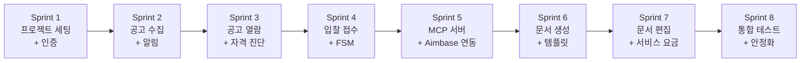

# SAM.gov Bidding Agency Platform Sprint 구조도

> 설계 버전: 1.9 | 최종 수정: 2026-10-26 | 관련 CR: CR-137, CR-140, CR-141, CR-142, CR-146, CR-147, CR-169, CR-170, CR-178, CR-179

> 단계: 1. Requirements | 설계

---

## Sprint 의존관계

> 화살표 방향 = 선행 Sprint 완료 후 진행. 풀스택 프로젝트이므로 각 Sprint에 BE/FE 작업을 함께 포함.

---

## Sprint 구조

### Sprint 1: 프로젝트 세팅 + 인증

| 기능 ID | 작업 내용 | 의존 관계 | 검증 기준 | 담당 | 상태 |
|---------|----------|----------|----------|------|------|
| 작업 1-1 | 프로젝트 구조 정리, docs 반영 | 없음 | CLAUDE.md 존재, docs/ 산출물 확인 | BE | |
| 작업 1-2 | DB 마이그레이션 정비 (역할 단순화 ADMIN/CUSTOMER) | 없음 | Flyway 마이그레이션 성공 | BE | |
| BID-AUTH-001 | 회원가입 API + 페이지 | 작업 1-2 | 회원가입 → DB 저장 → JWT 발급 | BE+FE | |
| BID-AUTH-002 | 로그인 API + 페이지 | BID-AUTH-001 | 로그인 → JWT 발급 → 인증 필요 API 호출 성공 | BE+FE | |
| BID-AUTH-003 | 토큰 갱신 | BID-AUTH-002 | Refresh Token으로 Access Token 재발급 성공 | BE | |
| BID-AUTH-005 | 이메일 인증번호 API + 가입 화면 인증 칸 (CR-146) | BID-AUTH-001, 알림 서버 틀 BID_EMAIL_CODE | 번호 받기, 확인, 확인 없는 가입 막힘(BIZ-062) | BE+FE | 설계중 |
| BID-AUTH-006 | SNS 가입 API + SNS 가입 화면 (CR-146) | BID-AUTH-005, 네이버, 카카오 앱 등록(구글 보류) | 처음 SNS 로 가입하고 바로 로그인, SNS 이메일 겹침 안내(BIZ-063) | BE+FE | 설계중 |
| BID-AUTH-007 | SNS 로그인 (CR-146) | BID-AUTH-006 | 가입한 SNS 로 다시 로그인, 표 두 번 쓰기 막힘 | BE+FE | 설계중 |

### Sprint 2: 공고 수집 + 알림

| 기능 ID | 작업 내용 | 의존 관계 | 검증 기준 | 담당 | 상태 |
|---------|----------|----------|----------|------|------|
| BID-OPP-001 | SAM.gov 스케줄 수집 | Sprint 1 | cron 실행 → 공고 DB 저장, 중복 검출 동작 | BE | |
| BID-OPP-003 | 첨부문서 자동 획득 | BID-OPP-001 | 수집 시 첨부파일 다운로드/링크 저장 확인 | BE | |
| BID-NOTIFY-001 | 이메일 발송 인프라 | Sprint 1 | 테스트 이메일 발송 성공, 발송 이력 DB 기록 | BE | |
| BID-OPP-004 | 수집 완료 이메일 알림 | BID-OPP-001, BID-NOTIFY-001 | 신규 공고 수집 시 관리자 이메일 수신 확인 | BE | |
| BID-OPP-002 | 수동 수집 트리거 | BID-OPP-001 | Admin API 호출 → 즉시 수집 실행 | BE | |
| BID-MKT-025 | 미 연방 계약 받기 (CR-142) | Sprint 1 | USAspending Mock 으로 전체·매일 받기, 같은 계약 키 덮어쓰기, 100건 미만 쪽에서 멈춤 | BE | |
| BID-MKT-026 | 옵션 끝날짜와 원래 공고번호 받기 (CR-142) | BID-MKT-025 | 범위 안 구매 주문·단독 계약만 상세 호출, 실패한 계약은 다음 회차에 다시 | BE | |
| BID-MKT-027 | 받기 실행과 기록 (CR-142) | BID-MKT-025 | 관리자 실행, 회차 기록, 도는 중 409 | BE | |
| ~~BID-MKT-033~~ | ~~계약 끝 메일 알림 (CR-142)~~ | ~~BID-MKT-031, BID-NOTIFY-001~~ | ~~90·30일 전 한 번만, 두 날짜가 같으면 한 통~~ | ~~BE~~ | **폐기 (CR-147)** |

### Sprint 3: 공고 열람 + 자격 진단

| 기능 ID | 작업 내용 | 의존 관계 | 검증 기준 | 담당 | 상태 |
|---------|----------|----------|----------|------|------|
| BID-BROWSE-001 | 공고 목록 조회 (BE API + FE 페이지) | Sprint 2 | 페이징/검색/필터 동작, 결과 화면 표시 | BE+FE | |
| BID-BROWSE-002 | 공고 상세 조회 | BID-BROWSE-001 | 상세 정보 + 첨부파일 목록 표시 | BE+FE | |
| BID-BROWSE-003 | 필요 문서 목록 표시 | BID-BROWSE-002 | 카테고리별 분류, BLOCKER 표시, 체크리스트 형태 | FE | |
| BID-QUAL-001 | 적격성 진단 (CR-137) | BID-BROWSE-002, BID-OPP-006 | 공고 참가 자격마다 회원 답 저장, 답별 개수 요약 표시 | BE+FE | |
| BID-QUAL-002 | 필수 인증/서류 가이드 | Sprint 1 | 가이드 페이지 정적 콘텐츠 표시 | FE | |
| ~~BID-MKT-028~~ | ~~계약 구분과 근거 (CR-142)~~ | ~~BID-MKT-026~~ | ~~BIZ-050 네 구분과 근거 한 줄, 공사 꼬리표~~ | ~~BE~~ | **폐기 (CR-147)** |
| ~~BID-MKT-029~~ | ~~다음 달 공고 (CR-142)~~ | ~~BID-MKT-028~~ | ~~숫자 세 칸, 거르기·정렬, 자료 기준~~ | ~~BE+FE~~ | **폐기 (CR-147)** |
| ~~BID-MKT-030~~ | ~~재발주 달력 (CR-142)~~ | ~~BID-MKT-028~~ | ~~달 칸 12개, 달 고르면 목록~~ | ~~BE+FE~~ | **폐기 (CR-147)** |
| ~~BID-MKT-031~~ | ~~회원 계약 찾기와 등록 (CR-142)~~ | ~~BID-MKT-025~~ | ~~표에서 찾기, 없으면 USAspending 검색 1회, 못 찾으면 직접 넣기~~ | ~~BE+FE~~ | **폐기 (CR-147)** |
| ~~BID-MKT-032~~ | ~~옵션 연장 알림 (CR-142)~~ | ~~BID-MKT-031~~ | ~~내 계약 표, 직접 넣은 날짜만 고치기, 지우기~~ | ~~BE+FE~~ | **폐기 (CR-147)** |
| BID-MKT-034 | 낙찰가 범위 (CR-142) | BID-MKT-025 | 두 줄 범위, 최소 건수 미만 숨김, 근거 계약 | BE+FE | |
| 작업 CR-147-1 | 재발주 예측과 입찰 교실 걷어내기, 마이그레이션 V51 (CR-147) | 없음 | 메뉴 7묶음 34항목, `/recompete/*` 는 없는 화면, `/api/federal-contracts/recompete` 404, member_contracts 표와 설정 둘(CONTRACT_END_ALERT_DAYS, RECOMPETE_ONE_TIME_NAICS_PREFIXES) 삭제, 교육 세 화면의 왼쪽 메뉴가 고객센터, 낙찰가 범위 아래 띠는 마감 전 공고만 | BE+FE | 설계중 |
| BID-BROWSE-001 | 마감 전 공고 화면 틀과 빈 상태 (CR-147) | BID-PAGE-001 | 속페이지 틀과 왼쪽 메뉴의 마감 전 공고 켜짐, 숫자 칸 "마감 전 공고" 전체 건수(0 이면 0), 검색어 없음·있음 빈 상태 문구 | FE | 설계중 |
| BID-SVC-001 | SAM 등록 대행 비용 문구 (CR-147) | 없음 | 비용 칸에 "등록 자체는 무료" 가 없고 대신 처리한다는 문구가 보임 | FE | 설계중 |
| BID-MKT-019 | 판정 계산과 근거 (CR-140) | BID-QUAL-001 | 판정 네 가지와 걸린 자격을 BIZ-040 순서로 냄 | BE | |
| BID-MKT-018 | 증빙 서류 붙이기 (CR-140) | BID-QUAL-001, 서류함(CR-125) | 있음 답에 내 서류 붙이고 떼기, 남의 서류 거부 | BE+FE | |
| BID-MKT-015 | 공고별 판정 (CR-140) | BID-MKT-019 | 판정별 개수와 거르기, 줄에서 공고별 진단으로 | FE | |
| BID-MKT-016 | 공고 검색 판정 칸 (CR-140) | BID-MKT-019 | 공고 줄마다 판정 꼬리표, 판정할 수 없으면 "-" | FE | |
| BID-MKT-017 | 공고 상세 판정 상자 (CR-140) | BID-MKT-019 | 판정과 걸린 자격 근거, 공고별 진단으로 | FE | |

### Sprint 4: 입찰 접수 + FSM

| 기능 ID | 작업 내용 | 의존 관계 | 검증 기준 | 담당 | 상태 |
|---------|----------|----------|----------|------|------|
| BID-REQ-001 | 입찰 참여 신청 | Sprint 3 | 공고에서 신청 → BidRequest CREATED 상태 생성 | BE+FE | |
| BID-PRICE-002 | 서비스 단계별 선택 | Sprint 1 | 신청 시 서비스 레벨 선택 UI, 선택값 저장 | FE+BE | |
| BID-REQ-002 | 필요 문서 업로드 | BID-REQ-001 | 파일 업로드 → MinIO 저장 → 체크리스트 진행률 갱신 | BE+FE | |
| BID-FSM-001 | 상태 전이 실행 | BID-REQ-001 | 화이트리스트 검증, 전이 성공/거부, 이력 기록 | BE | |
| BID-REQ-003 | 내 입찰 목록 조회 | BID-REQ-001 | 고객 본인 입찰 목록 페이징 조회 | BE+FE | |
| BID-REQ-004 | 입찰 상세/이력 조회 | BID-FSM-001 | 상태 타임라인, 문서 목록 표시 | BE+FE | |
| BID-MKT-020 | 요구 항목 채우기 (CR-141) | BID-OPP-006 | 분석 완료·관리자 수정 때 요구 항목을 다시 맞춤, 사라진 항목은 연결과 함께 지움, 서버 기동 때 빈 공고 채움 | BE | |
| BID-MKT-023 | 요구 서류 올리기와 서류함에서 고르기 (CR-141) | BID-MKT-020, 서류함(CR-125) | 항목에 파일 잇기, PDF 쪽수 세기, 서류함 서류 복사, 남의 입찰 건·서류 거부 | BE+FE | |
| BID-MKT-024 | 형식·쪽수 판정 (CR-141) | BID-MKT-023 | 형식 이름과 쪽수 한도를 원문에서 읽은 때만 맞음·어긋남, 그 밖은 사람 확인 | BE | |
| BID-MKT-035 | 서류함 고정 칸과 국문·영문 (CR-147) | 서류함(CR-125), 작업 CR-147-1(V51) | 고정 다섯 칸 순서, 국문·영문 칸 언어별 올리기와 같은 언어만 교체(BIZ-065), 언어 빠짐 400, 영문 먼저 고르기, 가장 긴 낱말 분류(BIZ-066), 기존 CAGE·SAM 등록증·과거 수행실적 서류가 기타로 바뀜, 단위시험 TC-DOC-201~209 | BE+FE | 설계중 |
| BID-MKT-022 | 입찰 건별 제출 전 검사 (CR-141) | BID-MKT-024 | 판정 셋과 근거 원문, 필수 서류 빠지면 서류 접수 전환 막힘, 검토 신청 미리 채움 | BE+FE | |
| BID-MKT-021 | 내 입찰 건 제출 전 검사 (CR-141) | BID-MKT-022 | 입찰 건별 요약 숫자, 분석 전 건은 숫자 없이 안내 | BE+FE | |
| BID-NOTIFY-002 | 마감일 임박 알림 | BID-NOTIFY-001 | D-7/D-3/D-1 이메일 발송, 중복 방지 확인 | BE | |

### Sprint 5: MCP 서버 + Aimbase 연동

| 기능 ID | 작업 내용 | 의존 관계 | 검증 기준 | 담당 | 상태 |
|---------|----------|----------|----------|------|------|
| BID-MCP-001 | MCP 서버 엔드포인트 | Sprint 4 | JSON-RPC 2.0 엔드포인트 응답, tool discovery 동작 | BE | |
| BID-MCP-002 | 공고 관련 Tool | BID-MCP-001 | 공고 조회/요구사항 조회 Tool 호출 성공 | BE | |
| BID-MCP-003 | 문서 관련 Tool | BID-MCP-001 | 문서 생성/조회/저장 Tool 호출 성공 | BE | |
| BID-MCP-004 | 입찰 상태 관련 Tool | BID-MCP-001 | 상태 조회/전이 Tool 호출 성공 | BE | |
| 작업 5-1 | Aimbase에 MCP 서버 등록 + Workflow 설계 | BID-MCP-001~004 | Aimbase에서 discover → Tool 목록 확인 | BE | |

### Sprint 6: 문서 생성 + 템플릿

| 기능 ID | 작업 내용 | 의존 관계 | 검증 기준 | 담당 | 상태 |
|---------|----------|----------|----------|------|------|
| BID-TPL-001 | 템플릿 등록 | Sprint 5 | Admin에서 템플릿 등록 → DB 저장 | BE+FE | |
| BID-TPL-002 | 템플릿 목록/상세 조회 | BID-TPL-001 | 목록 표시, 상세 내용 확인 | BE+FE | |
| BID-DOC-001 | AI 제안서 자동 작성 | Sprint 5, BID-TPL-001 | Aimbase Workflow 실행 → 문서 생성 → DB 저장 | BE | |
| BID-DOC-002 | 문서 생성 완료 이메일 알림 | BID-DOC-001, BID-NOTIFY-001 | 생성 완료 시 관리자 이메일 수신 | BE | |
| BID-DOC-003 | 문서 버전 관리 | BID-DOC-001 | 버전 목록 조회, 이전 버전 확인 | BE+FE | |
| 작업 CR-169-1 | 내용 해시 칸과 읽기 표, 절 근거 칸, 마이그레이션 V58 (CR-169) | 없음 | 서류 올리기와 서류함 복사 때 해시가 채워짐, 빈 해시는 읽기 시작 때 채워짐 | BE | 설계중 |
| BID-DOC-004 | 고객 서류 읽기 (CR-169) | 작업 CR-169-1, 서류함(CR-125), BID-MKT-023 | 분석 단계 진입 때 후보를 모아 읽음, 같은 내용 한 번만, 형식별 읽는 꼴(PDF, 그림, DOCX·XLSX·PPTX, HWP), 읽을 수 없는 형식 표시, 읽는 중이면 생성 전환 409, 다시 읽기 | BE+FE | 설계중 |
| BID-DOC-005 | 절별 근거 서류 (CR-169) | BID-DOC-004, BID-COMP-001 | 설계가 절마다 읽은 후보만 근거로 고름(아니면 저장 거부), 절 작성과 검증이 근거 사실을 받음, 근거 없는 회사 사실은 자리표시, 절 상세에 근거 서류 | BE+FE | 설계중 |
| 작업 CR-170-1 | 입찰 분석 표 bid_analyses 와 Pwin 정책 두 줄, 마이그레이션 V59 (CR-170) | 없음 | Flyway 로 한 번 돈다, 정책 초기값 두 줄이 들어간다 | BE | 설계중 |
| BID-DOC-006 | 입찰 분석 (CR-170) | 작업 CR-170-1, BID-DOC-004, BID-MKT-025 | 읽기가 끝나면 한 번 시작, 세 단계 저장, Pwin 과 판정 계산, 확신도와 출처, 대기 한도를 넘으면 분석 실패, 다시 분석 | BE+FE | 설계중 |
| BID-DOC-007 | Bid/No-Bid 결정 (CR-170) | BID-DOC-006 | Go, 조건부 Go 일 때만 문서 작성 중 전환(아니면 409), 조건과 사유 필수(400), 결정만 회차, 분석 단계에서 종료 | BE+FE | 설계중 |
| 작업 CR-178-1 | 문서 종류별 목차 규칙 (CR-178) | BID-DOC-001, BID-COMP-002 | 커버레터 목차가 장 1, 절 1 이고 대응 REQ ID 가 없음, 기술 제안서 커버리지가 대상 전부를 셈, 커버레터 커버리지는 평가 대상 아님 | BE+FE | 설계중 |
| 작업 CR-179-1 | 공고가 요구하는 문서 구성 (CR-179) | BID-OPP-006, BID-DOC-001, BID-COMP-002 | 공고 분석이 평가 항목마다 문서 종류와 커버레터 요구 여부를 남김, 문서 작성이 그 구성대로 문서를 만듦, 문서마다 설계 입력과 커버리지 대상이 자기 평가 항목의 줄 | BE+워크플로우 | 설계중 |

### Sprint 7: 문서 편집 + 서비스 요금

| 기능 ID | 작업 내용 | 의존 관계 | 검증 기준 | 담당 | 상태 |
|---------|----------|----------|----------|------|------|
| BID-EDIT-001 | 문서 후처리 편집 UI | Sprint 6 | TipTap 에디터 → 수정 → 새 버전 저장 | FE+BE | |
| BID-EDIT-002 | 문서 잠금/확정 | BID-EDIT-001 | DRAFT → LOCKED 전이, 편집 차단 확인 | BE+FE | |
| BID-EDIT-003 | PDF 내보내기 | BID-EDIT-001 | 문서 → PDF 생성 → 다운로드 | BE | |
| BID-PRICE-001 | 요금 안내 페이지 | Sprint 1 | 요금 정보 표시 (정적/관리자 설정) | FE | |
| BID-ADMIN-003 | 입찰 요청 관리 (Admin) | Sprint 4 | 전체 입찰 목록 조회, 상태 전이 실행 | FE | |

### Sprint 8: 통합 테스트 + 안정화

| 기능 ID | 작업 내용 | 의존 관계 | 검증 기준 | 담당 | 상태 |
|---------|----------|----------|----------|------|------|
| 작업 8-1 | E2E 플로우 테스트 | Sprint 7 | 공고 수집 → 입찰 신청 → AI 생성 → 편집 → 확정 전체 플로우 | BE+FE | |
| 작업 8-2 | 에러 핸들링 점검 | Sprint 7 | 각 실패 시나리오 (API 에러, AI 실패, 파일 업로드 실패) | BE+FE | |
| 작업 8-3 | 성능/보안 점검 | Sprint 7 | JWT 만료, 권한 검증, 파일 크기 제한 | BE | |
| 작업 8-4 | Docker Compose 배포 테스트 | Sprint 7 | 전체 서비스 docker-compose up → 정상 동작 | Infra | |

---

## Sprint 분리 원칙

1. 의존관계 순서로 배치 (인증 → 수집 → 열람 → 접수 → MCP → 문서 → 편집)
2. 1 Sprint = Claude Code 1세션. 세션 길어지면 컨텍스트 새므로 Sprint로 끊는다.
3. 각 Sprint에 검증 기준 필수. Claude Code가 테스트 코드로 변환한다.
4. Sprint 완료 시 CLAUDE.md에 진행 상태 기록 후 commit.
5. 풀스택: Sprint 내 BE API 먼저 → FE 연동 순서. BE/FE 병렬 시 Mock API 사용.
