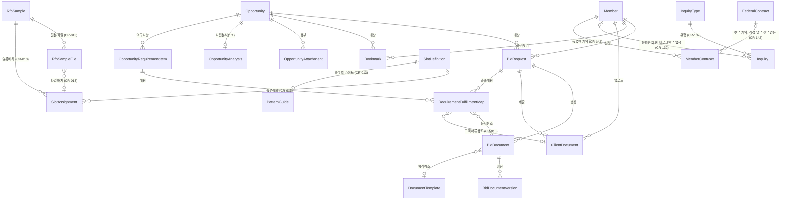

# SAM.gov Bidding Agency Platform 데이터 모델 정의

> 설계 버전: 1.17 | 최종 수정: 2026-10-24 | 관련 CR: CR-003, CR-129, CR-132, CR-135, CR-136, CR-137, CR-140, CR-141, CR-142, CR-146, CR-147, CR-153, CR-155, CR-156, CR-157, CR-159, CR-160, CR-169

> 단계: 3. Detail Design | 실행스펙 섹션 2에 포함
>
> 엔티티, 필드, 관계, Enum, 인덱스를 정의한다.
> Claude Code가 이 문서를 보고 엔티티 코드와 마이그레이션을 생성한다.

---

## Enum 정의

### Role (회원 역할)

| 값 | 설명 |
|----|------|
| ADMIN | 관리자 (입찰 대행 운영) |
| CUSTOMER | 고객 (입찰 의뢰자) |

> 기존 6개 역할(ADMIN, ANALYST, WRITER, REVIEWER, SUBMITTER, MEMBER)에서 2개로 단순화

### BidRequestState (입찰 요청 상태)

| 값 | 설명 |
|----|------|
| CREATED | 신청 접수 |
| DOCS_PENDING | 문서 대기 (고객에게 안내 전달) |
| DOCS_RECEIVED | 문서 접수 완료 |
| ANALYZING | AI 요구사항 분석 중 |
| GENERATING | AI 문서 생성 중 |
| REVIEW | 관리자 검토 |
| CONFIRMED | 확정 (문서 잠금) |
| SUBMITTED | 제출 완료 (최종) |
| CLOSED | 종료 (최종) |

> FSM 전이 규칙은 T1-5 참조

### DocumentType (문서 유형)

| 값 | 설명 |
|----|------|
| COVER_LETTER | 커버레터 |
| TECHNICAL_PROPOSAL | 기술 제안서 |
| PAST_PERFORMANCE | 과거 수행 실적 |
| COMPANY_PROFILE | 회사 프로필 |
| COMPLIANCE_MATRIX | 컴플라이언스 매트릭스 |
| PRICING_SUMMARY | 가격 요약 |
| OTHER | 기타 |

### DocumentStatus (문서 상태)

| 값 | 설명 |
|----|------|
| DRAFT | 초안 (편집 가능) |
| LOCKED | 잠금 (편집 불가) |
| ARCHIVED | 보관 (제출 후) |

> FSM 전이: DRAFT → LOCKED → ARCHIVED, LOCKED → DRAFT (잠금 해제)

### RequirementCategory (요구사항 카테고리)

| 값 | 설명 |
|----|------|
| DOCUMENT | 문서 |
| FORMAT | 형식 |
| SUBMISSION | 제출 |
| DEADLINE | 마감 |
| ELIGIBILITY | 자격 |
| TECHNICAL | 기술 |
| OTHER | 기타 |

### FulfillmentType (충족 유형)

| 값 | 설명 |
|----|------|
| DOCUMENT_SECTION | 문서 섹션으로 충족 |
| ATTACHMENT | 첨부파일로 충족 |
| NOT_APPLICABLE | 해당 없음 |
| MISSING | 미충족 |

### FulfillmentStatus (충족 상태)

| 값 | 설명 |
|----|------|
| PENDING | 대기 |
| FULFILLED | 충족 |
| MISSING | 미충족 |

### ServiceLevel (서비스 레벨)

| 값 | 설명 |
|----|------|
| MONITORING | 모니터링만 (공고 추적) |
| ANALYSIS | 분석 + 정리 (요구사항 분석) |
| AI_PROPOSAL | AI 제안서 작성 포함 |
| FULL_PACKAGE | 풀패키지 (제출 대행까지) |

### NotificationType (알림 유형)

| 값 | 설명 |
|----|------|
| COLLECTION_COMPLETE | 수집 완료 알림 |
| DOCUMENT_GENERATED | 문서 생성 완료 알림 |
| DEADLINE_D7 | 마감 7일 전 알림 (CR-156 전 이력만) |
| DEADLINE_D3 | 마감 3일 전 알림 (CR-156 전 이력만) |
| DEADLINE_D1 | 마감 1일 전 알림 (CR-156 전 이력만) |
| DEADLINE_ALERT | 입찰 요청 마감 알림, 관리자 전원과 요청 고객, bp-notification 템플릿 BID_DEADLINE_ALERT. 며칠 전인지는 POL-009 (CR-156) |
| BID_REQUEST_CREATED | 입찰 신청 접수 알림 |
| AI_WORKFLOW_FAILED | AI 워크플로우 실패 알림 |
| INQUIRY_RECEIVED | 1:1 문의 접수 관리자 알림, bp-notification 템플릿 BID_INQUIRY_ADMIN (CR-132) |
| INQUIRY_ANSWERED | 1:1 문의 고객 답변 메일, bp-notification 템플릿 BID_INQUIRY_ANSWER (CR-132) |
| DOCUMENT_EXPIRY | 공통 서류함 서류 만료 전 회원 메일, bp-notification 템플릿 BID_DOC_EXPIRY (CR-136) |
| ~~CONTRACT_END~~ | ~~회원 계약의 끝날짜나 옵션 끝날짜 전 회원 메일, bp-notification 템플릿 BID_CONTRACT_END (CR-142)~~ **폐기 (CR-147)**: 계약 끝 메일을 지운다 |

### InquiryStatus (1:1 문의 상태) (CR-132 신규)

| 값 | 설명 |
|----|------|
| RECEIVED | 미답변. 문의 저장 시 기본값 |
| ANSWERED | 답변완료. 고객 답변 메일 발송 성공 뒤 |

### OpportunityVisibility (공고 노출 상태) — CR-003 신규

| 값 | 설명 |
|----|------|
| HIDDEN | 비노출 (수집 직후 기본값, 관리자 승인 전) |
| VISIBLE | 노출 (관리자 승인 후 사용자에게 노출) |

### AnalysisStatus (사전 분석 상태) — CR-003 신규

| 값 | 설명 |
|----|------|
| PENDING | 분석 대기 |
| ANALYZING | LLM 분석 중 |
| COMPLETED | 분석 완료 |
| FAILED | 분석 실패 |

### AttachmentDownloadStatus (첨부 다운로드 상태)

| 값 | 설명 |
|----|------|
| SUCCESS | 다운로드 성공 (storage_url 보유) |
| FAILED | 다운로드 실패 |
| LINK_ONLY | 링크만 저장 (직접 다운 불가) |
| MANUAL_FETCH_REQUIRED | 외부 사이트 첨부 — 관리자가 외부서 직접 가져와야 함 (CR-019) |

> **CR-019**: SAM 수집 시 첨부(`resourceLinks`)가 외부 사이트로 연결되어 자동 다운로드되지 않으면
> `MANUAL_FETCH_REQUIRED`로 적재 → 관리자 원본 화면에 "가져와야 함" 표식.
> 관리자가 외부서 파일을 받아 수동 업로드하면 StorageService에 실제 저장 + `SUCCESS`로 전이.

### PieeFetchStatus (PIEE 입찰서류 받기 결과, CR-160 신규)

| 값 | 화면 이름 | 설명 |
|----|----------|------|
| WAITING | 받는 중 | 수집이 받기를 걸어 두었다. 그 공고의 SAM 첨부(PENDING)가 다 끝나거나 POL-040 기다림 상한이 지나면 받기 일꾼이 집는다 |
| FETCHING | 받는 중 | PIEE 에서 받고 있다 |
| DONE | 받음 | 압축을 받아 첨부로 넣었다. 공고 화면에 받기 단추가 없으면 파일 0개로 DONE |
| NOT_FOUND | PIEE 에 없음 | 공고번호로 열면 PIEE 첫 화면(`index.xhtml`)으로 넘어간다 |
| FAILED | 받기 실패 | 무게 상한, 시간 상한, 압축이 아닌 응답, 통신 오류, 받는 중 멈춤. 사유는 piee_fetch_message |

> 바뀌는 길: NULL 에서 WAITING 은 새 공고나 내용이 바뀐 공고를 넣을 때(BIZ-079 대상만). WAITING 에서 FETCHING 은 조건부 갱신으로 한 번만 잡는다. FETCHING 에서 DONE, NOT_FOUND, FAILED. DONE, NOT_FOUND, FAILED 에서 WAITING 은 내용이 바뀌어 다시 넣을 때. FETCHING 이 `PIEE_TIMEOUT_SECONDS` 두 배가 지나도 남아 있으면(받는 중 서버가 내려감) FAILED 로 바꾼다. 그 밖의 길은 없다.

### Outcome (성공 제안서 결과) — CR-013 신규

| 값 | 설명 |
|----|------|
| WON | 낙찰 확정 (B경로 최고 가치) |
| SUBMITTED | 제출완료 (낙찰 여부 미상, 실무 통과) |
| OTHER | 타업체 제출본 등 기타 (패턴 참고 신중) |

### IndustryType (사업유형) — CR-013 신규

| 값 | 설명 |
|----|------|
| GROUND_MAINTENANCE | 그라운드 메인터넌스 (조경/녹화) |
| CUSTODIAL | 청소 |
| LAUNDRY | 세탁 |
| HVAC | 냉난방/공조 |
| WASTE | 폐기물/슬러지 |
| PIPELINE | 유류 파이프라인 |
| SECURITY | 경비 |
| FACILITY_LEASE | 시설/격납고 임대 |

### GuideSource (가이드 출처) — CR-013 신규

| 값 | 설명 |
|----|------|
| AI_EXTRACTED | AI 자동추출 (재추출 시 자동갱신 가능) |
| HUMAN_EDITED | 사람이 AI 초안을 편집 (자동추출 보호) |
| HUMAN_ADDED | 사람이 직접 추가 (자동추출 보호) |

### ExtractionStatus (패턴 추출 상태) — CR-013 신규

| 값 | 설명 |
|----|------|
| PENDING | 추출 대기 |
| EXTRACTING | Aimbase 추출 중 |
| COMPLETED | 추출 완료 |
| FAILED | 추출 실패 |

### FederalAwardType (미 연방 계약 종류) (CR-142 신규)

USAspending 의 계약 종류 코드(award_type_codes)를 옮긴 것이다. 화면 구분(BIZ-050)이 이 값을 보고 나눈다.

| 값 | USAspending 코드 | 설명 |
|----|------------------|------|
| BPA_CALL | A | BPA 주문. 상위 계약(일괄 구매 약정) 안에서 낸 주문 |
| PURCHASE_ORDER | B | 구매 주문. 단독으로 낸 소액 구매 |
| DELIVERY_ORDER | C | 주문. 상위 계약 안에서 낸 납품·작업 주문 |
| DEFINITIVE_CONTRACT | D | 단독 계약 |

### FederalSyncMode (미 연방 계약 받기 방식) (CR-142 신규)

| 값 | 설명 |
|----|------|
| FULL | 받는 시작일(POL-031)부터 전체를 받는다 |
| DAILY | 지난 성공 회차 이후 바뀐 계약만 받는다(마지막 바뀐 날 기준) |

### FederalSyncStatus (받기 회차 상태) (CR-142 신규)

| 값 | 설명 |
|----|------|
| RUNNING | 받는 중. 이 상태 회차가 있으면 새 실행을 거부한다 |
| SUCCEEDED | 끝까지 받음 |
| FAILED | 다시 부르기를 다 쓰고 멈춤. 받은 쪽까지는 저장돼 있다 |

### ~~MemberContractSource (회원 계약 날짜 출처) (CR-142 신규)~~ (CR-147 폐기)

- **폐기 (2026-10-11, CR-147)**: 회원 계약 표(member_contracts)를 V51 에서 지운다

| 값 | 설명 |
|----|------|
| PUBLIC | 미 연방 계약 자료에서 찾은 계약. 매일 받기로 날짜가 바뀌면 따라 바뀐다(BIZ-056) |
| MANUAL | 회원이 날짜를 직접 넣은 계약. 회원만 고친다 |

### ~~RecompeteCategory (계약 구분, 저장하지 않음) (CR-142 신규)~~ (CR-147 폐기)

- **폐기 (2026-10-11, CR-147)**: 계약 구분 규칙(BIZ-050)과 계약 줄의 구분 칸을 지운다

조회 때 BIZ-050 으로 내는 값이다. 표에 두지 않는다.

| 값 | 설명 |
|----|------|
| IN_PARENT | 상위 계약 안 주문 |
| UNCONFIRMED | 옵션 끝날짜 확인 전 |
| RECOMPETE | 재발주 후보 |
| EXTENDABLE | 연장 가능 |

### ~~ContractDateKind (알림 기준 날짜) (CR-142 신규)~~ (CR-147 폐기)

- **폐기 (2026-10-11, CR-147)**: 계약 끝 메일과 계약 줄의 근거 날짜 종류 칸을 지운다

| 값 | 설명 |
|----|------|
| CURRENT_END | 지금 끝날짜 |
| POTENTIAL_END | 옵션을 다 쓰면 끝나는 날짜(옵션 끝날짜) |

### SnsProvider (SNS) (CR-146 신규)

| 값 | 설명 |
|----|------|
| NAVER | 네이버 |
| KAKAO | 카카오 |
| GOOGLE | 구글 (보류, 코드에 아직 없음) |

### SnsTicketKind (SNS 표 종류) (CR-146 신규)

| 값 | 설명 |
|----|------|
| LOGIN | 이미 이어진 회원의 로그인 넘김 |
| SIGNUP | 처음 들어온 SNS 계정의 가입 화면 |

---

## 엔티티 정의

### Member (회원)

| 필드 | 타입 | 필수 | 기본값 | 설명 |
|------|------|------|--------|------|
| id | BINARY(16) | PK | auto | UUID |
| email | VARCHAR(255) | Y | | UNIQUE |
| password_hash | VARCHAR(255) | N | | bcrypt. SNS 로만 가입한 회원은 비어 있다 (CR-146, BIZ-064) |
| company_name | VARCHAR(255) | Y | | 회사명 |
| business_registration_number | VARCHAR(50) | N | | 사업자등록번호 |
| contact_person | VARCHAR(100) | N | | 담당자명 |
| phone | VARCHAR(50) | N | | 연락처 |
| address | TEXT | N | | 주소 |
| uei | VARCHAR(20) | N | | SAM 고유 식별자 UEI (CR-124, V38. CR-146 에서 T3-1 누락 보정) |
| cage_code | VARCHAR(10) | N | | CAGE 코드 (CR-124, V38. CR-146 에서 T3-1 누락 보정) |
| role | Role | Y | CUSTOMER | ADMIN / CUSTOMER |
| last_login_at | DATETIME(6) | N | | 최종 로그인 |
| email_verified_at | DATETIME(6) | N | | 이메일 확인 시각(인증번호 또는 SNS 확인). CR-146 전에 가입한 회원은 비어 있다 (CR-146) |
| created_at | DATETIME(6) | Y | now() | |
| updated_at | DATETIME(6) | Y | now() | |

**인덱스**:
- `uniq_members_email` — email (UNIQUE)

---

### MemberConsent (가입 동의 이력) (CR-124, V38. CR-146 에서 T3-1 누락 보정)

테이블 `member_consents`. 가입 한 번에 한 줄. 이메일 가입과 SNS 가입 모두 남긴다.

| 필드 | 타입 | 필수 | 기본값 | 설명 |
|------|------|------|--------|------|
| id | BINARY(16) | PK | auto | UUID |
| member_id | BINARY(16) | Y | | FK members.id |
| terms_agreed | BOOLEAN | Y | false | 이용약관 동의 |
| privacy_agreed | BOOLEAN | Y | false | 개인정보처리방침 동의 |
| marketing_agreed | BOOLEAN | Y | false | 소식 받기 동의(선택) |
| terms_version | VARCHAR(20) | N | | 동의한 약관 버전 |
| agreed_at | DATETIME(6) | Y | | 동의 시각 |

**인덱스**:
- `idx_member_consents_member` (member_id)

---

### MemberSocialAccount (회원 SNS 연결) (CR-146 신규)

테이블 `member_social_accounts`.

| 필드 | 타입 | 필수 | 기본값 | 설명 |
|------|------|------|--------|------|
| id | BINARY(16) | PK | auto | UUID |
| member_id | BINARY(16) | Y | | FK members.id |
| provider | VARCHAR(20) | Y | | SnsProvider |
| provider_user_id | VARCHAR(255) | Y | | SNS 가 주는 계정 번호 |
| provider_email | VARCHAR(255) | N | | 이을 때 SNS 가 준 이메일(기록용) |
| created_at | DATETIME(6) | Y | now() | 이은 시각 |
| last_login_at | DATETIME(6) | N | | 이 SNS 로 마지막 로그인 |

**인덱스**:
- `uniq_social_provider_user` (provider, provider_user_id) UNIQUE (BIZ-063)
- `uniq_social_member_provider` (member_id, provider) UNIQUE (BIZ-063)

---

### MemberMembership (회원 기간) (CR-157 신규)

테이블 `member_memberships`, Flyway V55(V54 는 CR-156). 관리자가 넣은 회원 기간 하나가 한 줄이다. 결제 연동 전까지 관리자만 넣고 지우며, 넣은 줄은 고치지 않는다(BIZ-072). 오늘(서울 날짜)이 starts_on 과 ends_on 사이(두 날 포함)인 줄이 하나라도 있으면 회원이다.

| 필드 | 타입 | 필수 | 기본값 | 설명 |
|------|------|------|--------|------|
| id | BINARY(16) | PK | auto | UUID |
| member_id | BINARY(16) | Y | | FK members.id |
| starts_on | DATE | Y | | 시작일(서울 날짜, 이날 포함) |
| ends_on | DATE | Y | | 끝일(서울 날짜, 이날 포함). starts_on 보다 앞일 수 없다 |
| memo | VARCHAR(500) | N | | 관리자 메모(입금 확인 등) |
| created_by | BINARY(16) | Y | | 넣은 관리자 members.id |
| created_at | DATETIME(6) | Y | now() | 넣은 시각 |

**인덱스**:
- `idx_member_memberships_member` (member_id, ends_on)

**제약**:
- `chk_member_memberships_period` CHECK (ends_on >= starts_on)

---

### EmailVerificationCode (이메일 인증번호) (CR-146 신규)

테이블 `email_verification_codes`. 보낼 때마다 한 줄. 번호 원문은 저장하지 않는다.

| 필드 | 타입 | 필수 | 기본값 | 설명 |
|------|------|------|--------|------|
| id | BINARY(16) | PK | auto | UUID |
| email | VARCHAR(255) | Y | | 받는 주소(소문자로 맞춘 값) |
| code_hash | VARCHAR(100) | Y | | 번호 해시 |
| expires_at | DATETIME(6) | Y | | 보낸 시각 + 유효 시간(POL-037) |
| attempts | INT | Y | 0 | 틀린 횟수 |
| verified_at | DATETIME(6) | N | | 맞게 넣은 시각 |
| consumed_at | DATETIME(6) | N | | 가입에 쓴 시각. 채워지면 다시 쓰지 못한다 |
| created_at | DATETIME(6) | Y | now() | 보낸 시각(다시 받기 간격, 하루 횟수 계산) |

**인덱스**:
- `idx_email_codes_email_created` (email, created_at)

---

### SnsTicket (SNS 표) (CR-146 신규)

테이블 `sns_tickets`. SNS 에서 돌아온 결과를 화면에 전달하는 한 번짜리 값. 화면에는 원문 값을, 표에는 해시만 둔다.

| 필드 | 타입 | 필수 | 기본값 | 설명 |
|------|------|------|--------|------|
| id | BINARY(16) | PK | auto | UUID |
| token_hash | VARCHAR(100) | Y | | UNIQUE |
| kind | VARCHAR(20) | Y | | SnsTicketKind |
| provider | VARCHAR(20) | Y | | SnsProvider |
| provider_user_id | VARCHAR(255) | Y | | SNS 계정 번호 |
| provider_email | VARCHAR(255) | N | | SNS 가 준 이메일 |
| email_verified_by_provider | BOOLEAN | Y | false | SNS 가 그 이메일을 확인했다고 주었는지 |
| member_id | BINARY(16) | N | | LOGIN 일 때 회원 |
| expires_at | DATETIME(6) | Y | | POL-038 |
| used_at | DATETIME(6) | N | | 쓴 시각. 채워지면 다시 받지 않는다 |
| created_at | DATETIME(6) | Y | now() | |

> 마이그레이션 V52 (CR-146, CR-147 이 V51 을 먼저 써서 V50 에서 옮김). 시각 비교는 존을 명시한 Clock 하나로 한다.

---

### Opportunity (공고)

| 필드 | 타입 | 필수 | 기본값 | 설명 |
|------|------|------|--------|------|
| id | BINARY(16) | PK | auto | UUID |
| notice_id | VARCHAR(255) | Y | | UNIQUE. SAM.gov 공고 ID |
| solicitation_number | VARCHAR(255) | N | | 입찰번호 |
| title | VARCHAR(500) | Y | | 공고 제목 |
| type | VARCHAR(100) | N | | 공고 유형 (SAM.gov 원본 자유문자열) |
| industry_type | IndustryType | N | NULL | 사업유형 자동분류 (CR-014, BIZ-018). naics/PSC/title 기반. NULL=미분류. 성공 자산 매칭 키 |
| organization_name | VARCHAR(255) | N | | 발주 기관명 |
| posted_date | DATETIME(6) | N | | 게시일 |
| response_deadline | DATETIME(6) | N | | 마감일 |
| active | BOOLEAN | Y | true | 활성 여부 |
| visibility | OpportunityVisibility | Y | HIDDEN | 노출 상태 (CR-003). HIDDEN=비노출, VISIBLE=사용자 노출 |
| ui_link | TEXT | N | | SAM.gov 상세 링크 |
| description_link | TEXT | N | | 설명 페이지 링크 |
| content_hash | VARCHAR(64) | N | | 중복 검출용 해시 |
| first_seen_at | DATETIME(6) | Y | | 최초 수집일 |
| last_modified_at | DATETIME(6) | Y | | 최종 갱신일 |
| raw_json | JSON | N | | SAM.gov 원본 JSON (BIZ-004) |
| award_amount_usd | DECIMAL(15,2) | N | NULL | 낙찰 금액(달러, 숫자). 낙찰 공지만. 합계·정렬용 (CR-136, V44) |
| awardee_name | VARCHAR(255) | N | NULL | 낙찰 업체 이름(SAM award.awardee.name 그대로). 낙찰 공지만 (CR-136, V44) |
| awardee_uei | VARCHAR(20) | N | NULL | 낙찰 업체 SAM 고유번호(award.awardee.ueiSAM). 같은 업체 묶는 키(BIZ-029) (CR-136, V44) |
| title_ko | VARCHAR(500) | N | NULL | 한글 제목. 수집 때 옮긴다(CR-139). 관리자가 먼저 넣은 값은 덮지 않는다 (V21) |
| type_ko | VARCHAR(100) | N | NULL | 공고 유형 한글 이름. 코드표로 채운다 (CR-022) |
| description_body | MEDIUMTEXT | N | NULL | SAM.gov 원문 본문(평문). 수집 때 받는다(CR-155, 그 전에는 관리자 한글 번역 단추를 누를 때만). 원본 공고 상세의 원문 본문 (CR-032, V29) |
| description_summary_ko | TEXT | N | NULL | 원문 본문을 한글로 옮긴 것(요약이 아니라 전체 번역, 이름은 옛 이름 그대로). 수집 때 옮긴다(CR-155). 원본 공고 상세의 한글 본문 (CR-035, V23, V33 에서 TEXT) |
| translated_at | DATETIME(6) | N | NULL | 마지막으로 제목이나 본문 번역에 성공한 시각 (CR-022) |
| deleted_at | DATETIME(6) | N | NULL | 관리자가 지운 시각. 있으면 고객 화면과 집계에서 뺀다 (CR-040) |
| piee_fetch_status | VARCHAR(20) | N | NULL | PIEE 입찰서류 받기 결과 PieeFetchStatus. NULL 이면 받지 않는 공고(낙찰 공지, 공고번호 빈 공고, CR-160 전 공고) (CR-160, V57) |
| piee_fetch_status_at | DATETIME(6) | N | NULL | 받기 결과가 마지막으로 바뀐 시각. 기다림 상한과 멈춤 판정, 화면 시각에 쓴다 (CR-160, V57) |
| piee_file_count | INT | N | NULL | 마지막으로 받은 압축에 든 파일 수 (CR-160, V57) |
| piee_fetch_message | VARCHAR(500) | N | NULL | 받기 실패 사유 (CR-160, V57) |
| created_at | DATETIME(6) | Y | now() | |
| updated_at | DATETIME(6) | Y | now() | |

- **보정 (CR-155)**: title_ko, type_ko, description_body, description_summary_ko, translated_at, deleted_at 은 이미 있는 칸인데 이 표에 없어서 적었다. 새 칸, 새 마이그레이션은 없다. 그 밖에 표에 없는 칸(award_amount, place_of_performance_short, set_aside_ko, naics_label_ko, piee_link_broken)은 이번에 고치지 않았다

**인덱스**:
- `uniq_opportunities_notice_id` — notice_id (UNIQUE)
- `idx_opportunities_posted_date` — posted_date
- `idx_opportunities_deadline` — response_deadline
- `idx_opportunities_active` — active
- `idx_opportunities_visibility` — visibility (CR-003)
- `idx_opportunities_industry_type` — industry_type (CR-014)

---

### OpportunityAttachment (공고 첨부문서) — **신규**

| 필드 | 타입 | 필수 | 기본값 | 설명 |
|------|------|------|--------|------|
| id | BINARY(16) | PK | auto | UUID |
| opportunity_id | BINARY(16) | FK | | → Opportunity.id |
| file_name | VARCHAR(500) | Y | | 원본 파일명 |
| file_size | BIGINT | N | | 파일 크기 (bytes) |
| content_type | VARCHAR(100) | N | | MIME type |
| source_url | TEXT | Y | | 원본 다운로드 URL (SAM resourceLink 또는 admin-upload). PIEE 에서 받은 파일은 `piee:{공고번호}/{압축 안 경로}` (CR-160) |
| storage_url | TEXT | N | | StorageService 저장 경로 (SUCCESS일 때) |
| download_status | AttachmentDownloadStatus | Y | FAILED | SUCCESS/FAILED/LINK_ONLY/MANUAL_FETCH_REQUIRED |
| content_sha256 | CHAR(64) | N | NULL | 저장한 파일 내용의 SHA-256. 같은 파일 가리기(BIZ-080). CR-160 전 행은 비어 있고 그 공고를 PIEE 로 받을 때 채운다 (CR-160, V57) |
| downloaded_at | DATETIME(6) | N | | 다운로드 완료 시점 |
| created_at | DATETIME(6) | Y | now() | |
| updated_at | DATETIME(6) | Y | now() | |

**인덱스**:
- `idx_opp_attachments_opportunity` — opportunity_id
- `idx_opp_attachments_status` — download_status
- `idx_opp_attachments_sha256`: content_sha256 (CR-160)

> **CR-019 적재 경로**:
> 1. **수집 시 자동 적재** — SAM `resourceLinks`를 첨부로 적재. 외부 사이트 링크라 자동 다운로드 안 되면 `MANUAL_FETCH_REQUIRED`(source_url=resourceLink, storage_url=null).
> 2. **관리자 수동 업로드** — 외부서 받은 파일을 `POST /admin/opportunities/{id}/attachments`로 업로드 → StorageService 저장 → `SUCCESS`(storage_url 세팅, downloaded_at 기록). 기존 `MANUAL_FETCH_REQUIRED` 첨부가 있으면 그 행을 갱신, 없으면 신규 행.
> 3. **한글화 참고** — 공고문 생성(NoticeService) 시 SUCCESS 첨부의 다운로드 URL을 워크플로우 입력 `attachmentFiles[]`로 전달 → Aimbase가 `parse_document(url)`로 발췌해 한글 요약 입력에 반영 (RfpSample fileUrls와 동일 패턴, BE 사전 파싱 없음).
> 4. **PIEE 입찰서류 (CR-160)**: 받기 일꾼이 PIEE 압축을 받아 파일마다 `SUCCESS` 행으로 넣는다(source_url=`piee:...`, content_sha256 세팅). 같은 공고에 같은 해시가 있으면 넣지 않고, 같은 이름의 `MANUAL_FETCH_REQUIRED` 행이 있으면 그 행을 채우고, 같은 공고번호 다른 판의 SAM 또는 PIEE 행에 같은 해시가 있으면 storage_url 을 같이 쓴다(BIZ-080).
>
> **V57 (CR-160)**: opportunities 에 piee_fetch_status, piee_fetch_status_at, piee_file_count, piee_fetch_message. opportunity_attachments 에 content_sha256 과 idx_opp_attachments_sha256. system_settings 에 POL-040 다섯 값(PIEE_FETCH_ENABLED, PIEE_NOTICE_URL, PIEE_MAX_ZIP_MB, PIEE_TIMEOUT_SECONDS, PIEE_SAM_WAIT_MINUTES).

---

### OpportunityAnalysis (공고 사전 분석) — **CR-003 신규**

| 필드 | 타입 | 필수 | 기본값 | 설명 |
|------|------|------|--------|------|
| id | BINARY(16) | PK | auto | UUID |
| opportunity_id | BINARY(16) | FK | | → Opportunity.id (UNIQUE — 공고당 1건) |
| status | AnalysisStatus | Y | PENDING | 분석 상태 |
| summary_json | JSON | N | | 공고 요약본 (구조화된 요약) |
| document_formats_json | JSON | N | | 문서 양식 정보 (어떤 문서를 어떤 구조로 작성해야 하는지) |
| required_documents_json | JSON | N | | 필요 서류 목록 (사용자가 준비해야 할 서류) |
| llm_prompt_preset_json | JSON | N | | LLM 프롬프트 프리셋 (문서 작성 시 LLM에 전달할 컨텍스트) |
| analyzed_at | DATETIME(6) | N | | 분석 완료 시점 |
| error_message | TEXT | N | | 분석 실패 시 에러 메시지 |
| workflow_run_id | VARCHAR(255) | N | | Aimbase 워크플로우 실행 ID |
| created_at | DATETIME(6) | Y | now() | |
| updated_at | DATETIME(6) | Y | now() | |

**인덱스**:
- `uniq_opp_analysis_opportunity` — opportunity_id (UNIQUE)
- `idx_opp_analysis_status` — status

**설계 원칙**:
- 공고당 1건만 존재 (1:1 관계). 재분석 시 기존 레코드를 UPDATE
- 분석 결과 4개 JSON 필드는 각각 독립적. Aimbase MCP 콜백으로 개별 저장 가능
- `llm_prompt_preset_json`은 사용자에게 직접 노출되지 않음. 문서 작성 시 LLM 입력으로만 사용

---

### OpportunityRequirementItem (공고 요구사항)

| 필드 | 타입 | 필수 | 기본값 | 설명 |
|------|------|------|--------|------|
| id | BINARY(16) | PK | auto | UUID |
| opportunity_id | BINARY(16) | FK | | → Opportunity.id |
| category | RequirementCategory | Y | | 카테고리 |
| title | VARCHAR(500) | Y | | 요구사항 제목 |
| description | TEXT | N | | 상세 설명 |
| requirement_json | JSON | Y | | 구조화된 요구사항 데이터 |
| is_blocker | BOOLEAN | Y | false | BLOCKER 여부 (BIZ-007) |
| is_verified | BOOLEAN | Y | false | 검증 완료 여부 |
| created_at | DATETIME(6) | Y | now() | |
| updated_at | DATETIME(6) | Y | now() | |

**인덱스**:
- `idx_requirement_items_opportunity` — opportunity_id
- `idx_requirement_items_category` — category
- `idx_requirement_items_blocker` — is_blocker

**CR-141 채우는 곳 (BIZ-045)**: 공고 분석의 제출 서류에서 채운다(AI 요구사항 추출과 MCP save_requirements 는 걷어냄). 칸은 바꾸지 않는다. category 는 DOCUMENT, title 은 서류 이름, is_blocker 는 필수이고 고객 올림인 항목(BIZ-046), sort_order(테이블에 이미 있는 칸, INT 기본 0)는 분석의 순서. requirement_json 키:

| 키 | 설명 |
|----|------|
| sourceKey | 항목 열쇠. 제출물 번호, 없으면 서류 이름. 겹치면 순번을 붙임. 다시 맞출 때 이 값으로 같은 항목을 찾는다 |
| fulfillmentParty | CLIENT_UPLOAD, PLATFORM_GENERATED, SYSTEM_FORM. 평면 목록에서 온 항목은 CLIENT_UPLOAD |
| mandatory | 공고 분석의 필수 여부 |
| format | 형식 원문(BIZ-047) |
| pageLimit | 쪽수 원문(BIZ-048) |
| sourceRef | 원문 위치 |
| notes | 비고 |
| factorId, factorTitle | 평가 항목 번호와 이름(제출물에서 온 항목만) |

**CR-159 컴플라이언스 매트릭스 줄 (BIZ-073~075)**: 공고문의 `compliance_matrix_json` 에서 제출 서류 줄과 같은 때 맞춘다. 칸 둘을 더한다(V56).

| 필드 | 타입 | 필수 | 기본값 | 설명 |
|------|------|------|--------|------|
| req_id | VARCHAR(20) | N | | REQ ID(REQ-001). 매트릭스 줄만 채운다. 비어 있으면 제출 서류 줄 |
| req_level | VARCHAR(10) | N | | 구분. SHALL, SHOULD, MAY. 매트릭스 줄만 채운다 |

- 유일 제약 `uq_requirement_items_req_id` (opportunity_id, req_id). 제출 서류 줄은 req_id 가 NULL 이라 걸리지 않는다
- 매트릭스 줄의 category 는 TECHNICAL, FORMAT, SUBMISSION, DEADLINE, ELIGIBILITY, OTHER 가운데 분석이 낸 분류이고 DOCUMENT 는 쓰지 않는다. title 은 원문 앞 500자, description 은 번역, is_blocker 는 늘 false, sort_order 는 REQ ID 의 숫자
- 제출 서류 줄만 읽는 조회(BIZ-075)는 `req_id IS NULL` 로 거른다

매트릭스 줄의 requirement_json 키:

| 키 | 설명 |
|----|------|
| sourceKey | 항목 열쇠. `REQ:` 에 출처 조항과 원문(빈칸을 하나로 줄이고 앞뒤 빈칸을 뺀 것)을 이어 SHA-256 한 값 |
| text | 원문 그대로 |
| translation | 번역 |
| sourceFile, page, clause, quote | 출처 파일, 쪽, 조항, 원문 인용 |
| verb | 요구 동사 |
| fulfillmentParty | CLIENT_UPLOAD, PLATFORM_GENERATED, SYSTEM_FORM |
| factorId, factorTitle | 평가항목 번호와 이름 |
| queryCandidate | 질의 후보이면 true |
| ambiguity, draftQuery | 질의 후보의 모호한 점과 질의(안) |

---

### BidRequest (입찰 요청)

| 필드 | 타입 | 필수 | 기본값 | 설명 |
|------|------|------|--------|------|
| id | BINARY(16) | PK | auto | UUID |
| member_id | BINARY(16) | FK | | → Member.id (신청 고객) |
| opportunity_id | BINARY(16) | FK | | → Opportunity.id |
| state | BidRequestState | Y | CREATED | 현재 상태 |
| service_level | ServiceLevel | Y | | 선택한 서비스 레벨 |
| state_history | JSON | Y | [] | 상태 전이 이력 |
| assigned_to | BINARY(16) | N | | → Member.id (담당 관리자) |
| submitted_at | DATETIME(6) | N | | 제출 완료 시점 |
| closed_at | DATETIME(6) | N | | 종료 시점 |
| close_reason | VARCHAR(500) | N | | 종료 사유 |
| created_at | DATETIME(6) | Y | now() | |
| updated_at | DATETIME(6) | Y | now() | |

**state_history JSON 구조**:
```json
[
  {
    "fromState": "CREATED",
    "toState": "DOCS_PENDING",
    "userId": "uuid",
    "username": "admin@example.com",
    "timestamp": "2026-03-19T10:00:00",
    "notes": "필요 문서 안내 완료",
    "automatic": false
  }
]
```

**인덱스**:
- `idx_bid_requests_state` — state
- `idx_bid_requests_member` — member_id
- `idx_bid_requests_opportunity` — opportunity_id
- `uniq_bid_requests_member_opportunity` — (member_id, opportunity_id) UNIQUE — BIZ-006

---

### ClientDocument (고객 제출 문서) — **신규 엔티티화**

| 필드 | 타입 | 필수 | 기본값 | 설명 |
|------|------|------|--------|------|
| id | BINARY(16) | PK | auto | UUID |
| bid_request_id | BINARY(16) | FK | | → BidRequest.id |
| member_id | BINARY(16) | FK | | → Member.id (업로더) |
| file_name | VARCHAR(500) | Y | | 원본 파일명 |
| file_size | BIGINT | Y | | 파일 크기 (bytes, ≤ 50MB BIZ-011) |
| content_type | VARCHAR(100) | Y | | MIME type |
| storage_url | TEXT | Y | | MinIO 저장 경로 |
| document_category | VARCHAR(100) | N | | 문서 분류 (사업자등록증, 경력증명 등) |
| page_count | INT | N | | PDF 쪽수. 올릴 때 센다. PDF 가 아니거나 세지 못하면 비움 (CR-141, BIZ-048) |
| created_at | DATETIME(6) | Y | now() | |
| updated_at | DATETIME(6) | Y | now() | |

**CR-141 마이그레이션**: 이 표와 요구 항목 연결 표의 created_at, updated_at, 연결 표의 attachment_reference 는 마이그레이션에 없었다. 운영에는 created_at, updated_at 이 마이그레이션 밖에서 이미 들어가 있어 IF NOT EXISTS 로 더한다. 운영 값을 건드리지 않으려고 기존 행은 채우지 않는다(칸이 없던 DB 의 기존 행은 마이그레이션 시각).

**인덱스**:
- `idx_client_documents_bid_request` — bid_request_id
- `idx_client_documents_member` — member_id

---

### BidDocument (입찰 문서)

| 필드 | 타입 | 필수 | 기본값 | 설명 |
|------|------|------|--------|------|
| id | BINARY(16) | PK | auto | UUID |
| bid_request_id | BINARY(16) | FK | | → BidRequest.id |
| document_type | DocumentType | Y | | 문서 유형 |
| status | DocumentStatus | Y | DRAFT | DRAFT/LOCKED/ARCHIVED |
| current_version_no | INTEGER | Y | 1 | 현재 버전 번호 |
| template_id | BINARY(16) | N | | → DocumentTemplate.id (사용된 템플릿) |
| created_at | DATETIME(6) | Y | now() | |
| updated_at | DATETIME(6) | Y | now() | |

**인덱스**:
- `idx_bid_documents_bid_request` — bid_request_id
- `idx_bid_documents_type` — document_type
- `idx_bid_documents_status` — status

---

### BidDocumentVersion (문서 버전)

| 필드 | 타입 | 필수 | 기본값 | 설명 |
|------|------|------|--------|------|
| id | BINARY(16) | PK | auto | UUID |
| document_id | BINARY(16) | FK | | → BidDocument.id |
| version_no | INTEGER | Y | | 버전 번호 |
| content_json | JSON | Y | | TipTap 에디터 JSON (BIZ-002 불변) |
| edited_by | BINARY(16) | Y | | → Member.id (편집자) |
| edited_at | DATETIME(6) | Y | | 편집 시점 |
| change_summary | TEXT | N | | 변경 요약 |
| word_count | INTEGER | N | | 단어 수 |
| created_at | DATETIME(6) | Y | now() | |
| updated_at | DATETIME(6) | Y | now() | |

**인덱스**:
- `idx_bid_doc_versions_document` — document_id
- `uniq_document_version` — (document_id, version_no) UNIQUE

---

### DocumentTemplate (문서 양식)

| 필드 | 타입 | 필수 | 기본값 | 설명 |
|------|------|------|--------|------|
| id | BINARY(16) | PK | auto | UUID |
| template_name | VARCHAR(255) | Y | | 양식 이름 |
| document_type | DocumentType | Y | | 문서 유형 |
| template_version | INTEGER | Y | 1 | 양식 버전 |
| content_json | JSON | Y | | TipTap 형식 양식 내용 |
| description | TEXT | N | | 양식 설명 |
| active | BOOLEAN | Y | true | 활성 여부 (BIZ-010) |
| created_at | DATETIME(6) | Y | now() | |
| updated_at | DATETIME(6) | Y | now() | |

**인덱스**:
- `idx_templates_type` — document_type
- `idx_templates_active` — active

---

### RequirementFulfillmentMap (요구사항 충족 매핑)

| 필드 | 타입 | 필수 | 기본값 | 설명 |
|------|------|------|--------|------|
| id | BINARY(16) | PK | auto | UUID |
| bid_request_id | BINARY(16) | FK | | → BidRequest.id |
| requirement_item_id | BINARY(16) | FK | | → OpportunityRequirementItem.id |
| fulfillment_type | FulfillmentType | Y | | 충족 유형 (CR-010: `CLIENT_DOCUMENT` 값 추가) |
| document_id | BINARY(16) | N | | → BidDocument.id (AI 생성 문서로 충족 시) |
| client_document_id | BINARY(16) | N | | → ClientDocument.id (CR-010, 고객 업로드 서류로 충족 시) |
| document_section_path | TEXT | N | | 문서 내 섹션 경로 |
| attachment_reference | TEXT | N | | 첨부파일 참조 |
| status | FulfillmentStatus | Y | PENDING | 충족 상태 |
| notes | TEXT | N | | 비고 |
| mapped_by | BINARY(16) | N | | → Member.id |
| mapped_at | DATETIME(6) | N | | |
| created_at | DATETIME(6) | Y | now() | |
| updated_at | DATETIME(6) | Y | now() | |

**인덱스**:
- `idx_fulfillment_bid_request` — bid_request_id
- `idx_fulfillment_requirement` — requirement_item_id
- `idx_fulfillment_status` — status
- `idx_fulfillment_client_document` — client_document_id (CR-010)

**FulfillmentType enum** (CR-010 갱신):
- `DOCUMENT_SECTION` — AI 생성 문서의 특정 섹션으로 충족 (기존)
- `ATTACHMENT` — 첨부파일 참조로 충족 (기존)
- `CLIENT_DOCUMENT` — 고객 업로드 ClientDocument로 충족 (CR-010 신규)
- `MANUAL` — 관리자 수동 확인 (기존)
- `MISSING` — 미충족 (기존)

**UNIQUE 제약 (CR-010)**: `(bid_request_id, requirement_item_id)` — 한 의뢰의 한 요구사항은 한 슬롯

---

### Bookmark (즐겨찾기)

| 필드 | 타입 | 필수 | 기본값 | 설명 |
|------|------|------|--------|------|
| id | BINARY(16) | PK | auto | UUID |
| member_id | BINARY(16) | FK | | → Member.id |
| opportunity_id | BINARY(16) | FK | | → Opportunity.id |
| created_at | DATETIME(6) | Y | now() | |
| updated_at | DATETIME(6) | Y | now() | |

**인덱스**:
- `uniq_bookmark` — (member_id, opportunity_id) UNIQUE
- `idx_bookmarks_member` — member_id

---

### NotificationLog (알림 이력) — **신규**

| 필드 | 타입 | 필수 | 기본값 | 설명 |
|------|------|------|--------|------|
| id | BINARY(16) | PK | auto | UUID |
| notification_type | NotificationType | Y | | 알림 유형 |
| recipient_email | VARCHAR(255) | Y | | 수신자 이메일 |
| recipient_id | BINARY(16) | N | | → Member.id |
| subject | VARCHAR(500) | Y | | 이메일 제목 |
| reference_id | BINARY(16) | N | | 참조 엔티티 ID (공고/입찰 등) |
| reference_type | VARCHAR(50) | N | | 참조 엔티티 타입 |
| sent_at | DATETIME(6) | Y | | 발송 시점 |
| success | BOOLEAN | Y | | 발송 성공 여부 |
| error_message | TEXT | N | | 실패 시 에러 메시지 |
| idempotency_key | VARCHAR(255) | Y | | 멱등 키 (BIZ-012) |
| created_at | DATETIME(6) | Y | now() | |

**인덱스**:
- `uniq_notification_idempotency` — idempotency_key (UNIQUE)
- `idx_notification_type` — notification_type
- `idx_notification_reference` — (reference_type, reference_id)
- `idx_notification_sent_at` — sent_at

---

### CollectorRun (수집 실행 이력)

| 필드 | 타입 | 필수 | 기본값 | 설명 |
|------|------|------|--------|------|
| id | BINARY(16) | PK | auto | UUID |
| keyword | VARCHAR(255) | N | | 검색 키워드 |
| started_at | DATETIME(6) | Y | | 수집 시작 |
| completed_at | DATETIME(6) | N | | 수집 완료 |
| total_fetched | INTEGER | Y | 0 | 조회된 공고 수 |
| new_count | INTEGER | Y | 0 | 신규 공고 수 |
| updated_count | INTEGER | Y | 0 | 갱신 공고 수 |
| success | BOOLEAN | Y | | 성공 여부 |
| error_message | TEXT | N | | 실패 시 에러 |
| triggered_by | VARCHAR(50) | Y | | SCHEDULED / MANUAL |
| created_at | DATETIME(6) | Y | now() | |

**인덱스**:
- `idx_collector_runs_started_at` — started_at
- `idx_collector_runs_success` — success

---

### KeywordGroup (수집 키워드)

| 필드 | 타입 | 필수 | 기본값 | 설명 |
|------|------|------|--------|------|
| id | BINARY(16) | PK | auto | UUID |
| keyword | VARCHAR(255) | Y | | 검색 키워드 |
| active | BOOLEAN | Y | true | 활성 여부 |
| created_at | DATETIME(6) | Y | now() | |
| updated_at | DATETIME(6) | Y | now() | |

**인덱스**:
- `idx_keyword_groups_active` — active

---

### EventLog (이벤트 로그)

| 필드 | 타입 | 필수 | 기본값 | 설명 |
|------|------|------|--------|------|
| id | BINARY(16) | PK | auto | UUID |
| event_type | VARCHAR(100) | Y | | 이벤트 유형명 |
| entity_type | VARCHAR(50) | Y | | 대상 엔티티 타입 |
| entity_id | BINARY(16) | Y | | 대상 엔티티 ID |
| actor_id | BINARY(16) | N | | → Member.id (행위자) |
| payload | JSON | N | | 이벤트 데이터 |
| created_at | DATETIME(6) | Y | now() | |

**인덱스**:
- `idx_event_logs_type` — event_type
- `idx_event_logs_entity` — (entity_type, entity_id)
- `idx_event_logs_created_at` — created_at

---

### ~~SlotDefinition (표준 슬롯 정의)~~ — **CR-013-R 폐기 (V11 드롭)**

> ❌ **폐기됨 (2026-05-29, CR-013-R).** 원본을 7축으로 사전 분류하는 슬롯 구조를 걷어냄. 실물(rfp/)이 이미 FACTOR별 파일로 나뉘어 제출돼 슬롯 재분류가 중복 노동이었음. 마이그레이션 V11에서 `slot_definition` 테이블 DROP. 작성 시 도구(parse_document)로 원본을 발췌하는 방식으로 대체.

---

### RfpSample (성공 제안서) — **CR-013 신규**

| 필드 | 타입 | 필수 | 기본값 | 설명 |
|------|------|------|--------|------|
| id | BINARY(16) | PK | auto | UUID |
| opportunity_no | VARCHAR(50) | Y | | 공고번호 (대표) |
| industry_type | IndustryType | Y | | 사업유형(정규화 코드) |
| outcome | Outcome | Y | | 결과 (WON/SUBMITTED/OTHER) |
| company | VARCHAR(200) | N | | 제출 업체 |
| agency | VARCHAR(200) | N | | 발주처/지역 |
| award_amount | BIGINT | N | | 낙찰 금액 (원) |
| fiscal_year | INT | N | | 회계연도 |
| use_for_pattern | BOOLEAN | Y | true | 패턴 추출 대상 여부 |
| factors_json | JSON | N | | 보유 FACTOR 구성 (공고마다 가변) |
| note | TEXT | N | | 메모 |
| created_at / updated_at | DATETIME(6) | Y | now() | |

**인덱스**: `idx_rfp_sample_industry` — industry_type / `idx_rfp_sample_outcome` — outcome

---

### RfpSampleFile (성공 제안서 원본 파일) — **CR-013 신규**

> 원본만 보관. **텍스트 추출/파싱은 이 플랫폼이 하지 않고 Aimbase가 담당**(Aimbase에 파서가 풍부 — 브로슈어형 PDF·OCR 등). 패턴 추출 시 Aimbase가 MCP로 원본을 가져가 직접 파싱.

| 필드 | 타입 | 필수 | 기본값 | 설명 |
|------|------|------|--------|------|
| id | BINARY(16) | PK | auto | UUID |
| rfp_sample_id | BINARY(16) | FK | | → RfpSample.id (ON DELETE CASCADE) |
| file_name | VARCHAR(500) | Y | | 원본 파일명 |
| file_size | BIGINT | N | | 파일 크기 |
| content_type | VARCHAR(100) | N | | MIME 타입 |
| storage_url | TEXT | Y | | 저장 경로 (로컬: 상대경로). 원본 불변 보관 |
| is_pws | BOOLEAN | Y | false | PWS 공고문 파일 여부 (A경로용) |
| created_at / updated_at | DATETIME(6) | Y | now() | |

**인덱스**: `idx_rfp_file_sample` — rfp_sample_id

---

### ~~SlotAssignment (슬롯 배치)~~ — **CR-013-R 폐기 (V11 드롭)**

> ❌ **폐기됨 (2026-05-29, CR-013-R).** 원본↔슬롯 배치 테이블 제거. 원본은 통째로 보관(폴더=1건, 파일 그대로)하고 작성 시 도구로 발췌. 마이그레이션 V11에서 `slot_assignment` 테이블 DROP.

---

### PatternGuide (공고유형별 패턴 가이드) — **CR-013 / CR-013-R (V11 유형단위 전환)**

> 🔄 **CR-013-R로 슬롯 단위 → 공고유형(industry_type) 단위로 전환.** 슬롯 FK 제거, industry_type UNIQUE. 유형마다 "이 유형 잘 쓰는 법" 가이드 1개를 AI추출+누적+사람편집.

| 필드 | 타입 | 필수 | 기본값 | 설명 |
|------|------|------|--------|------|
| id | BINARY(16) | PK | auto | UUID |
| industry_type | IndustryType | Y | | 사업유형 (UNIQUE — 유형당 1가이드) |
| status | ExtractionStatus | Y | PENDING | 추출 상태 |
| source | GuideSource | Y | AI_EXTRACTED | 출처 (AI 자동갱신 vs 사람편집 보호) |
| guide_json | LONGTEXT | N | | 구조화 가이드 (골격/체크리스트/금기 — LLM 입력용) |
| guide_markdown | LONGTEXT | N | | 편집용 본문 (사람 편집 위주) |
| sample_count | INT | N | | 추출에 쓰인 건수 |
| extracted_at | DATETIME(6) | N | | 추출 완료 시점 |
| error_message | TEXT | N | | 추출 실패 시 메시지 |
| workflow_run_id | VARCHAR(255) | N | | Aimbase 워크플로우 실행 ID |
| created_at / updated_at | DATETIME(6) | Y | now() | |

**인덱스**:
- `uniq_pattern_guide_industry` — industry_type (UNIQUE — 유형당 1가이드)
- `idx_pattern_guide_status` — status

**설계 원칙**:
- 추출 단위 = 공고유형. 그 유형의 성공 제안서들(1건 이상)에서 공통 패턴 추출·누적
- 출처 보호(BIZ-017): source=HUMAN_*인 가이드는 AI 자동추출이 덮어쓰지 않음
- guide_json은 골격/체크리스트/금기 구조를 계약으로 사용 (save_pattern_guide MCP 입력 스키마)

---

## 엔티티 관계



---

## 변경 사항 요약 (기존 대비)

| 변경 | 내용 | 사유 |
|------|------|------|
| Role 단순화 | 6개 → 2개 (ADMIN, CUSTOMER) | 관리자 중심 운영 모델 |
| 구독 필드 제거 | subscription_status 등 제거 | MVP 범위 외 |
| BidRequestState 단순화 | 12개 → 9개 | 워크플로우 간소화 |
| DocumentStatus 변경 | DRAFT/READY/APPROVED/LOCKED → DRAFT/LOCKED/ARCHIVED | T1-5 FSM 기준 |
| service_level 추가 | BidRequest에 ServiceLevel 필드 | 서비스 레벨별 과금 |
| OpportunityAttachment 신규 | 공고 첨부문서 관리 | BID-OPP-003 |
| ClientDocument 엔티티화 | 기존 테이블 → 엔티티 클래스 | BID-REQ-002 |
| NotificationLog 신규 | 이메일 알림 이력 | BID-NOTIFY-001, BIZ-012 |
| template_id 추가 | BidDocument에 사용 템플릿 참조 | BID-TPL-001 |
| OpportunityAnalysis 신규 (CR-003) | 공고 사전 분석 결과 저장 (요약, 양식, 필요서류, 프롬프트 프리셋) | BID-OPP-006 |
| Opportunity.visibility 추가 (CR-003) | 공고 노출 상태 (HIDDEN/VISIBLE) | BID-OPP-008 |
| SlotDefinition 신규 (CR-013) | 표준 7슬롯 시드 정의 (코드 하드코딩 금지) | BID-RFP-002 |
| RfpSample/RfpSampleFile 신규 (CR-013) | 성공 제안서 등록 단위 + 원본 파일 + 추출 텍스트 | BID-RFP-001 |
| SlotAssignment 신규 (CR-013) | 제안서 파일/섹션 → 7슬롯 배치 | BID-RFP-002 |
| PatternGuide 신규 (CR-013) | 슬롯별 추출 가이드 (출처 보호) | BID-RFP-003/004 |
| Notice.extracted_facts_json 추가 (CR-038) | 공고문 분석 추출 사실의 근거(sourceQuote/sourceFile/page/confidence) 영속화 | BID-OPP-006 |
| Notice.analysis_started_at 추가 (CR-039) | 한글화/분석 시작(markAnalyzing) 시각 — stuck 자동 정리 임계 판정 기준 | BID-NOTICE 분석 중단 |
| Opportunity 낙찰 칸 3개 추가 (CR-136) | award_amount_usd, awardee_name, awardee_uei | BID-MKT-007, BID-MKT-009 |
| military_bases 신규 (CR-136) | 기지 목록(이름, 찾을 낱말, 위치) | BID-MKT-010, BID-MKT-011 |
| member_documents.expires_on 추가 (CR-136) | 서류 만료일 | BID-MKT-012~014 |
| federal_contracts 신규 (CR-142) | USAspending 에서 받은 한국 내 국방부 계약 | BID-MKT-025, 026, 028~030, 034 |
| federal_contract_sync_runs 신규 (CR-142) | 받기 회차 기록(호출 수, 넣은 수, 바꾼 수) | BID-MKT-027 |
| ~~member_contracts 신규 (CR-142)~~ | ~~회원이 알림을 받으려고 등록한 계약~~ | ~~BID-MKT-031~033~~ **폐기 (CR-147)** |
| member_contracts 삭제 (CR-147, V51) | 표 DROP(2026-10-11 운영 0행). system_settings 의 CONTRACT_END_ALERT_DAYS, RECOMPETE_ONE_TIME_NAICS_PREFIXES 두 줄 삭제 | BID-MKT-028~033 폐기 |
| member_documents.language 추가 (CR-147, V51) | 국문·영문 칸의 언어(KO, EN). 분류 값 목록 변경(BUSINESS_REGISTRATION_CERTIFICATE, LICENSE 추가. CAGE, SAM_REGISTRATION, PAST_PERFORMANCE 는 OTHER 로 바꿈) | BID-MKT-035 |
| 컴플라이언스 매트릭스 칸 (CR-159, V56) | notices.compliance_matrix_json, opportunity_requirement_items.req_id·req_level, opportunities.last_req_no. notices.factor_tree_json 을 공고 분석이 채운다 | BID-OPP-006, BID-COMP-001, BID-COMP-002 |

---

## Notice.extracted_facts_json (공고문 분석 추출 사실) — **CR-038 신규**

> CR-038: 공고문 분석 WF가 작업장(grep/read)에서 추출한 각 사실에 **근거**를 부착해 저장.
> 별도 테이블이 아니라 **Notice 엔티티의 JSON 컬럼**(factor_tree_json/price_items_json과 동일 패턴) — 교정 채팅(CR-033)이 Notice를 전체치환 저장하므로, facts가 Notice에 속해야 치환 시 함께 보존된다(별도 테이블이면 동기화 누락 위험).

| 필드 | 타입 | 설명 |
|------|------|------|
| extracted_facts_json | longtext(JSON 배열) | 추출 사실 목록. 각 원소 = `{key, value, sourceFile, sourceQuote, page, confidence}` |

**원소 스키마** (Aimbase WF v2 `structure_output.facts[]`와 일치):
- `key` — 항목명 (예: "마감일", "FACTOR 1 페이지제한")
- `value` — 추출값
- `sourceFile` — 근거가 된 작업장 파일명 (예: "ATCH_2_Instructions.txt", "description.txt")
- `sourceQuote` — 원문 1~2문장 그대로 (환각 검증·근거 추적용)
- `page` — 페이지 (있으면)
- `confidence` — HIGH / MEDIUM / LOW (근거 못 찾으면 LOW + 빈 value)

**설계 원칙**:
- 근거 없는 사실은 value 빈 문자열 + confidence=LOW (추측 금지, WF 프롬프트 강제)
- 교정 채팅(CR-033)의 `get_opportunity_analysis`는 이 필드를 반환하고, `save_opportunity_analysis`는 이 필드를 수신·치환해야 함 — 둘 다 누락 시 교정마다 facts 소멸 (save가 markCompleted 전체치환이라)

---

## Notice.analysis_started_at (분석 시작 시각) — **CR-039 신규**

> CR-039: 한글화/분석이 ANALYZING 상태로 멈춘 stuck 건을 stuck 정리 스케줄러가 자동 FAILED 처리할 때, "시작 후 N분 경과" 판정 기준.

| 필드 | 타입 | 설명 |
|------|------|------|
| analysis_started_at | DATETIME(6) NULL | markAnalyzing() 시점 기록. resetForRegeneration / 재생성 시 갱신 |

**설계 원칙**:
- `updated_at`(@LastModifiedDate)을 쓰지 않는 이유: markAnalyzing 이후 무관한 컬럼 update(예: visibility 토글)에도 updated_at이 밀려 stuck 판정 시각이 부정확해짐. 분석 시작 전용 시각이 필요.
- markAnalyzing 시 `analysis_started_at = now()`, markCompleted/markFailed에서는 손대지 않음(analyzed_at·error_message만). 다음 ANALYZING 진입 시 다시 갱신.
- stuck 판정: `generationStatus = ANALYZING AND analysis_started_at < now() - {stuck-threshold-minutes}` (POL-012).

---

## member_documents (회사 공통 서류함) — **CR-125 신규**

> CR-125: 사업자등록증·CAGE 증빙 등 회사 공통 서류를 member 종속으로 한 번 보관 → 매 공고 재사용 + 제안서 슬롯 자동채움. ClientDocument(BidRequest 종속)와 별개.

| 필드 | 타입 | 제약 | 설명 |
|------|------|------|------|
| id | BINARY(16) | PK | BaseEntity |
| member_id | BINARY(16) | FK members, NOT NULL | 소유 회원 |
| category | VARCHAR(40) | NOT NULL | DocumentCategory enum |
| file_name | VARCHAR(500) | NOT NULL | 원본 파일명 |
| file_size | BIGINT | NOT NULL | 바이트 |
| content_type | VARCHAR(100) | NOT NULL | MIME |
| storage_url | TEXT | NOT NULL | StorageService 상대경로 |
| display_name | VARCHAR(255) | NULL | 문서제목(고정=카테고리 한글명, 기타=사용자 입력 필수) |
| description | TEXT | NULL | 설명 메모(기타 전용) |
| expires_on | DATE | NULL | 서류 만료일(한국 날짜). 비면 만료일 없음 (CR-136, V45) |
| language | VARCHAR(2) | NULL | 국문·영문 칸의 언어 `KO`, `EN`. 국문·영문 칸만 값이 있고 나머지는 비운다 (CR-147, V51, BIZ-065) |
| created_at / updated_at | DATETIME(6) | | BaseEntity |

**인덱스**: `idx_member_documents_member(member_id)`, `idx_member_documents_member_category(member_id, category)`

**DocumentCategory enum**: `BUSINESS_REGISTRATION`(사업자등록증)·`CAGE`(CAGE 증빙)·`COMPANY_PROFILE`(회사소개서)·`FINANCIAL_STATEMENT`(재무제표)·`SAM_REGISTRATION`(SAM 등록증)·`PAST_PERFORMANCE`(과거 수행실적)·`OTHER`(기타). 각 `displayName`(한글)·`fixed`(boolean) 보유.

**설계 원칙**:
- 고정 카테고리(fixed=true): member당 최대 1건. 재업로드 = 기존 레코드 교체(파일 삭제 후 갱신). 제목 고정, description 미사용.
- `OTHER`(fixed=false): 다건 허용. 등록 시 displayName(필수)·description(선택) 입력.
- 자동매칭(CR-125 2단계)은 고정 카테고리만 대상. 슬롯 category ↔ 서류함 category 동일성으로 매칭 → ClientDocument 복제 + RequirementFulfillmentMap.fulfillWithClientDocument.
- **변경 (CR-147)**: DocumentCategory 값은 `BUSINESS_REGISTRATION`(사업자등록증), `BUSINESS_REGISTRATION_CERTIFICATE`(사업자등록증명원, 국문·영문), `COMPANY_PROFILE`(지명원·회사소개 PPT, 국문·영문), `FINANCIAL_STATEMENT`(재무제표), `LICENSE`(인허가증), `OTHER`(기타)다. 고정 칸은 앞의 다섯이고 이 순서로 보인다. `CAGE`, `SAM_REGISTRATION`, `PAST_PERFORMANCE` 는 고정 칸에서 빼고, V51 이 이미 있는 행의 category 를 `OTHER` 로 바꾼다(display_name 은 원래 칸 이름이 남는다, 2026-10-11 운영 0행). 국문·영문 칸은 member 당 언어마다 최대 1건(같은 언어 다시 올리면 그 언어만 교체), 다른 고정 칸은 member 당 최대 1건이다(BIZ-065). 서류함에서 분류로 하나 고를 때 국문·영문 칸은 EN 을 먼저, 없으면 KO 를 고른다(BIZ-065). 공고 글로 분류를 찾을 때(matchByText) 맞은 낱말 중 가장 긴 낱말의 분류를 고른다(BIZ-066).

## system_settings (운영 설정값) — **CR-129 신규**

> CR-129: 운영 중 바뀌는 값을 코드 대신 DB 에 둔다. 첫 항목은 회원 월 요금(POL-010).

| 필드 | 타입 | 제약 | 설명 |
|------|------|------|------|
| setting_key | VARCHAR(100) | PK | 설정 키. 코드에서는 SettingKey 상수로만 쓴다 |
| setting_value | VARCHAR(500) | NULL | 값. 비어 있으면 미정 |
| description | VARCHAR(255) | NULL | 무엇의 값인지 |
| updated_at | DATETIME(6) | NOT NULL, 기본 현재 시각, 갱신 시 현재 시각 | |

**초기 행 (V40)**: `PRICING_MEMBER_MONTHLY_KRW`, 값 비움, "회원 월 요금(원, 부가세 별도). 비어 있으면 요금 화면에 금액 대신 안내 문구"

**추가 행 (V41, CR-132)**: `INQUIRY_NOTIFY_EMAILS`, 값 비움, "1:1 문의 접수 알림 받는 주소(쉼표로 나눔). 비어 있으면 관리자 계정 전원" (POL-013)

**추가 행 (V54, CR-156)**: `DEADLINE_ALERT_DAYS`, 값 `7,3,1`, "입찰 요청 마감 알림을 보내는 날(마감 며칠 전, 쉼표로 나눔). 비어 있으면 보내지 않음" (POL-009)

**추가 행 (V45, CR-136)**: `DOC_EXPIRY_ALERT_DAYS`, 값 `30,7`, "서류 만료 메일을 보내는 날(만료 며칠 전, 쉼표로 나눔). 비어 있으면 보내지 않음" (POL-016)

**추가 행 (번호 배포 직전 배정, CR-141)**: `PRE_CHECK_PAGE_UNITS`, 값 `page,pages,p,pp,페이지,쪽,매`, "쪽수 조건을 숫자로 읽을 때 쓰는 쪽 단위 낱말(쉼표로 나눔, 대소문자 무시). 비어 있으면 쪽수 조건은 모두 사람 확인" (POL-028)

**추가 행 (번호 배포 직전 배정, CR-142)**:
- `AWARD_RANGE_MIN_COUNT`, 값 `5`, "낙찰가 범위를 보이는 최소 계약 수. 이보다 적으면 범위 대신 건수만" (POL-034)
- ~~`CONTRACT_END_ALERT_DAYS`, 값 `90,30`, "계약 끝 메일을 보내는 날(끝날짜 며칠 전, 쉼표로 나눔). 비어 있으면 보내지 않음" (POL-035)~~ **폐기 (CR-147)**: V51 이 이 줄을 지운다
- `FEDERAL_DATA_LAG_DAYS`, 값 `90`, "미 연방 계약 자료가 늦게 올라오는 날 수. 화면 안내 문구에만 쓴다" (POL-036)
- ~~`RECOMPETE_ONE_TIME_NAICS_PREFIXES`, 값 `23`, "한 번짜리 공사일 수 있음 꼬리표를 붙이는 업종 코드 앞자리(쉼표로 나눔). 비어 있으면 꼬리표 없음" (POL-036)~~ **폐기 (CR-147)**: V51 이 이 줄을 지운다. `FEDERAL_DATA_LAG_DAYS` 는 낙찰가 범위 자료 기준에 남는다

**추가 행 (V43, CR-135)**: `NOTICE_SAMPLE_ID`, 값 사용자가 고른 공개 공고문 id, "공고문 예시 화면에 보일 공고문 id(UUID). 비거나 그 공고문이 숨김이면 화면에 준비 안내" (POL-015)

**추가 행 (V53, CR-153)** (POL-039):
- `SITE_PHOTO_ALLOWED_TYPES`, 값 `image/jpeg,image/png`, "고객 화면 사진으로 받는 형식(쉼표로 나눔)"
- `SITE_PHOTO_MAX_UPLOAD_MB`, 값 `20`, "고객 화면 사진 한 장 올리는 무게 상한(MB)"
- `SITE_PHOTO_MAX_MEGAPIXELS`, 값 `50`, "고객 화면 사진 원본 화소 수 상한(백만 화소)"
- `SITE_PHOTO_MIN_WIDTH`, 값 `1000`, "고객 화면 사진 가로 최소(px). 이보다 좁으면 받지 않는다"
- `SITE_PHOTO_SAVE_WIDTH`, 값 `1600`, "고객 화면 사진 저장 가로(px). 이보다 넓으면 줄여 저장"
- `SITE_PHOTO_SAVE_MAX_KB`, 값 `400`, "고객 화면 사진 저장 무게 목표(KB)"

**설계 원칙**:
- 값은 문자열로 두고 읽는 쪽이 형식을 해석한다. 해석할 수 없으면 비어 있는 것으로 본다.
- 관리자 입력 화면은 없다(2026-10-10 18:50). 값을 바꿀 때는 이 행을 갱신한다.

---

## military_bases (기지 목록) (**CR-136 신규**, V44)

> 공고 제목에서 기지를 찾고 기지별 지도에 점을 찍는 기준. 사람이 관리자 화면에서 채우며, 마이그레이션은 표만 만들고 행을 넣지 않는다.

| 필드 | 타입 | 제약 | 설명 |
|------|------|------|------|
| id | BINARY(16) | PK | UUID |
| name_ko | VARCHAR(100) | NOT NULL | 한글 이름 |
| name_en | VARCHAR(100) | NOT NULL, UNIQUE | 영문 이름 |
| match_terms | VARCHAR(1000) | NOT NULL | 제목에서 찾을 낱말, 쉼표로 나눔(예: 기지의 여러 표기). 대소문자를 가리지 않는다(BIZ-031) |
| region | VARCHAR(100) | NULL | 지역 이름 |
| latitude | DECIMAL(9,6) | NULL | 위도. 경도와 함께 있을 때만 지도에 점을 찍는다 |
| longitude | DECIMAL(9,6) | NULL | 경도 |
| sort_order | INT | NOT NULL, 기본 0 | 표에 보이는 순서 |
| created_at / updated_at | DATETIME(6) | NOT NULL | |

**설계 원칙**:
- 공고와 기지의 연결은 저장하지 않고 조회할 때 제목으로 찾는다. 찾을 낱말을 고치면 바로 모든 공고에 다시 적용된다.
- 낙찰 공지 제목에 기지가 없으면 같은 공고번호의 다른 공고 제목으로 찾는다.

## inquiry_types (1:1 문의 유형 코드 목록) (**CR-132 신규**)

> 화면에 보여 주기만 하고 코드가 보고 분기하지 않으므로 Enum 이 아니라 코드 목록으로 둔다(POL-014).

| 필드 | 타입 | 제약 | 설명 |
|------|------|------|------|
| code | VARCHAR(40) | PK | 유형 코드. 다른 화면이 주소에 담아 전달하므로 바꾸지 않는다(CR-133) |
| label | VARCHAR(100) | NOT NULL | 화면에 보이는 이름 |
| sort_order | INT | NOT NULL | 보이는 순서 |
| active | BOOLEAN | NOT NULL, 기본 TRUE | 끄면 고객 화면 목록에서 빠지고 새 문의에 쓸 수 없다. 이미 접수된 문의의 유형 이름은 그대로 보인다 |

**초기 행 (V41)**: SERVICE 서비스 이용 문의(1), CONSULTING 서비스 상담(2), SAM_REGISTRATION SAM.gov 등록 문의(3), PROPOSAL 제안서 자문·검토 문의(4), PAYMENT 결제·환불 문의(5), ETC 기타(6)

## inquiries (1:1 문의) (**CR-132 신규**)

| 필드 | 타입 | 제약 | 설명 |
|------|------|------|------|
| id | BINARY(16) | PK | UUID |
| type_code | VARCHAR(40) | NOT NULL, FK inquiry_types.code | 문의 유형 |
| title | VARCHAR(200) | NOT NULL | 제목 |
| content | VARCHAR(5000) | NOT NULL | 내용 |
| name | VARCHAR(100) | NOT NULL | 문의한 사람 이름 |
| email | VARCHAR(255) | NOT NULL | 답변 받을 이메일 |
| member_id | BINARY(16) | NULL, FK members.id | 로그인한 고객이면 회원, 비로그인이면 NULL |
| status | VARCHAR(20) | NOT NULL | InquiryStatus. 기본 RECEIVED |
| answer | VARCHAR(5000) | NULL | 보낸 답변 본문 |
| answered_at | DATETIME(6) | NULL | 답변 메일을 보낸 시각 |
| answered_by | BINARY(16) | NULL, FK members.id | 답변한 관리자 |
| created_at | DATETIME(6) | NOT NULL | 접수 시각 |
| updated_at | DATETIME(6) | NOT NULL | |

**인덱스**:
- `idx_inquiries_status_created`: (status, created_at)
- `idx_inquiries_type`: type_code
- `idx_inquiries_member`: member_id

**설계 원칙**:
- 답변 칸 세 개(answer, answered_at, answered_by)는 ANSWERED 로 바뀔 때 함께 채우고 그 뒤 고치지 않는다(BIZ-024).
- 관리자 알림 발송 결과는 이 표에 두지 않고 알림 이력(notification_logs, reference_type=Inquiry, reference_id=문의 id)에서 읽는다.

## eligibility_answers (적격성 진단 답) (**CR-137 신규**, V42, CR-140 칸 추가)

> 회원이 공고문의 참가 자격마다 남긴 답. 자격 항목 자체는 공고문 분석 결과(notices.required_documents_json 의 eligibility 배열)에 있고 이 표에 옮기지 않는다.

| 필드 | 타입 | 제약 | 설명 |
|------|------|------|------|
| id | BINARY(16) | PK | UUID |
| member_id | BINARY(16) | NOT NULL, FK members.id | 답한 회원 |
| notice_id | BINARY(16) | NOT NULL, FK notices.id ON DELETE CASCADE | 공고문. 공고문을 지우면 답도 지워진다(BIZ-033) |
| item_no | INT | NOT NULL | eligibility 배열의 순번(0부터) |
| item_title | VARCHAR(500) | NOT NULL | 답할 때의 자격 이름. 지금 이름과 다르면 옛 답으로 본다(BIZ-033) |
| answer | VARCHAR(20) | NOT NULL | EligibilityAnswerValue: HAVE 있음, LACK 없음, UNSURE 확인 필요 |
| document_id | BINARY(16) | NULL, FK member_documents.id ON DELETE SET NULL | 증빙으로 붙인 내 서류(CR-140, BIZ-043). "있음" 답에만 둔다. 서류를 지우면 비워진다. 마이그레이션 번호는 배포 직전 배정 |
| created_at / updated_at | DATETIME(6) | NOT NULL | 처음 답한 때, 마지막으로 바꾼 때 |

**제약**: `uk_eligibility_answers`: (member_id, notice_id, item_no) 유일

**설계 원칙**:
- 답을 바꾸면 같은 행을 고친다. 지난 답 이력은 두지 않는다.
- 자격 이름이 바뀐 행은 지우지 않고 화면에서 "답 안 함" 으로 보며, 회원이 다시 답하면 그 행의 이름과 답을 새로 쓴다.
- CR-140: 답을 없음이나 확인 필요로 바꾸거나 옛 답에 다시 답하면 document_id 를 비운다(BIZ-043). 판정은 저장하지 않고 조회 때마다 낸다(답, 서류, 오늘 날짜가 바뀌면 판정도 바뀐다).

## federal_contracts (미 연방 계약) (**CR-142 신규**, 번호 배포 직전 배정)

> USAspending.gov 에서 받은 한국 내 국방부 계약(POL-031). 다음 달 공고, 재발주 달력, 낙찰가 범위, 회원 계약 찾기가 이 표를 읽는다. 우리 공고(opportunities)와 섞지 않는다.

| 필드 | 타입 | 제약 | 설명 |
|------|------|------|------|
| id | BINARY(16) | PK | UUID |
| award_key | VARCHAR(200) | NOT NULL, UNIQUE | USAspending 계약 고유 키(generated_internal_id, 예: `CONT_AWD_{piid}_{기관}_{상위 계약번호}_{상위 기관}`). 같은 키는 덮어쓴다(BIZ-052) |
| piid | VARCHAR(100) | NOT NULL | 계약번호. 대문자, 하이픈과 빈칸 뺀 값 |
| parent_piid | VARCHAR(100) | NULL | 상위 계약번호. 고유 키의 상위 자리가 `-NONE-` 이면 비운다 |
| award_type | VARCHAR(30) | NOT NULL | FederalAwardType |
| recipient_name | VARCHAR(300) | NULL | 업체 이름 |
| recipient_uei | VARCHAR(20) | NULL | 업체 UEI |
| start_date | DATE | NULL | 시작일 |
| end_date | DATE | NULL | 지금 끝날짜 |
| potential_end_date | DATE | NULL | 옵션 끝날짜. 상세에서 받는다(BID-MKT-026). 받기 전이면 비어 있다 |
| solicitation_number | VARCHAR(100) | NULL | 원래 공고번호. 상세에서 받는다 |
| detail_fetched_at | DATETIME(6) | NULL | 상세를 받은 시각(Asia/Seoul). 비어 있으면 아직 안 받았다 |
| amount_usd | DECIMAL(15,2) | NULL | 계약 금액(지금까지 확정된 금액). 0 이하도 원본대로 둔다. 범위 계산에서만 뺀다(BIZ-054) |
| naics_code | VARCHAR(10) | NULL | 업종 코드 |
| naics_name | VARCHAR(300) | NULL | 업종 이름(영문) |
| psc_code | VARCHAR(10) | NULL | 품목 코드 |
| description | TEXT | NULL | 계약 내용 |
| awarding_sub_agency | VARCHAR(200) | NULL | 발주 하위 기관(육군, 공군 등) |
| source_modified_date | DATE | NULL | USAspending 의 마지막 바뀐 날. 매일 받기의 기준이다 |
| raw_json | JSON | NOT NULL | 검색 응답 한 줄 원본, 상세를 받으면 상세 원본도 함께(BIZ-052) |
| created_at / updated_at | DATETIME(6) | NOT NULL | |

**인덱스**:
- `uk_federal_contracts_award_key` — award_key (UNIQUE)
- `idx_federal_contracts_piid` — piid
- `idx_federal_contracts_end` — (award_type, potential_end_date)
- `idx_federal_contracts_naics` — naics_code

**설계 원칙**:
- 계약 구분(재발주 후보, 연장 가능, 상위 계약 안 주문, 확인 전)은 저장하지 않고 조회할 때 BIZ-050 으로 낸다. 규칙이나 오늘 날짜가 바뀌면 구분도 바뀐다.
- 받는 범위 밖이 된 계약을 지우지 않는다.
- **변경 (CR-147)**: 다음 달 공고, 재발주 달력, 회원 계약 찾기를 지워 이 표는 낙찰가 범위와 업종 고르기만 읽는다. 계약 구분(BIZ-050 폐기)을 내지 않으므로 계약 줄 응답의 구분 칸 넷(category, basisDateKind, basisDate, oneTimeConstruction)도 지운다. 표 칸은 바꾸지 않는다(potential_end_date, solicitation_number 는 BID-MKT-026 이 계속 채운다).

## federal_contract_sync_runs (미 연방 계약 받기 회차) (**CR-142 신규**, 번호 배포 직전 배정)

| 필드 | 타입 | 제약 | 설명 |
|------|------|------|------|
| id | BINARY(16) | PK | UUID |
| mode | VARCHAR(10) | NOT NULL | FederalSyncMode |
| status | VARCHAR(10) | NOT NULL | FederalSyncStatus |
| modified_since | DATE | NULL | DAILY 일 때 이 날 이후 바뀐 것만 받았다. FULL 이면 비운다 |
| started_at | DATETIME(6) | NOT NULL | 시작 시각(Asia/Seoul) |
| finished_at | DATETIME(6) | NULL | 끝난 시각(Asia/Seoul) |
| search_calls | INT | NOT NULL, 기본 0 | 검색 호출 수 |
| detail_calls | INT | NOT NULL, 기본 0 | 상세 호출 수 |
| inserted_count | INT | NOT NULL, 기본 0 | 새로 넣은 계약 수 |
| updated_count | INT | NOT NULL, 기본 0 | 바꾼 계약 수 |
| error_message | TEXT | NULL | 멈춘 까닭 |
| triggered_by | VARCHAR(20) | NOT NULL | SCHEDULER 또는 ADMIN |

**인덱스**: `idx_federal_sync_runs_started` — started_at

**설계 원칙**:
- 화면의 "자료 기준" 은 마지막 SUCCEEDED 회차의 finished_at 이다.
- 앱이 받는 중에 내려가 RUNNING 으로 남은 회차는 다음 실행 때 FAILED("앱 재기동으로 멈춤")로 닫고 새로 시작한다.

## ~~member_contracts (회원 계약) (**CR-142 신규**, 번호 배포 직전 배정)~~ (CR-147 폐기)

- **폐기 (2026-10-11, CR-147)**: 옵션 연장 알림과 계약 끝 메일을 지우면서 V51 에서 이 표를 DROP 한다(2026-10-11 운영 0행). 근거: 원문 "재발주 예측 삭제", 사용자 10/11 20:01 /전승(정할 것 1)

> 옵션 연장 알림(BID-MKT-031~033). 회원이 계약번호로 등록하고 끝날짜 전에 메일을 받는다.

| 필드 | 타입 | 제약 | 설명 |
|------|------|------|------|
| id | BINARY(16) | PK | UUID |
| member_id | BINARY(16) | NOT NULL, FK members.id | 등록한 회원 |
| piid | VARCHAR(100) | NOT NULL | 계약번호. 대문자, 하이픈과 빈칸 뺀 값 |
| federal_contract_id | BINARY(16) | NULL, FK federal_contracts.id ON DELETE SET NULL | 찾은 계약. 직접 넣었으면 비어 있다 |
| source | VARCHAR(10) | NOT NULL | MemberContractSource |
| description | VARCHAR(500) | NULL | 계약 내용. 찾은 계약이면 그 내용, 직접 넣었으면 회원이 쓴 것 |
| end_date | DATE | NOT NULL | 지금 끝날짜 |
| potential_end_date | DATE | NULL | 옵션 끝날짜. 모르면 비운다 |
| dates_changed_on | DATE | NULL | 공개 자료로 날짜가 바뀐 날(Asia/Seoul). 화면에 "날짜 바뀜" 을 보인다(BIZ-056) |
| created_at / updated_at | DATETIME(6) | NOT NULL | |

**제약**: `uk_member_contracts`: (member_id, piid) 유일

**설계 원칙**:
- 알림 이력은 notification_logs 에 둔다. reference_type `MEMBER_CONTRACT`, reference_id 는 이 표의 id, 멱등 키는 BIZ-055.
- 날짜가 바뀌면 멱등 키도 바뀌므로 새 날짜 기준으로 다시 알린다.

---

## site_photo_slots (고객 화면 사진 자리 코드 표) (**CR-153 신규**, V53)

> 고객 화면에서 사진을 그리는 칸 하나가 자리 하나다. 코드는 자리 키만 알고 이름과 설명은 이 표에서 읽는다. V53 이 10행을 넣는다.

| 필드 | 타입 | 제약 | 설명 |
|------|------|------|------|
| slot_key | VARCHAR(50) | PK | 자리 키(영문 대문자). 고객 포털 코드가 칸마다 이 키를 쓴다 |
| name | VARCHAR(100) | NOT NULL | 관리자 화면에 보이는 자리 이름 |
| location | VARCHAR(255) | NOT NULL | 고객 화면에서 보이는 곳 설명 |
| sort_order | INT | NOT NULL | 관리자 목록 순서 |

**초기 행 (V53)**: HOME_INTRO(홈 첫걸음 상자), HOME_EMPTY(홈 공고 0건 상자), HOME_PROMO_REGISTRATION(홈 홍보 칸 등록 대행), HOME_PROMO_SITE_VISIT(홈 홍보 칸 현장 지원), LOGIN(로그인), REGISTER(회원가입, SNS 가입 포함), SERVICE_DESK(서비스 안내 상담), SERVICE_ONLINE(서비스 안내 온라인 등록), SERVICE_MEETING(서비스 안내 회의), SERVICE_SEMINAR(서비스 안내 세미나). 보이는 곳은 CR-153 문서 3.2

## site_photos (고객 화면 사진) (**CR-153 신규**, V53)

> 자리마다 여러 장. 고객 화면은 자리의 보이는 사진 중 한 장을 방문마다 고른다(BID-SITE-002).

| 필드 | 타입 | 제약 | 설명 |
|------|------|------|------|
| id | BINARY(16) | PK | UUID |
| slot_key | VARCHAR(50) | NOT NULL, FK site_photo_slots | 자리 |
| bundled_path | VARCHAR(255) | NULL | 고객 화면과 함께 배포된 사진 경로(`/img/...`) |
| storage_url | VARCHAR(500) | NULL | 관리자가 올린 사진의 저장 경로(StorageService, `site-photos/<자리 키>/...`) |
| file_name | VARCHAR(255) | NOT NULL | 원래 파일 이름(올린 사진은 확장자 .jpg 로 바꿔 둔다) |
| width | INT | NOT NULL | 저장한 사진 가로 |
| height | INT | NOT NULL | 저장한 사진 세로 |
| original_width | INT | NULL | 올린 원본 가로(함께 배포된 사진은 비움) |
| original_height | INT | NULL | 올린 원본 세로 |
| size_bytes | BIGINT | NOT NULL | 저장한 무게 |
| visible | BOOLEAN | NOT NULL, 기본 TRUE | 고객 화면에 보이나 |
| created_at / updated_at | DATETIME(6) | NOT NULL | |

**제약**: `ck_site_photos_source`: bundled_path 와 storage_url 중 하나만 있다. `idx_site_photos_slot`: (slot_key, created_at)

**초기 행 (V53)**: 자리 10곳에 지금 사진(CR-151) 한 장씩. bundled_path 로 넣어 고객 포털 public/img 의 파일을 그대로 쓴다. 서비스 안내 상담과 로그인은 biz-handshake.jpg, 서비스 안내 온라인 등록과 회원가입은 biz-laptop.jpg 를 각자 행으로 가진다

**설계 원칙**:
- 사진 순서는 넣은 순서(created_at)다.
- 올린 사진 파일은 바뀌지 않는다. 바꾸려면 새로 올리고 옛것을 지운다. 그래서 사진 파일 주소를 브라우저가 오래 남겨 둬도 된다.
- 지우면 행을 지우고, 올린 사진이면 저장 파일도 지운다. 함께 배포된 사진은 행만 지운다.

---

## 컴플라이언스 매트릭스 칸 (**CR-159**, V56)

> 새 표는 없다. 공고문, 요구 항목, 원본 공고에 칸을 더하고, 쓰이지 않던 제안서 절 충족 매핑을 쓴다.

| 표 | 칸 | 타입 | 제약 | 설명 |
|----|----|------|------|------|
| notices | compliance_matrix_json | LONGTEXT | NULL | 공고 분석이 낸 컴플라이언스 매트릭스 그대로. `{lines: [...], questions: [...]}`. 요구 항목의 매트릭스 줄을 다시 맞추는 원천(BIZ-045) |
| notices | factor_tree_json | LONGTEXT | NULL | 칸은 V26 에 있다. CR-159 부터 공고 분석이 평가 항목 구조(항목, 하위 항목, 상대 중요도, 평가 방식)를 채운다 |
| opportunity_requirement_items | req_id, req_level | VARCHAR(20), VARCHAR(10) | NULL, 유일 (opportunity_id, req_id) | OpportunityRequirementItem 의 CR-159 표 참조 |
| opportunities | last_req_no | INT | NOT NULL, 기본 0 | 그 공고에서 마지막으로 준 REQ ID 의 숫자. 지운 번호를 다시 쓰지 않으려고 둔다(BIZ-074) |

**compliance_matrix_json 의 줄 하나**: `{text, translation, sourceFile, page, clause, quote, level(SHALL|SHOULD|MAY), verb, category, fulfillmentParty, factorId, factorTitle, queryCandidate, ambiguity, draftQuery}`. REQ ID 는 워크플로우가 아니라 서버가 맞추며 준다.

**충족 매핑의 제안서 절 줄 (BIZ-077)**: requirement_fulfillment_maps 에 칸 변경은 없다. 제안서 절 검증이 채우는 줄은 fulfillment_type `DOCUMENT_SECTION`, document_id 는 제안서 문서, document_section_path 는 제안서 절 id, status 는 답했으면 FULFILLED, 아니면 MISSING 이다. 입찰 요청과 요구 항목 한 쌍에 한 줄(V15 `uq_fulfillment_bid_requirement`)이므로 고객 서류 줄(CLIENT_DOCUMENT)과는 요구 항목이 겹치지 않는다(매트릭스 줄과 제출 서류 줄은 다른 줄). 제안서 설계를 다시 저장하면 절을 지우고 다시 만들어 절 id 가 바뀌므로, 그 문서의 제안서 절 줄을 같이 지운다. 다시 만든 절의 검증이 다시 채운다. 고객이 서류를 올리는 길은 매트릭스 줄을 받지 않는다.

**V56**: 칸 넷을 더하고 유일 제약을 건다. 데이터를 옮기지 않는다(지금 매트릭스 줄은 없다).

## document_readings (고객 서류 읽기) (**CR-169 신규**, V58)

> 고객 서류를 읽은 결과. 파일 내용의 SHA-256 하나에 한 줄이라 같은 내용은 공고별 서류든 서류함 서류든 한 번만 읽는다(BIZ-085). 어느 서류가 어느 입찰 건의 후보인지는 저장하지 않고 그때그때 모은다(그 건의 client_documents, 그 회원의 만료 전 member_documents).

| 필드 | 타입 | 제약 | 설명 |
|------|------|------|------|
| id | BINARY(16) | PK | readingId. 워크플로우 입력과 근거 서류 목록이 이 값을 쓴다 |
| content_sha256 | CHAR(64) | NOT NULL, 유일 | 파일 내용의 SHA-256 |
| file_name | VARCHAR(500) | NOT NULL | 처음 읽을 때의 파일 이름. 확장자로 읽는 꼴을 정한다 |
| content_type | VARCHAR(100) | NULL | MIME. 확장자가 없을 때 읽는 꼴을 정한다 |
| read_as | VARCHAR(10) | NOT NULL | ReadAs `PDF`(PDF, 그림), `TEXT`(DOCX, XLSX, PPTX, TXT, CSV, MD), `HWP`(HWP, HWPX), `NONE`(그 밖) (BIZ-086) |
| status | VARCHAR(20) | NOT NULL | ReadingStatus `WAITING`, `READING`, `DONE`, `FAILED`, `UNSUPPORTED` |
| status_at | DATETIME(6) | NOT NULL | 상태가 마지막으로 바뀐 시각. 읽는 중 대기 한도 판정에 쓴다(BIZ-087) |
| facts_json | LONGTEXT | NULL | 사실 목록. 줄 하나 `{category, key, value, page, anchor, confidence, readMode}` |
| fact_count | INT | NOT NULL, 기본 0 | 사실 수 |
| vision_used | BOOLEAN | NOT NULL, 기본 0 | 사실 가운데 readMode `VISION` 이 하나라도 있으면 1 |
| failure_reason | VARCHAR(500) | NULL | 읽지 못한 사유 |
| workflow_run_id | VARCHAR(100) | NULL | 마지막으로 읽은 Aimbase 워크플로우 실행 id |
| read_at | DATETIME(6) | NULL | 읽음이 된 시각 |
| created_at / updated_at | DATETIME(6) | | BaseEntity |

**사실 줄의 칸**: category `COMPANY`, `LICENSE`, `PAST_PERFORMANCE`, `PERSONNEL`, `EQUIPMENT`, `FINANCIAL`, `INSURANCE`, `CERTIFICATION`, `OTHER`. confidence `HIGH`, `MEDIUM`, `LOW`. readMode `TEXT`, `VISION`. page 는 1 부터, 텍스트로 읽은 서류는 비울 수 있다.

**상태 바뀜**: 읽기를 걸면 `WAITING`, 워크플로우 호출을 보내면 `READING`, 결과를 저장하면 `DONE`, 워크플로우가 끝났는데 결과가 없거나 실패하면 `FAILED`, read_as `NONE` 이면 처음부터 `UNSUPPORTED`. `READING` 이 워크플로우 대기 한도(BIZ-087)를 넘은 줄은 후보를 모을 때 `FAILED`(사유 "읽기 시간 초과")로 바꾼다.

## 고객 서류 내용 해시와 절 근거 서류 칸 (**CR-169**, V58)

| 표 | 칸 | 타입 | 제약 | 설명 |
|----|----|------|------|------|
| client_documents | content_sha256 | CHAR(64) | NULL, 인덱스 | 올릴 때와 서류함에서 복사할 때 채운다. V58 전 줄은 비어 있고 읽기를 시작할 때 저장소에서 읽어 채운다 |
| member_documents | content_sha256 | CHAR(64) | NULL, 인덱스 | 올릴 때와 고정 칸 교체 때 채운다. 빈 줄은 위와 같이 채운다 |
| proposal_section | source_reading_ids | JSON | NULL | 근거 서류 readingId 배열. 제안서 설계가 구조를 저장할 때 채운다(BIZ-088). 비면 근거 서류가 없는 절 |

**V58**: document_readings 를 만들고 칸 셋과 인덱스 둘(`idx_client_documents_sha256`, `idx_member_documents_sha256`)을 더한다. 해시는 파일을 읽어야 하므로 마이그레이션에서 채우지 않는다.
