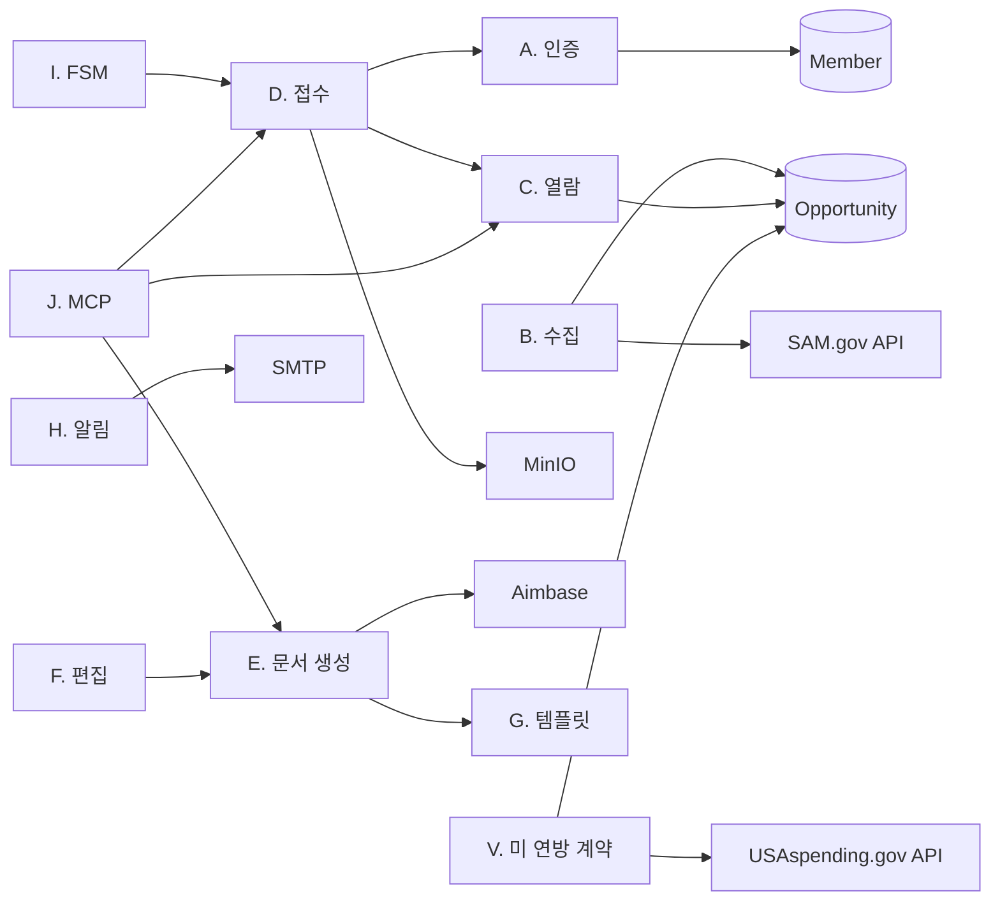
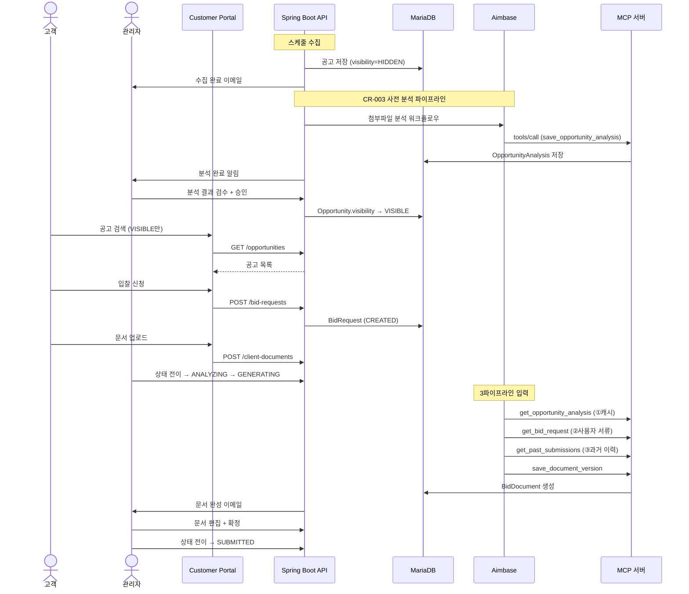

# 실행 지시서: SAM.gov Bidding Agency Platform

> 설계 버전: 1.17 | 최종 수정: 2026-10-25 | 관련 CR: CR-003, CR-132, CR-133, CR-135, CR-136, CR-137, CR-140, CR-141, CR-142, CR-143, CR-146, CR-147, CR-153, CR-155, CR-157, CR-159, CR-160, CR-162, CR-169, CR-170

> **프로젝트:** bidding-agency-platform (미군 조달 입찰 AI 대행 서비스)
> **프로젝트 유형:** 풀스택 (BE: Java 17 + Spring Boot 3.2 / FE: React 19 × 2)
> **버전:** v1
> **최종 갱신:** 2026-03-19
>
> 이 문서는 **실행 지시서**입니다.
> Claude Code는 CLAUDE.md → 이 문서 → 해당 Sprint 참조 파일 순서로 읽습니다.
> 각 산출물의 상세 내용은 개별 파일을 직접 참조하세요.

---

## 0. 프로젝트 개요

SAM.gov에 올라오는 미군(USFK) 조달 입찰 공고를 자동 수집하고, AI(Aimbase)가 제안서를 작성하며, 관리자가 검토 후 최종 제출하는 입찰 대행 서비스.

- **유형:** 풀스택 (BE + Customer Portal + Admin Console)
- **모듈:** 14개 | **기능:** 45개 (MVP 31) | **비즈니스 규칙:** 14개 | **정책:** 11개
- **핵심 설계 결정:** Aimbase MCP 서버 아키텍처 (이 플랫폼이 MCP 서버), 관리자 중심 운영 모델 (ADMIN + CUSTOMER 2역할)
- **연관 서비스:** SAM.gov API, Aimbase (LLM 오케스트레이션), MinIO (파일 스토리지)

---

## 1. 산출물 맵

### 1단계: 요구사항 분석

| 번호 | 산출물 | 파일명 | 요약 |
|------|--------|--------|------|
| T1-1 | 기능 요구사항 명세서 | `T1-1_기능요구사항_명세서.md` | 14모듈 45기능 (MVP 31 / later 14) |
| T1-2 | 모듈 요약 | `T1-2_모듈_요약.md` | 모듈별 기능 수/MVP/책임 |
| T1-3 | 비즈니스 규칙 | `T1-3_비즈니스_규칙.md` | 14개 불변 규칙 |
| T1-4 | 정책 정의 | `T1-4_정책_정의.md` | 11개 변경 가능 규칙 |
| T1-5 | FSM 상태 정의 | `T1-5_FSM_상태_정의.md` | BidRequest 9상태 + BidDocument 3상태 |
| T1-6 | 이벤트 계약 | `T1-6_이벤트_계약.md` | 내부 8개 + 외부 3개 이벤트 |
| T1-7 | Sprint 구조도 | `T1-7_Sprint_구조도.md` | 8 Sprint, 의존관계, 검증 기준 |
| T1-8 | 시스템 가이드 | `T1-8_시스템_가이드.md` | 비개발자용 시스템 설명 |

### 2단계: 아키텍처 설계

| 번호 | 산출물 | 파일명 | 요약 |
|------|--------|--------|------|
| T2-1 | 기술 스택 결정서 | `T2-1_기술스택_결정서.md` | BE/FE/AI 기술 선택과 이유 |
| T2-2 | CLAUDE.md | 프로젝트 루트 `CLAUDE.md` | 프로젝트 컨텍스트, 규칙, 테스트 전략 |

### 3단계: 상세 설계

| 번호 | 산출물 | 파일명 | 요약 |
|------|--------|--------|------|
| T3-1 | 데이터 모델 | `T3-1_데이터_모델.md` | 15 엔티티, 10 Enum |
| T3-2 | API 설계 | `T3-2_API_설계.md` | REST 51개 + MCP Tool 8개 |
| T3-3 | 화면 구조 (IA) | `T3-3_화면_구조.md` | Portal 11페이지 + Admin 8페이지 |
| T3-4 | 화면 상호작용 | `T3-4_화면_상호작용.md` | 4개 복잡 페이지 인터랙션 |
| T3-5 | 단위테스트 명세 | `T3-5_단위테스트_명세.md` | 74개 테스트 케이스 |

### 관리

| 번호 | 산출물 | 파일명 | 요약 |
|------|--------|--------|------|
| CR | 변경 이력 | `CR_변경_이력.md` | CR 목록 |

---

## 2. 기술 스택 요약

### 백엔드

| 영역 | 선택 | 비고 |
|------|------|------|
| 언어 | Java 17 | |
| 프레임워크 | Spring Boot 3.2 | |
| DB 접근 | Spring Data JPA + Hibernate | |
| DB | MariaDB 11.2 | |
| 캐시 | Redis 7.2 | |
| 인증 | JWT (HS256) | Access 15min + Refresh 7day |
| 이메일 | Spring Mail + Thymeleaf | |
| MCP | MCP Java SDK | JSON-RPC 2.0 |

### 프론트엔드

| 영역 | 선택 | 비고 |
|------|------|------|
| 프레임워크 | React 19 + TypeScript 5 | Vite 7 빌드 |
| 상태 관리 | Context API | AuthContext |
| UI 라이브러리 | Radix UI + Lucide Icons | |
| 스타일 | TailwindCSS 4.1 | |
| HTTP | Axios | |
| 에디터 | TipTap | 문서 편집 |

---

## 3. 모듈 총괄

| 모듈 | 기능 수 | 책임 | 외부 연동 |
|------|---------|------|----------|
| A. 인증 | 7 | 회원가입(이메일 인증번호), 로그인, JWT 관리, SNS 가입·로그인 (CR-146) | 네이버, 카카오 로그인(구글 보류), 알림 서버 메일 틀 (CR-146) |
| B. 공고 수집 | 8 | SAM.gov 수집 + **사전 분석 + 노출 관리** (CR-003) | SAM.gov API, **Aimbase** |
| C. 공고 열람 | 4 | 검색, 상세, 필요 문서, 북마크 | — |
| D. 입찰 접수 | 4 | 신청, 문서 업로드, 현황 조회 | MinIO |
| E. 문서 생성 (AI) | 3 | AI 제안서 생성, 버전 관리 | Aimbase |
| F. 문서 편집 | 3 | 관리자 편집, 잠금, PDF | — |
| G. 템플릿 | 2 | 문서 양식 CRUD | — |
| H. 알림 | 2 | 이메일 발송, 마감 알림 | SMTP |
| I. FSM | 1 | 상태 전이 관리 | — |
| J. MCP 서버 | 4 | Aimbase 연동 Tool | Aimbase |
| K. 자격 진단 | 2 | AI 사전 진단 | Aimbase |
| L. 요금 | 2 | 요금 안내 | — |
| M. 관리자 | 4 | 회원/입찰/수집/**공고** 관리 (CR-003) | — |
| N. 인증 가이드 | 1 | 정적 가이드 페이지 | — |
| O. 고객센터 | 5 | 1:1 문의 접수, 관리자 알림, 관리자 조회·답변 (CR-132), 공지사항, 자주 묻는 질문 (CR-133) | bp-notification |
| P. 메뉴 속 화면 | ~~21~~ 20 | 속페이지 틀, 항목별 준비 안내, 등록·컨설팅 서비스 안내, ~~입찰 교실 4화면~~ 교육 3화면(CR-147: 무료 입찰 교실 폐기, 교육 자료·용어 사전·서식 모음은 고객센터 묶음) (CR-133, T1-1 R 모듈). 있는 데이터로 여는 6화면과 모은 공고 목록·집계 API 6개 (CR-135). 낙찰 업체 저장과 지난 낙찰 다시 받기, 낙찰 업체, 기지 관리와 기지별 지도, 서류 만료일과 유효기간 알림, 만료 메일 (CR-136, T1-1 T 모듈) | O. 고객센터(상담 신청), B. 공고 수집(모은 공고 읽기만, CR-136 은 낙찰 칸 저장), H. 알림(만료 메일, bp-notification) |
| V. 미 연방 계약 자료 | ~~10~~ 4 | USAspending 매일 받기와 옵션 끝날짜 받기, 받기 기록, ~~계약 구분(예측)과 근거, 다음 달 공고, 재발주 달력, 회원 계약과 옵션 연장 알림, 계약 끝 메일,~~ 낙찰가 범위 (CR-142, T1-1 V 모듈. CR-147 에서 재발주 예측, 회원 계약, 계약 끝 메일 폐기) | USAspending.gov API, ~~H. 알림(계약 끝 메일, bp-notification),~~ C. 공고 열람(공고 업종 코드 읽기) |
| U. 제출 전 검사 | 5 | 요구 항목을 공고 분석에서 채우기, 내 입찰 건과 건별 제출 전 검사, 요구 서류 올리기와 서류함에서 고르기, 형식·쪽수 판정 (CR-141, T1-1 U 모듈). AI 요구사항 추출과 MCP save_requirements 걷어냄 | MinIO, O. 고객센터(검토 신청) |
| W. 서류함 고정 칸 | 1 | 서류함 고정 다섯 칸과 국문·영문 칸, 영문 먼저 고르기(BIZ-065), 가장 긴 낱말 분류 찾기(BIZ-066) (CR-147, T1-1 W 모듈) | 없음 |

---

## 4. 데이터 모델 요약

> 상세: `docs/AI-SDLC/T3-1_데이터_모델.md`

- **엔티티 16개**: Member, Opportunity, OpportunityAttachment, **OpportunityAnalysis** (CR-003), OpportunityRequirementItem, BidRequest, ClientDocument, BidDocument, BidDocumentVersion, DocumentTemplate, RequirementFulfillmentMap, Bookmark, NotificationLog, CollectorRun, KeywordGroup, EventLog / CR-132: Inquiry, InquiryType 추가(T3-1) / CR-136: MilitaryBase 추가, Opportunity 낙찰 칸 3개, MemberDocument 만료일(T3-1) / CR-137: EligibilityAnswer 추가(T3-1) / CR-141: ClientDocument 쪽수 칸(T3-1) / CR-142: FederalContract, FederalContractSyncRun, MemberContract 추가(T3-1)
- **FSM 관리 엔티티**: BidRequest (9상태), BidDocument (3상태), **Opportunity (2상태: HIDDEN/VISIBLE)**, **OpportunityAnalysis (4상태)** (CR-003), **Inquiry (2상태: RECEIVED/ANSWERED)** (CR-132)
- **핵심 원칙**: UUID PK, JSON 컬럼(stateHistory, rawJson, contentJson), 문서 버전 불변성, 콘텐츠 해시 중복 검출

---

## 5. Sprint별 참조 가이드

### Sprint 1: 프로젝트 세팅 + 인증

**목표:** 프로젝트 구조 정리, DB 마이그레이션, 회원가입/로그인 구현
**기능:** 5개 (작업 1-1, 1-2, BID-AUTH-001~003)

#### BE 참조

| 순서 | 읽을 파일 | 참조 범위 |
|------|----------|----------|
| 1 | `CLAUDE.md` | BE 아키텍처 규칙, 네이밍 |
| 2 | `docs/AI-SDLC/T3-1_데이터_모델.md` | Member, Role Enum |
| 3 | `docs/AI-SDLC/T1-1_기능요구사항_명세서.md` | BID-AUTH-001~003 |
| 4 | `docs/AI-SDLC/T1-3_비즈니스_규칙.md` | BIZ-008 (이메일 유일성) |
| 5 | `docs/AI-SDLC/T3-2_API_설계.md` | A. 인증 API |
| 6 | `docs/AI-SDLC/T3-5_단위테스트_명세.md` | TC-AUTH-001~008 |
| 7 | `docs/AI-SDLC/T1-7_Sprint_구조도.md` | Sprint 1 검증 기준 |

#### FE 참조

| 순서 | 읽을 파일 | 참조 범위 |
|------|----------|----------|
| 1 | `CLAUDE.md` | FE 아키텍처 규칙 |
| 2 | `docs/AI-SDLC/T3-3_화면_구조.md` | 홈, 로그인, 회원가입, 프로필 |
| 3 | `docs/AI-SDLC/T3-2_API_설계.md` | A. 인증 API |
| 4 | `docs/AI-SDLC/T1-7_Sprint_구조도.md` | Sprint 1 FE 검증 기준 |

**핵심 설계 결정:**
- Role을 ADMIN + CUSTOMER 2개로 단순화. Flyway 마이그레이션으로 기존 역할 정리
- JWT HS256: Access 15min + Refresh 7day
- 회원가입 시 기본 역할은 CUSTOMER

**핵심 검증:** 회원가입 → DB 저장 → JWT 발급 → 인증 필요 API 호출 성공

---

### Sprint 2: 공고 수집 + 알림 + 사전 분석 (CR-003 확장)

**전제:** Sprint 1 완료
**기능:** 8개 (BID-OPP-001~008, BID-NOTIFY-001) — CR-003으로 BID-OPP-006~008 추가

#### BE 참조

| 순서 | 읽을 파일 | 참조 범위 |
|------|----------|----------|
| 1 | `CLAUDE.md` | BE 규칙 |
| 2 | `docs/AI-SDLC/T3-1_데이터_모델.md` | Opportunity, OpportunityAttachment, **OpportunityAnalysis (CR-003)**, CollectorRun, KeywordGroup, NotificationLog |
| 3 | `docs/AI-SDLC/T1-1_기능요구사항_명세서.md` | BID-OPP-001~005, **BID-OPP-006~008 (CR-003)**, BID-NOTIFY-001 |
| 4 | `docs/AI-SDLC/T1-3_비즈니스_규칙.md` | BIZ-004 (원본 보존), BIZ-005 (중복 검출), BIZ-012 (알림 멱등) |
| 5 | `docs/AI-SDLC/T1-4_정책_정의.md` | POL-001 (수집 주기), POL-002 (알림 대상) |
| 6 | `docs/AI-SDLC/T1-6_이벤트_계약.md` | OpportunitiesCollected, AttachmentDownloaded |
| 7 | `docs/AI-SDLC/T3-2_API_설계.md` | B. 공고 수집 API |
| 8 | `docs/AI-SDLC/T3-5_단위테스트_명세.md` | TC-OPP, TC-ATT, TC-NOTI |
| 9 | `docs/AI-SDLC/T1-7_Sprint_구조도.md` | Sprint 2 검증 기준 |

**핵심 설계 결정:**
- SAM.gov API 호출은 cron 4회/일 + 수동 트리거
- 원본 JSON은 rawJson 필드에 보존 (BIZ-004)
- 이메일 발송은 Thymeleaf HTML 템플릿 사용
- 알림 중복 방지: idempotencyKey 기반
- **(CR-003)** 첨부파일 다운로드 완료 → 자동 사전 분석 트리거 (Aimbase 워크플로우)
- **(CR-003)** 관리자 수동 첨부파일 업로드 → 사전 분석 트리거
- **(CR-003)** Opportunity.visibility: HIDDEN(기본) → 관리자 승인 → VISIBLE (사용자 노출)
- **(CR-019)** 수집 시 SAM `resourceLinks`를 OpportunityAttachment로 적재. 외부 사이트라 자동 다운로드 불가하면 `MANUAL_FETCH_REQUIRED` 표식 (BIZ-020)
- **(CR-019)** 관리자 수동 업로드 → StorageService 실제 저장 + SUCCESS 전이 (`MANUAL_FETCH_REQUIRED` 행 갱신 또는 신규)
- **(CR-019)** 공고문 한글화(NoticeService) 시 SUCCESS 첨부의 다운로드 URL을 워크플로우 입력 `attachmentFiles[]`로 전달 → Aimbase parse_document 발췌 반영
- **(CR-160)** 수집 때 새 공고(정정 새 판 포함)와 내용이 바뀐 공고는 PIEE 받기 결과를 WAITING 으로 건다. 낙찰 공지, 공고번호 빈 공고, `PIEE_FETCH_ENABLED=false` 는 걸지 않는다 (BIZ-079)
- **(CR-160)** PIEE 받기 일꾼(`@Scheduled`, `app.piee.fetch-interval-ms`)이 WAITING 공고를 오래된 순으로 하나씩 집는다. 그 공고의 SAM 첨부가 PENDING 이면 `PIEE_SAM_WAIT_MINUTES` 까지 미룬다. WAITING 에서 FETCHING 은 조건부 갱신으로 한 번만 잡는다. FETCHING 이 `PIEE_TIMEOUT_SECONDS` 두 배를 넘으면 FAILED
- **(CR-160)** 받기: `PIEE_NOTICE_URL` 을 쿠키를 보관하며 연다(끝 주소가 `index.xhtml` 이면 NOT_FOUND). 같은 쿠키로 `viewPublicNotice.xhtml` 에 양식을 보낸다(`form_SUBMIT=1`, 화면의 `javax.faces.ViewState`, `form:_idcl=downloadAllAttachments`). 단추가 없으면 DONE 0개. 응답은 임시 파일로 받고 `PIEE_MAX_ZIP_MB` 를 넘으면 끊는다. 압축 파일마다 SHA-256 을 세어 BIZ-080 으로 넣거나 건너뛴다. 임시 파일은 끝나면 지운다. 새 라이브러리 없이 지금 쓰는 Apache HttpClient 5 와 java.util.zip 을 쓴다
- **(CR-160)** 압축 풀기와 첨부 넣기는 서비스(OpportunityAttachmentIngestService)로 옮겨 관리자 손 올리기(CR-037)와 같이 쓴다. 컨트롤러는 받고 돌려주기만 한다. SAM 자동 받기와 손 올리기도 content_sha256 을 남긴다
- **(CR-160)** OpportunityAdminDto 에 pieeFetchStatus, pieeFetchStatusAt, pieeFileCount, pieeFetchMessage, pieeUrl. 관리자 원본 공고 상세 PIEE 칸이 받기 결과 한 줄을 보이고 PIEE 입찰서류 보기 주소를 pieeUrl 로 쓴다

**핵심 검증:** cron 수집 → DB 저장 → 중복 검출 → 첨부 다운로드 → **사전 분석 자동 트리거** → 관리자 이메일 수신 → **관리자 승인 → 사용자 노출**

---

### Sprint 3: 공고 열람 + 자격 진단

**전제:** Sprint 2 완료
**기능:** 5개 (BID-BROWSE-001~004, BID-QUAL-001~002)

#### BE 참조

| 순서 | 읽을 파일 | 참조 범위 |
|------|----------|----------|
| 1 | `CLAUDE.md` | BE 규칙 |
| 2 | `docs/AI-SDLC/T3-1_데이터_모델.md` | Opportunity, OpportunityRequirementItem, Bookmark |
| 3 | `docs/AI-SDLC/T1-1_기능요구사항_명세서.md` | BID-BROWSE, BID-QUAL |
| 4 | `docs/AI-SDLC/T3-2_API_설계.md` | C. 공고 열람, D. 즐겨찾기, E. 자격 진단 |
| 5 | `docs/AI-SDLC/T3-5_단위테스트_명세.md` | TC-BROWSE, TC-BM, TC-QUAL(CR-137, CR-140), TC-PRE(CR-141), TC-FED(CR-142) |

#### FE 참조

| 순서 | 읽을 파일 | 참조 범위 |
|------|----------|----------|
| 1 | `CLAUDE.md` | FE 규칙 |
| 2 | `docs/AI-SDLC/T3-3_화면_구조.md` | 공고 검색, 공고 상세, 즐겨찾기, 가이드 |
| 3 | `docs/AI-SDLC/T3-4_화면_상호작용.md` | 공고 상세 — 입찰 신청 (자격 진단 부분) |
| 4 | `docs/AI-SDLC/T3-2_API_설계.md` | C, D, E API |

- **(CR-162)** 사이트 자료 규모 `GET /opportunities/stats/site` 는 공개 조회다. 서비스가 미 연방 계약 자료 행 수, 모은 공고(지운 것 제외, 같은 공고번호 한 건), 마감 전 공고(모은 공고 목록의 마감 전, 같은 공고번호 하나만과 같은 계산)를 센다. 마감 전 판정과 같은 공고번호 하나만 남기는 계산은 모은 공고 목록의 것을 그대로 써 숫자가 어긋나지 않게 한다. 숫자를 저장하거나 고정하지 않는다(BIZ-082)
- **(CR-162)** 고객 포털: 메뉴 정의에서 맞춤 판정 묶음을 입찰 자격 진단으로 바꿔 맨 뒤로, 사이트 정보의 서비스 한 줄과 저작권 줄, 유틸 띠 회원 구분 꼬리표(AuthContext 의 membership, loading 이면 비움), 홈 공고 줄 글자 크기(wjbid-aida.css), 대표 문장 아래 자료 규모 한 줄(못 받으면 숨김), 등록·컨설팅 안내 간략화(화면 정의 파일의 단계 설명, 안내 상자, 준비할 것을 지우고 비용 한 줄)
- **(CR-162)** 고객 화면 문구는 CR-162 점검표(docs/CR/CR-162_고객화면_문구와_배치.md 부록)대로 고친다. 점검표 고칠 문구에 옛 이름(적격성 진단 등)이 남아 있으면 용어표 「고객 화면 이름」 이 우선한다. 요술봉, 로봇, 로켓 아이콘은 서류, 확인, 돋보기 아이콘으로. 고객 알림 제목의 "[Bidding Agency]" 머리말을 뺀다(BIZ-081)

**핵심 검증:** 공고 목록 페이징/검색/필터 → 상세 + 요구사항 + 첨부 → 북마크 토글

---

### Sprint 4: 입찰 접수 + FSM

**전제:** Sprint 3 완료
**기능:** 7개 (BID-REQ-001~004, BID-FSM-001, BID-PRICE-002, BID-NOTIFY-002)

#### BE 참조

| 순서 | 읽을 파일 | 참조 범위 |
|------|----------|----------|
| 1 | `CLAUDE.md` | BE 규칙 |
| 2 | `docs/AI-SDLC/T3-1_데이터_모델.md` | BidRequest, ClientDocument, ServiceLevel Enum, BidRequestState Enum |
| 3 | `docs/AI-SDLC/T1-5_FSM_상태_정의.md` | BidRequest 전체 FSM |
| 4 | `docs/AI-SDLC/T1-3_비즈니스_규칙.md` | BIZ-001 (FSM 화이트리스트), BIZ-006 (중복 신청), BIZ-011 (파일 크기) |
| 5 | `docs/AI-SDLC/T1-6_이벤트_계약.md` | BidRequestCreated, BidRequestStateChanged, DocumentsReceived, DeadlineApproaching |
| 6 | `docs/AI-SDLC/T3-2_API_설계.md` | F. 입찰 접수, G. 고객 문서 제출, H. 입찰 관리 |
| 7 | `docs/AI-SDLC/T3-5_단위테스트_명세.md` | TC-BID, TC-FSM, TC-DOC-UPLOAD, TC-DEADLINE |

#### FE 참조

| 순서 | 읽을 파일 | 참조 범위 |
|------|----------|----------|
| 1 | `CLAUDE.md` | FE 규칙 |
| 2 | `docs/AI-SDLC/T3-3_화면_구조.md` | 내 입찰 현황, 입찰 상세, 대시보드, 입찰 관리 |
| 3 | `docs/AI-SDLC/T3-4_화면_상호작용.md` | 공고 상세 입찰 신청, 입찰 상세 문서 업로드, 입찰 상세 관리 |
| 4 | `docs/AI-SDLC/T3-2_API_설계.md` | F, G, H API |

**핵심 설계 결정:**
- FSM 화이트리스트: 허용 전이만 실행, 나머지 전부 거부
- 동일 공고 중복 신청 방지: (member_id, opportunity_id) UNIQUE 제약
- 마감 알림: D-7, D-3, D-1 스케줄러

**핵심 검증:** 신청 → CREATED → DOCS_PENDING → 문서 업로드 → DOCS_RECEIVED → 전체 FSM 전이 테스트

---

### Sprint 5: MCP 서버 + Aimbase 연동 (CR-002 갱신)

**전제:** Sprint 4 완료
**기능:** 6개 (BID-MCP-001~005, 작업 5-1)

#### BE 참조

| 순서 | 읽을 파일 | 참조 범위 |
|------|----------|----------|
| 1 | `CLAUDE.md` | BE 규칙, AI 연동 섹션 |
| 2 | `docs/AI-SDLC/T3-2_API_설계.md` | MCP 서버 전체 + Aimbase 워크플로우 호출 |
| 3 | `docs/AI-SDLC/T1-1_기능요구사항_명세서.md` | BID-MCP-001~005 |
| 4 | `docs/AI-SDLC/T1-3_비즈니스_규칙.md` | BIZ-013 (MCP 무상태) |
| 5 | `docs/AI-SDLC/T3-5_단위테스트_명세.md` | TC-MCP 전체 |

**핵심 설계 결정 (CR-002):**
- MCP 전송: HTTP POST (`POST /mcp`) + **SSE** (`GET /mcp/sse` + `POST /mcp/message`) 이중 지원
- 11개 Tool (기존 8개 + CR-003 신규 3개: get_opportunity_analysis, save_opportunity_analysis, get_past_submissions)
- McpDispatcher 추출 → HTTP/SSE 공유
- LLMPlatformClient: `localhost:9000` → Aimbase `59.8.160.12:8280`, `X-API-Key` 인증 추가
- AIWorkflowService: 후처리 저장 로직 제거 (Aimbase MCP 콜백으로 대체)
- 순환 트리거 방지 가드 추가

**핵심 검증:**
1. Aimbase 연결 확인 (LLMPlatformClient.isHealthy())
2. Aimbase에서 SSE로 MCP 서버 등록 → discover → 11개 Tool 목록 확인
3. 워크플로우 실행 → MCP 콜백 → 데이터 저장 확인
4. Aimbase 셋업 스크립트 실행 (Connection, MCP Server, Workflow 생성)

---

### Sprint 6: 문서 생성 + 템플릿

**전제:** Sprint 5 완료
**기능:** 9개 (BID-TPL-001~002, BID-DOC-001~007). BID-DOC-004~005 는 CR-169, BID-DOC-006~007 은 CR-170

#### BE 참조

| 순서 | 읽을 파일 | 참조 범위 |
|------|----------|----------|
| 1 | `CLAUDE.md` | BE 규칙 |
| 2 | `docs/AI-SDLC/T3-1_데이터_모델.md` | DocumentTemplate, BidDocument, BidDocumentVersion |
| 3 | `docs/AI-SDLC/T1-3_비즈니스_규칙.md` | BIZ-002 (버전 불변), BIZ-010 (사용 중 템플릿 삭제 불가) |
| 4 | `docs/AI-SDLC/T1-6_이벤트_계약.md` | DocumentGenerated, AimbaseWorkflowCompleted |
| 5 | `docs/AI-SDLC/T3-2_API_설계.md` | I. 문서 템플릿 |
| 6 | `docs/AI-SDLC/T3-5_단위테스트_명세.md` | TC-TPL, TC-DOCGEN |

#### FE 참조

| 순서 | 읽을 파일 | 참조 범위 |
|------|----------|----------|
| 1 | `docs/AI-SDLC/T3-3_화면_구조.md` | 문서 양식 관리 |
| 2 | `docs/AI-SDLC/T3-2_API_설계.md` | I. 템플릿 API |

**핵심 설계 결정 (CR-003 / CR-014):**
- BID-DOC-001 LLM 입력 3파이프라인: ①OpportunityAnalysis(캐시) + ②ClientDocument[](사실 출처) + ③**성공 제안서 자산**(CR-014 개정 — 기존 "사용자 과거 BidDocument[]"에서 대체)
- ③ = 신규 공고 industry_type(BIZ-018) 매칭 → successGuide(PatternGuide.guideJson) + referenceSamples[](성공 제안서 원본 메타+다운로드 URL, Aimbase가 parse_document로 발췌) + referenceUsagePolicy(사실 복붙 금지, BIZ-019)
- 조회해서 전달하면 끝. industry_type=NULL(미분류)이면 빈 처리. 조건 분기 없음
- 사전 분석이 COMPLETED 상태여야 문서 생성 가능
- **(CR-169)** ②는 CR-169 전까지 설계, 절 작성, 절 검증에 들어가지 않았다. 입찰 건이 ANALYZING 이 되면 후보 서류(그 건의 client_documents, 그 회원의 만료 전 member_documents)를 내용 해시로 묶어 Aimbase 워크플로우 client-document-read 로 읽고 document_readings 에 사실을 남긴다(BIZ-085, 086). 같은 해시는 다시 읽지 않는다
- **(CR-169)** 읽는 꼴은 서버가 정해 서명 주소 `/mcp/document-readings/{readingId}/download` 로 준다. 그림은 iText 로 한 쪽 PDF, DOCX, XLSX, PPTX 는 Apache POI 로 글자만, HWP 는 스킬 `scripts/convert_hwp.py` 를 Aimbase skill_run 으로. 그 밖은 UNSUPPORTED
- **(CR-169)** 읽는 중이면 GENERATING 전환 409(BIZ-087). 설계가 절마다 sourceReadingIds 를 고르고 서버는 읽음 후보만 받는다(BIZ-088). 절 작성과 절 검증은 sourceDocuments 를 받고 회사 사실은 거기서만, 없으면 `[Client data required: ...]`(BIZ-089)
- **(CR-169)** Aimbase 소스는 고치지 않는다. 워크플로우 정의(`docs/workflows/client-document-read.steps.json` 신설, proposal-design, proposal-write-section, proposal-verify-fidelity 지시문)만 올린다. MCP 도구가 바뀌므로 배포 뒤 Aimbase 연결을 다시 맺는다
- **(CR-169)** 문서 묶기는 서버(ProposalAssembleService)가 한다. 장, 절, 블록 순서로 TipTap 문서를 만들어 새 버전으로 저장하고(편집자는 작성을 시킨 관리자), 모든 문서 종류를 마친 뒤 하나라도 묶였으면 REVIEW 로 넘긴다. Aimbase proposal-assemble 은 부르지 않는다(10/25 상용 4차 시험 결함, 사용자 10:27 "1")
- **(CR-170)** 고객 서류 읽기가 끝나면(진입 때 읽을 것이 없으면 바로) 서버가 입찰 분석 회차(bid_analyses)를 만들고 Aimbase 워크플로우 bid-analysis 를 부른다(BIZ-090). 단계 셋이 스킬 01 STEP 2~7, 11, 02 로 종합 분석 리포트, 캡처플랜, Bid/No-Bid 결정을 save_bid_analysis 로 차례로 저장한다. 자료는 get_bid_analysis_input 과 search_award_history(federal_contracts, 낙찰 공고)이고 웹 검색은 쓰지 않는다(BIZ-093)
- **(CR-170)** Pwin, 판정, 강점과 약점, 핵심이슈 순위는 DECISION 저장 때 서버가 POL-041 로 계산한다(BIZ-091). 관리자 결정이 GO, CONDITIONAL_GO 가 아니면 GENERATING 전환 409 `BID_DECISION_REQUIRED`(BIZ-092). ANALYZING 에서 CLOSED 를 허용한다
- **(CR-170)** Aimbase 소스는 고치지 않는다. 워크플로우 정의 `docs/workflows/bid-analysis.steps.json` 을 신설해 올린다. MCP 도구가 셋 늘어나므로 배포 뒤 Aimbase 연결을 다시 맺는다

**핵심 검증:** 템플릿 등록 → **사전 분석 캐시 확인** → Aimbase Workflow 실행 (3파이프라인 입력) → 문서 생성 → DB 저장 → 관리자 이메일

---

### Sprint 7: 문서 편집 + 서비스 요금

**전제:** Sprint 6 완료
**기능:** 5개 (BID-EDIT-001~003, BID-PRICE-001, BID-ADMIN-003)

#### BE 참조

| 순서 | 읽을 파일 | 참조 범위 |
|------|----------|----------|
| 1 | `docs/AI-SDLC/T3-1_데이터_모델.md` | BidDocument, BidDocumentVersion |
| 2 | `docs/AI-SDLC/T1-5_FSM_상태_정의.md` | BidDocument FSM |
| 3 | `docs/AI-SDLC/T1-3_비즈니스_규칙.md` | BIZ-002, BIZ-003, BIZ-009 |
| 4 | `docs/AI-SDLC/T1-6_이벤트_계약.md` | DocumentConfirmed |
| 5 | `docs/AI-SDLC/T3-2_API_설계.md` | J. 문서 편집, L. 요금 안내 |
| 6 | `docs/AI-SDLC/T3-5_단위테스트_명세.md` | TC-EDIT |

#### FE 참조

| 순서 | 읽을 파일 | 참조 범위 |
|------|----------|----------|
| 1 | `docs/AI-SDLC/T3-3_화면_구조.md` | 문서 편집, 요금 안내 |
| 2 | `docs/AI-SDLC/T3-4_화면_상호작용.md` | 문서 편집 페이지 전체 |
| 3 | `docs/AI-SDLC/T3-2_API_설계.md` | J, L API |

**핵심 검증:** TipTap 편집 → 새 버전 → 잠금 → 잠금 해제 → PDF 내보내기

---

### Sprint 8: 통합 테스트 + 안정화

**전제:** Sprint 7 완료
**기능:** 4개 (작업 8-1~8-4)

| 순서 | 읽을 파일 | 참조 범위 |
|------|----------|----------|
| 1 | 전체 설계 문서 | E2E 플로우 검증 |
| 2 | `docs/AI-SDLC/T1-5_FSM_상태_정의.md` | 전체 FSM 전이 검증 |
| 3 | `docs/AI-SDLC/T1-6_이벤트_계약.md` | 이벤트 흐름 검증 |

**핵심 검증:** 공고 수집 → 입찰 신청 → 문서 제출 → AI 생성 → 편집 → 확정 → 제출 전체 플로우

---

## 5-A. 구현 세션 분리 전략

**선택한 전략:** 옵션 A — Sprint 단위 BE/FE 분리

각 Sprint에서 BE를 먼저 구현하고, BE API가 완성되면 FE를 연동.

---

## 5-B. Git 브랜치 전략

### 브랜치 구조

| 브랜치 | 역할 | 보호 |
|--------|------|------|
| `main` | 운영 배포 가능 상태 | PR 머지만 허용 |
| `develop` | 개발 통합 | PR 머지 권장 |
| `feat/SPR-{N}-{기능명}` | Sprint 작업 | develop에 PR |

### 커밋 메시지 형식

`<type>: <설명>` — type: feat / fix / refactor / docs / chore / ui

---

## 6. 핵심 아키텍처 원칙

1. **FSM 화이트리스트** — 허용 전이 외 전면 차단 (BIZ-001)
2. **문서 버전 불변성** — 수정 시 새 버전 생성, 기존 불변 (BIZ-002)
3. **MCP 무상태** — Tool 호출 독립 처리, requestId 멱등 (BIZ-013)
4. **알림 멱등성** — idempotencyKey로 중복 발송 방지 (BIZ-012)
5. **원본 보존** — SAM.gov rawJson 변경 금지 (BIZ-004)

---

## 7. Sprint 의존관계 다이어그램

```
Sprint 1 (인증)
    │
    ▼
Sprint 2 (수집 + 알림)
    │
    ▼
Sprint 3 (열람 + 진단)
    │
    ▼
Sprint 4 (접수 + FSM)
    │
    ▼
Sprint 5 (MCP + Aimbase)
    │
    ▼
Sprint 6 (문서 생성)
    │
    ▼
Sprint 7 (편집 + 요금)
    │
    ▼
Sprint 8 (통합 테스트)
```

---

## 8. 설계 리뷰 시트

### 8-1. 모듈 관계도



### 8-2. 핵심 데이터 흐름



### 8-3. 화면 - API 매핑 요약

| 화면 | 주요 API | 비고 |
|------|---------|------|
| 홈 | `GET /site-photos`, `GET /opportunities/collected`, `GET /opportunities/stats/site` (CR-162) | 문구는 정적 콘텐츠. 사진 자리 넷은 사진 목록에서 방문마다 한 장(CR-153). 마감 전 공고 목록과 건수는 모은 공고에서 `openOnly`, `latestOnly`, `sort`, `dueWithinDays` 로(CR-155) |
| 회원가입 | `POST /auth/email-codes`, `/auth/email-codes/verify`, `/auth/register` | 이메일 인증번호 확인을 마친 주소만 가입 (BIZ-062, CR-146) |
| SNS 가입·로그인 | `GET /auth/sns/providers`, `/oauth2/authorization/{provider}`, `/auth/sns/signup/{ticket}`, `POST /auth/sns/register`, `/auth/sns/login` | 네이버, 카카오(구글 보류). 키가 있는 곳만 (CR-146) |
| 공고 검색 | ~~`GET /opportunities`, `/search`, `/near-deadline`~~ `GET /opportunities/collected` (CR-155) | 필터, 페이징. CR-155: 모은 공고 중 마감 전인 것 전부(BIZ-069), 검색어 `q`, 줄을 누르면 공고문 상세 또는 원본 공고 상세. CR-147: 화면 이름 마감 전 공고, 속페이지 틀, 숫자 칸은 검색어와 상관없는 마감 전 공고 전체 건수, 빈 상태 두 가지 |
| 공고 상세 | `GET /opportunities/{id}`, `/requirements`, `/attachments` | 관심 공고는 응답의 `opportunityId` 로(CR-155) |
| 원본 공고 상세 | `GET /opportunities/origin/{opportunityId}` | 한글 본문(`descriptionKo`) 먼저, 원문 본문은 접어 둔다(CR-152, CR-155) |
| 회원 구분 (CR-157) | `GET /members/me` 의 `membership` | 원본 공고 상세의 공고문 이동과 회원 전용 안내, 공고 상세 회원 안내, 판정 칸, 적격성 진단, 공고별 판정, 요금 안내 지금 단계, 내 프로필이 이 값으로 가른다. 서버는 공고문 조회, 적격성, 입찰 신청을 BIZ-071 로 다시 막는다 |
| 관리자 회원 관리 (CR-157) | `GET /admin/members`, `GET /admin/members/{memberId}/memberships`, `POST /admin/members/{memberId}/memberships`, `DELETE /admin/members/{memberId}/memberships/{membershipId}` | 회원 여부와 끝일, 회원 기간 넣기, 지우기, 이력(BIZ-072) |
| 입찰 신청 | `POST /bid-requests` | 서비스 레벨 선택 |
| 내 입찰 현황 | `GET /bid-requests/my`, `/{id}`, `/{id}/history` | 자기 입찰 건만, 남의 건 404 (BIZ-060) |
| 문서 업로드 | `POST /bid-requests/{id}/client-documents` | multipart, 자기 입찰 건만 (BIZ-060) |
| 즐겨찾기 | `GET/POST/DELETE /bookmarks/{id}` | 번호는 모은 공고 번호. 줄을 누르면 원본 공고 상세 주소로(CR-155) |
| Admin 대시보드 | `GET /admin/bid-requests/stats` | |
| Admin 입찰 관리 | `GET/POST /admin/bid-requests/*` | FSM 전이 |
| Admin 문서 편집 | `GET/POST /bid-documents/{id}/*` | TipTap + 잠금 |
| Admin 수집 관리 | `POST /admin/collection/trigger` | |
| **Admin 공고 관리** | `GET/POST /admin/opportunities/*` | **CR-003**: 첨부 업로드, 분석, 승인 |
| Admin 양식 관리 | `GET/POST/DELETE /admin/document-templates` | |
| 메뉴 속 화면 (CR-133) | 없음 | 화면 정의 파일. 상담·참가 신청은 1:1 문의 화면으로 이동. CR-147: 무료 입찰 교실과 참가 신청 폐기, 메뉴 7묶음 34항목 |
| 사전 공고, 변경 공고, 공고문 예시, 최근 낙찰, 월별 동향, 업종별 발주 (CR-135) | `GET /opportunities/collected`, `/amendments`, `/sample`, `/awards`, `/stats/monthly`, `/stats/naics` | 로그인 없이. 모은 원본 공고를 읽기만 |
| 낙찰 업체, 기지별 지도 (CR-136) | `GET /opportunities/awardees`, `/stats/bases`, `/stats/bases/{baseId}/opportunities` | 로그인 없이. 기지 목록이 비면 빈 상태 |
| 유효기간 알림 (CR-136) | `GET /member-documents/expiry`, `PATCH /member-documents/{id}/expiry` | 로그인. 메일은 매일 09:00 Asia/Seoul 스케줄러 |
| Admin 기지 관리, 지난 낙찰 공지 다시 받기 (CR-136) | `GET/POST/PUT/DELETE /admin/bases`, `GET /admin/bases/unmatched`, `POST /admin/opportunities/award-backfill` | 다시 받기는 SAM 검색 1회 |
| 요금 안내 | `GET /pricing` | CR-129. CR-133 에서 속페이지 틀 안 |
| 적격성 진단, 공고별 진단 (CR-137) | `GET /eligibility/notices`, `GET /eligibility/notices/{noticeId}`, `PUT /eligibility/notices/{noticeId}/answers/{itemNo}` | 로그인. 자격은 공고문 분석 결과를 읽고, 답만 저장(BIZ-032, BIZ-033) |
| 공고별 판정, 공고 검색 판정 칸, 공고 상세 판정 상자, 증빙 서류 붙이기 (CR-140) | `GET /eligibility/notices`, `GET /eligibility/notices/{noticeId}`, `PUT /eligibility/notices/{noticeId}/answers/{itemNo}/document`, `GET /member-documents` | 로그인. 판정은 답과 붙인 서류로만 조회 때 낸다(BIZ-040~044). 저장하지 않는다 |
| ~~다음 달 공고, 재발주 달력 (CR-142)~~ | ~~`GET /federal-contracts/recompete`, `/recompete/calendar`, `/naics`~~ | ~~로그인. 구분은 조회 때 BIZ-050 으로 낸 예측. 자료 기준일과 90일 늦음을 밝힌다~~ **폐기 (CR-147)** |
| ~~옵션 연장 알림 (CR-142)~~ | ~~`GET /member-contracts`, `GET /member-contracts/lookup`, `POST /member-contracts`, `PATCH/DELETE /member-contracts/{id}`~~ | ~~로그인, 본인 계약만. 찾기는 표에 없을 때만 USAspending 1회. 메일은 매일 09:00 Asia/Seoul 스케줄러~~ **폐기 (CR-147)** |
| 낙찰가 범위 (CR-142) | `GET /federal-contracts/award-range`, `/naics` | 로그인. 금액 0 이하 제외, 건수가 설정값 미만이면 범위를 내지 않음(BIZ-054) |
| 관리자 미 연방 계약 받기 (CR-142) | `POST /admin/federal-contracts/sync`, `GET /admin/federal-contracts/sync-runs` | 화면 없음. 매일 05:00 Asia/Seoul 스케줄러와 같은 처리 |
| 제출 전 검사, 입찰 건별 제출 전 검사, 입찰 상세 제출 서류 (CR-141) | `GET /bid-requests/my/pre-check`, `GET /bid-requests/{id}/pre-check`, `POST/DELETE /bid-requests/{id}/required-document-slots/{itemId}[/upload, /from-vault]`, `GET /member-documents`, `PATCH /bid-requests/{id}/state` | 로그인, 자기 입찰 건만(BIZ-049). 필수 서류 빠지면 서류 접수 전환을 막고 형식·쪽수는 경고만(BIZ-046~048) |
| 고객 화면 사진 자리(홈, 로그인, 회원가입, SNS 가입, 서비스 안내, 준비 안내) (CR-153) | `GET /site-photos`, `GET /site-photos/{id}/image` | 로그인 없이. 앱 시작 때 한 번 받고 브라우저에 남겨 둔다. 사진이 없거나 못 받으면 사진 없이(BIZ-067) |
| 관리자 고객 화면 사진 (CR-153) | `GET/POST /admin/site-photos`, `PATCH/DELETE /admin/site-photos/{id}` | 올린 사진은 가로 1600, 400KB 안팎 JPEG 로 다시 저장(BIZ-068, POL-039) |
| Admin 공고문 관리 상세의 컴플라이언스 매트릭스 (CR-159) | `GET /admin/notices/{id}/compliance-matrix` | 읽기만. 매트릭스 줄은 공고 분석이 내고 서버가 REQ ID 를 맞춰 준다(BIZ-073~075). 워크플로우는 Aimbase 범용 스킬 묶음 뒤 |
| Admin 제안서 Section 관리 (CR-030, CR-159) | `GET /admin/bid-documents/{documentId}/chapters`, `/sections/{sectionId}[/verification]`, `POST .../regenerate, /lock, /unlock, /reverify`, `GET .../coverage` | 커버리지 검증은 볼 때 계산, 경고만 하고 막지 않는다(BIZ-078). CR-169: 절 상세에 근거 서류 |
| Admin 입찰 상세 관리의 고객 서류 읽기 (CR-169) | `GET /admin/bid-requests/{id}/document-readings`, `GET /admin/document-readings/{readingId}`, `POST /admin/bid-requests/{id}/document-readings/run` | 읽는 중이면 10초마다 다시 부르고 문서 작성 중 전환을 막는다(BIZ-087) |
| Admin 입찰 상세 관리의 입찰 분석 (CR-170) | `GET /admin/bid-requests/{id}/bid-analysis`, `POST /admin/bid-requests/{id}/bid-analysis/run`, `POST /admin/bid-requests/{id}/bid-analysis/decision` | 분석 중이거나 읽는 중이면 10초마다 다시 부른다. Go, 조건부 Go 가 아니면 문서 작성 중 전환을 막는다(BIZ-092) |

### 8-4. 리뷰 체크리스트

- [ ] 모듈 관계도에서 빠진 의존관계가 없는가?
- [ ] 데이터 흐름에서 누락된 단계가 없는가?
- [ ] 모든 화면이 필요한 API를 호출하고 있는가?
- [ ] FSM 상태 전이가 T1-5과 일치하는가?
- [ ] 이벤트 발행/수신이 T1-6과 일치하는가?
- [ ] MCP Tool 목록이 T3-2와 일치하는가?
- [ ] 비즈니스 규칙(T1-3)이 테스트 케이스(T3-5)에 반영되었는가?
