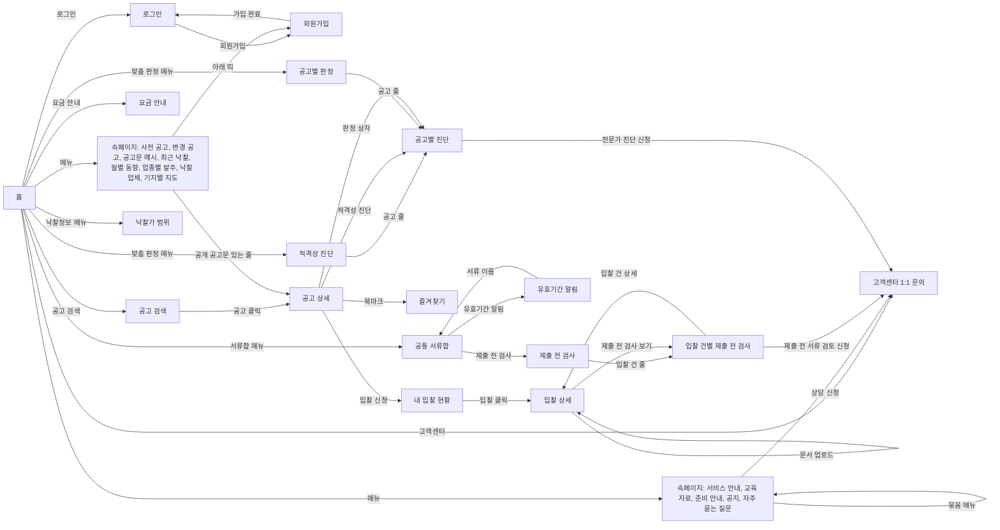
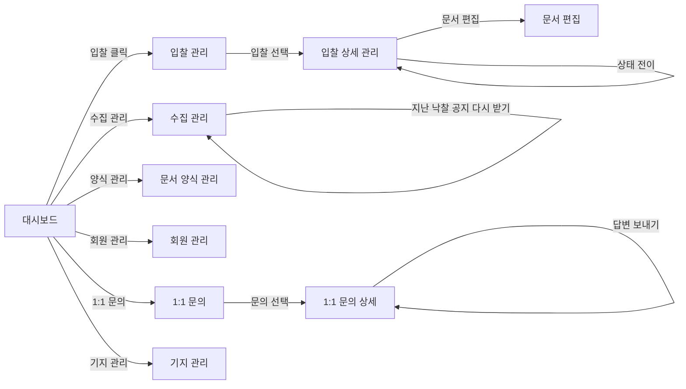

# SAM.gov Bidding Agency Platform 화면 구조 (IA)

> 설계 버전: 1.11 | 최종 수정: 2026-10-12 | 관련 CR: CR-127, CR-129, CR-131, CR-132, CR-133, CR-134, CR-135, CR-136, CR-137, CR-140, CR-141, CR-142, CR-146, CR-147, CR-151

> 단계: 3. Detail Design | 실행스펙 섹션 8에 포함
>
> 화면의 **정보 구조(Information Architecture)**를 정의한다.
> 어떤 페이지가 있고, 각 페이지가 무엇을 보여주며, 어떻게 연결되는가.

---

## Customer Portal 페이지 목록

| 경로 | 페이지명 | 인증 | 역할 | 설명 | Sprint |
|------|---------|------|------|------|--------|
| `/` | 홈 | | | 서비스 소개, 최근 공고, CTA | 1 |
| `/login` | 로그인 | | | 이메일/비밀번호 로그인, 공통 틀 안 (CR-131) | 1 |
| `/register` | 회원가입 | | | 회원가입 폼, 공통 틀 안 (CR-131) | 1 |
| `/register/sns` | SNS 가입 | | | SNS 에서 처음 들어온 고객의 회사 정보, 약관 동의, 필요하면 이메일 인증번호 (CR-146) | 1 |
| `/auth/sns/done` | SNS 로그인 처리 | | | SNS 에서 돌아온 직후 로그인 표를 토큰으로 바꾸고 넘기는 빈 화면 (CR-146) | 1 |
| `/search` | 공고 검색 | | | 공고 목록 + 필터/검색. 속페이지 틀 안, 제목 "마감 전 공고", 입찰공고 묶음 (CR-147) | 3 |
| `/search/{id}` | 공고 상세 | | | 공고 내용 + 요구사항 + 첨부 | 3 |
| `/pricing` | 요금 안내 | | | 월 구독 두 단계(무료, 회원)와 대행·컨설팅 건별 견적 (CR-129). 속페이지 틀 안 (CR-133) | 7 |
| `/guide` | 인증/서류 가이드 | | | USFK 입찰 필수 인증 안내 | 3 |
| `/support` | 고객센터 | | | 1:1 문의. 서버에 접수 (CR-132). 속페이지 틀 안, 자주 묻는 질문 요약 대신 바로가기 (CR-133) | CR-124 |
| `/notices` | 공지사항 | | | 공지 목록, 0건 안내. 속페이지 틀 안 (CR-133) | CR-133 |
| `/faq` | 자주 묻는 질문 | | | 분류 탭과 펼치는 질문. 속페이지 틀 안 (CR-133) | CR-133 |
| `/proposals` | 내 입찰 현황 | 🔒 | | 입찰 목록 + 상태 추적 | 4 |
| `/proposals/{id}` | 입찰 상세 | 🔒 | | 상태 타임라인 + 문서 뷰어 | 4 |
| `/bookmarks` | 즐겨찾기 | 🔒 | | 북마크한 공고 목록 | 3 |
| `/profile` | 내 프로필 | 🔒 | | 회사 정보 수정 | 1 |
| `/billing` | 결제 내역 | 🔒 | | 회원 월 요금과 대행·컨설팅 결제 내역 (CR-129) | CR-124 |
| `/coming-soon/{항목키}` | 항목별 준비 안내 | | | 화면이 아직 없는 항목 12개를 항목마다 안내(CR-135 에서 18개 중 6개가 화면을 가짐). 모르는 키와 `/coming-soon` 은 일반 준비 중 안내 (CR-127, CR-133) | CR-133 |
| `/services/{서비스키}` | 등록·컨설팅 서비스 안내 | | | 서비스 7개를 한 틀로 (CR-133) | CR-133 |
| ~~`/academy/class`~~ | ~~무료 입찰 교실~~ | | | ~~교실 안내와 참가 신청 (CR-133)~~ | **폐기 (CR-147)** |
| `/academy/materials` | 교육 자료 | | | 다섯 단계 안내 글, `?step=1~5` (CR-133). 고객센터 묶음 (CR-147) | CR-133 |
| `/academy/glossary` | 용어 사전 | | | 찾기, 영문 첫 글자 색인, 용어 목록 (CR-133). 고객센터 묶음 (CR-147) | CR-133 |
| `/academy/forms` | 서식 모음 | | | 미 연방 표준 서식과 준비물 (CR-133). 고객센터 묶음 (CR-147) | CR-133 |
| `/bids/pre-solicitation` | 사전 공고 | | | 사전 공고·사전 수요 조사 목록 (CR-135) | CR-135 |
| `/bids/amendments` | 변경 공고 | | | 같은 공고번호로 다시 올라온 공고 묶음과 판 (CR-135) | CR-135 |
| `/bids/sample` | 공고문 예시 | | | 설정값으로 정한 마감된 한글 공고문 한 건 (CR-135) | CR-135 |
| `/awards/recent` | 최근 낙찰 | | | 낙찰 공지 목록과 요약 숫자 (CR-135) | CR-135 |
| `/analysis/monthly` | 월별 동향 | | | 달마다 유형별 공고 수 (CR-135) | CR-135 |
| `/analysis/naics` | 업종별 발주 | | | 업종 대분류별 공고 수와 최근 공고 (CR-135) | CR-135 |
| `/awards/awardees` | 낙찰 업체 | | | 낙찰 업체별 낙찰 건수와 금액 합계 (CR-136) | CR-136 |
| `/analysis/base-map` | 기지별 지도 | | | 기지마다 공고 수와 낙찰 수, 위치를 넣은 기지는 지도 위 점 (CR-136) | CR-136 |
| `/documents/expiry` | 유효기간 알림 | 🔒 | | 공통 서류함 서류의 만료일과 남은 날, 만료 전 메일 알림 (CR-136) | CR-136 |
| `/documents/pre-check` | 제출 전 검사 | 🔒 | | 내 입찰 건마다 필수 서류 중 올린 수, 빠진 수, 형식·쪽수 어긋남, 사람 확인 (CR-141) | CR-141 |
| `/documents/pre-check/:bidRequestId` | 입찰 건별 제출 전 검사 | 🔒 | | 요구 서류 한 줄씩 판정 셋과 근거 원문, 올리기, 서류함에서 고르기, 제출 전 서류 검토 신청 (CR-141) | CR-141 |
| `/fit/eligibility` | 적격성 진단 | | | 진단할 공고 고르기. 비로그인은 안내와 로그인만 (CR-137) | CR-137 |
| `/fit/eligibility/{공고문}` | 공고별 진단 | 🔒 | | 참가 자격마다 있음, 없음, 확인 필요로 답하고 답별 개수를 본다 (CR-137) | CR-137 |
| ~~`/recompete/next-month`~~ | ~~다음 달 공고~~ | 🔒 | | ~~다음 달 끝나는 한국 내 미군 계약을 구분(예측)과 근거로 (CR-142)~~ | **폐기 (CR-147)** |
| ~~`/recompete/calendar`~~ | ~~재발주 달력~~ | 🔒 | | ~~이번 달부터 12달, 달마다 구분별 계약 수와 고른 달 목록 (CR-142)~~ | **폐기 (CR-147)** |
| ~~`/recompete/option-alert`~~ | ~~옵션 연장 알림~~ | 🔒 | | ~~계약번호로 끝날짜와 옵션 끝날짜를 찾아 등록, 끝날짜 전 메일 (CR-142)~~ | **폐기 (CR-147)** |
| `/awards/range` | 낙찰가 범위 | 🔒 | | 업종별 지난 한국 내 미군 계약 금액 범위와 근거 계약 (CR-142) | CR-142 |

홈(`/`)은 CR-127 에서 "서비스 소개, 최근 공고, CTA" 를 AIDA 첫 화면(마감 전 공고, 무료로 시작, 다섯 단계 띠)과 아래 구역으로 바꿨다.

- **변경 (CR-147)**: 재발주 예측 세 화면(`/recompete/*`)과 무료 입찰 교실(`/academy/class`)을 지운다. 지운 주소는 없는 화면으로 간다. 교육 자료, 용어 사전, 서식 모음은 주소를 그대로 두고 고객센터 묶음으로 옮긴다. 근거: 원문 "재발주 예측 삭제", "입찰교실 삭제", 사용자 10/11 20:01 /전승(정할 것 1, 2)

---

## 고객 포털 색 이름표 (CR-127)

고객 포털의 색은 이 이름표로만 쓴다. 값은 `frontend/customer-portal/src/index.css` 의 `@theme` 한 곳에 있고, Tailwind 클래스로 그대로 쓴다(`bg-brand`, `text-ink-sub`, `border-line`). 화면 코드에 16진 색이나 Tailwind 기본 팔레트 색(`gray-500`, `blue-50` 등)을 직접 쓰지 않는다. 색을 바꿀 때는 "강조색 묶음" 7개 값만 바꾼다(사용자 2026-10-10 16:13 "색상은 추후 설정으로 변경"). 디자인시스템(ds-ui) 부품의 색(`--primary`, `--ring`, `--accent` 등)도 `src/wjbid-theme.css` 에서 이 이름표를 가리킨다.

**강조색 묶음 (색 바꿀 때 바꾸는 7개):**

| 이름표 | 뜻 | 파랑(지금) | 차콜과 주황 | 먹색 | 모카 |
|--------|-----|-----------|------------|------|------|
| `brand` | 강조: 주 단추, 링크, 검색 테두리, 단계 번호, 선택 표시 | #1a56db | #c2410c | #1f2329 | #7a4b2a |
| `brand-strong` | 강조를 누르거나 올렸을 때 | #1546b3 | #9a3412 | #000000 | #5e3920 |
| `brand-soft` | 강조의 옅은 바탕: 선택 칩, Q 표시, 안내 상자 | #edf3ff | #fdf0e7 | #eef0f2 | #f5ede6 |
| `brand-softer` | 더 옅은 바탕: 넓은 안내 면 | #f5f8ff | #fef8f3 | #f7f8f9 | #faf6f2 |
| `brand-deep` | 짙은 바탕: 전체메뉴 단추, 선택된 탭, 꼬리표 | #0c1e3d | #23272e | #111418 | #2a211b |
| `brand-line` | 강조 테두리: 회원 꼬리표 | #b9cdf3 | #f3c3a3 | #c4c9d0 | #dbc3ae |
| `brand-on-dark` | 어두운 바탕 위 강조 글자: 꼬리말의 개인정보처리방침 | #8fb3ff | #fdba8c | #d0d4da | #e2c3a6 |

후보 세 색은 화면 정본과 같은 폴더의 홈시안_색3_차콜주황.html, 홈시안_색7_먹색.html, 홈시안_색8_모카.html 이다. 색은 아직 정하지 않았다.

**고정 색 (색을 바꿔도 그대로):**

| 이름표 | 뜻 | 값 | 바꿀 때 참고(기존 팔레트) |
|--------|-----|-----|------------------------|
| `ink` | 진한 글자: 제목, 본문, 값 | #141d30 | gray-900, gray-800, slate-900 |
| `ink-sub` | 보통 글자: 설명, 보조 값 | #3d4657 | gray-700, gray-600, slate-700 |
| `ink-mute` | 옅은 글자: 안내, 날짜, 입력 안내 | #6b7384 | gray-500, gray-400, slate-500 |
| `ink-faint` | 더 옅은 글자: 비활성, 지난 날 | #c4c9d2 | gray-300 |
| `line` | 기본 선: 상자, 표, 입력 | #e1e5ec | gray-200, slate-200 |
| `line-soft` | 옅은 선: 목록 줄 사이, 구역 경계 | #eef1f5 | gray-100 |
| `line-strong` | 진한 선 | #c9d0da | gray-300(선) |
| `surface` | 회색 바탕: 회색 띠, 화면 바탕, 옅은 상자 | #f6f7f9 | gray-50, gray-100(바탕), slate-50 |
| `surface-warm` | 따뜻한 회색 바탕: 사진 안내 둘째 칸 | #f7f5f1 | |
| `dark` | 어두운 면: 꼬리말 | #2b313c | gray-800 |
| `dark-text` | 어두운 면 위 글자 | #aeb6c3 | |
| `dark-line` | 어두운 면 위 선 | #424a57 | gray-700(선) |
| `danger` | 마감 임박, 오류, 새 알림 수 | #d93838 | red-500, red-600, red-700 |
| `danger-soft` | 그 옅은 바탕 | #fdeeee | red-50, red-100 |
| `success` | 완료, 참여 가능 | #12805c | green-*, emerald-* |
| `success-soft` | 그 옅은 바탕 | #e8f6ef | green-50, emerald-50, emerald-100 |
| `warning` | 주의, 서류 부족 | #b45309 | amber-*, yellow-*, orange-* |
| `warning-soft` | 그 옅은 바탕 | #fff4e5 | amber-50, amber-100, yellow-50 |
| `new` | 새 글 표시 | #e8890c | |
| `ci-red` | 회사 CI 의 W 표 붉은 두 획(머리말과 꼬리말의 CI) | #a32d35 | |
| `ci-gold` | 회사 CI 의 W 표 금색 두 획 | #dea23e | |

흰색은 Tailwind `white` 를 그대로 쓴다. 파랑 계열 안내 바탕(blue-50 등)은 `brand-soft`, 보라·청록 등 다른 색 칩은 쓰지 않고 `line` 테두리의 흰 칩으로 바꾼다(사용자 2026-10-10 15:50 "알록달록 티 안 나도록").

**옛 이름표:** `navy`, `primary`, `blue`, `secondary`, `brandBlue`, `accent`, `border` 는 CR-128 이 화면에서 새 이름표로 바꾼 뒤 CR-127 에서 지웠다(2026-10-10). ds-ui 부품의 주 색 `--primary` 는 `brand` 다. 옛 이름표가 남아 있을 때는 앱이 같은 이름의 클래스를 만들어 ds-ui 단추를 남색으로 덮었다. `tailwind.config.js` 의 색은 Tailwind 4 가 읽지 않는 설정이라 지운다.

## 고객 화면 색 대응 (CR-128)

> 상태: 사용자 승인(2026-10-10 19:05), 적용 d02fafd. 위 색 이름표(CR-127 계약, 07ac2c3) 기준.

홈 밖 고객 화면(공고 검색, 공고 상세, 내 입찰 현황, 입찰 상세, 서류함, 결제, 관심 공고, 저장한 검색, 일정, 알림, 내 정보, 공지사항, 자주 묻는 질문, 고객센터, 이용 가이드, 요금 안내, 로그인, 회원가입, 약관 4종)과 공통 부품(단추, 입력, 표, 쪽 넘김, 빈 화면, 통계 카드, 공고문 보기, 알림 창, AI 제안서 창, D-day 표시)의 직접 지정 색을 위 이름표로 바꾼다. 화면 목록, 영역, 배치, 문구, 누를 수 있는 것은 바꾸지 않는다. 요금 안내는 CR-129 커밋 뒤 색만 바꾼다.

**공통 대응표:**

| 순번 | 지금 색 | 쓰이는 곳 | 이름표 |
|------|---------|----------|--------|
| 1 | gray-900, gray-800, slate-900, slate-800(글자), `#0c1e3d`(글자) | 쪽 제목, 본문, 값 | `ink` |
| 2 | gray-700, gray-600, slate-700, slate-600 | 설명, 보조 값 | `ink-sub` |
| 3 | gray-500, gray-400, slate-500, slate-400 | 안내, 날짜, 보조 아이콘 | `ink-mute` |
| 4 | gray-300, slate-300(글자) | 비활성, 빈 값 표시 | `ink-faint` |
| 5 | gray-200, slate-200(선), gray-200(진행 선 바탕) | 상자, 표, 입력 테두리 | `line` |
| 6 | gray-100, gray-50(선), divide-gray-100 | 목록 줄 사이 | `line-soft` |
| 7 | gray-300, slate-300(선) | 진한 선 | `line-strong` |
| 8 | gray-50, gray-100, slate-50, slate-100(바탕), `#f5f7fa` | 회색 바탕 | `surface` |
| 9 | gray-800(선) | 문서 미리보기 제목 밑줄 | `ink` |
| 10 | red-500, red-600, red-700, red-900 | 마감 임박, 오류 | `danger` |
| 11 | red-50, red-100 / red-200, red-300(선) | 오류 바탕 / 오류 테두리 | `danger-soft` / `danger` 30% |
| 12 | amber-*, yellow-*, 상태 뜻의 orange | 주의, 반려, 부적격 안내, 마감 14일 이내 | `warning`, `warning-soft`, 테두리는 `warning` 30% |
| 13 | emerald-*, green-* | 완료, 업로드됨, 보관 중, 증빙 | `success`, `success-soft` |
| 14 | blue-50, blue-100(바탕), `bg-primary/10` | 안내 상자, 선택된 줄, 꾸밈 아이콘 상자 | `brand-soft` |
| 15 | blue-50/50(누를 때 바탕) | 목록 줄 누를 때 | `brand-softer` |
| 16 | blue-400~700(글자), `#1a56db`, `text-secondary` | 링크, 안내 아이콘, 새 알림 점 | `brand` |
| 17 | hover:text-blue-700 | 링크 누를 때 | `brand-strong` |
| 18 | blue-300(선) | 강조 상자 테두리 | `brand-line` |
| 19 | `#0c1e3d`(바탕), slate-800, slate-900, gray-800(바탕), 남색 그라데이션 | 로고 상자, 표 머리, 어두운 통계 카드, 검은 꼬리표 | `brand-deep` (그라데이션은 단색) |
| 20 | slate-700(선, 어두운 바탕 위) | 표 머리 칸 사이 선 | `dark-line` |
| 21 | `rgba(255,255,255,x)` | 어두운 바탕 위 글자, 상자 | `white` 투명도(`text-white/60` 등) |
| 22 | `bg-[#1a56db]/5`, `border-[#1a56db]/30` | 면책 고지 강조 상자 | `brand-softer`, `brand-line` |
| 23 | `#eef3fb`, `#c7d6ef`, `#1b3a72` | 요금 안내 추천 요금제 | `brand-soft`, `brand-line`, `brand-deep` |
| 24 | 옛 이름표 `navy`, `primary` | 강조 글자, 옅은 강조 바탕, 어두운 통계 카드 | 글자는 `ink`, 투명도 바탕은 `brand-soft`, 짙은 바탕은 `brand-deep` |
| 25 | 옛 이름표 `blue`, `secondary`, `brandBlue` | 링크, 선택 표시, 단추 | `brand` |
| 26 | 옛 이름표 `accent` | 강조 단추, 통계 아이콘 | `brand` (색 줄이기 17행) |
| 27 | 옛 이름표 `border` | 테두리 | `line` |

흰 바탕과 흰 글자는 `white` 그대로다. 이름표 뒤에 투명도만 붙인 것(`danger/30`)은 이름표를 따라 바뀌므로 이름표 사용으로 본다.

**색 줄이기 (먹색, 강조색 하나, 상태색만):** 뜻이 있는 상태(완료, 주의, 오류, 마감 임박)만 `success`·`warning`·`danger` 를 쓰고, 꾸밈으로 색을 나눈 곳은 강조색 하나 또는 무채색으로 모은다.

| 순번 | 화면 | 영역 | 지금 | 바꾼 뒤 |
|------|------|------|------|---------|
| 1 | 이용 가이드 | 단계 카드 6개의 아이콘 상자 | 파랑, 보라, 청록, 남보라, 주황, 초록 | 6개 모두 `brand-soft` 바탕, `brand` 아이콘 |
| 2 | 내 입찰 현황 | 단계별 빈 화면 아이콘 4종 | 파랑, 주황, 보라, 초록 | 4개 모두 `brand-soft` 바탕, `brand` 아이콘 |
| 3 | 결제 | 통계 카드 아이콘 3개 | 남색, 하늘, 초록 | 3개 모두 `brand-soft` 바탕, `brand` 아이콘 |
| 4 | 서류함 | 통계 카드 아이콘(보관 중, 고정 서류 미등록) | 초록, 주황 | `success`, `warning` (상태 뜻 유지) |
| 5 | 공고 상세 | 분석 진행 중 안내 | 보라 상자 | `brand-soft` 상자, `brand` 글자 |
| 6 | 공고 상세 | 첨부 파일 아이콘 | PDF 빨강, 문서 파랑, 기타 회색 | 모두 `surface` 바탕, `ink-mute` 아이콘 |
| 7 | 공고 상세 | 마감까지 남은 날 | 7일 이하 빨강, 14일 이하 노랑, 그 외 회색 | `danger`, `warning`, `ink-sub` |
| 8 | 입찰 상세 | 서류 출처 칩(플랫폼 생성, 시스템 양식) | 파랑, 보라 | 둘 다 흰 바탕, `line` 테두리, `ink-sub` 글자 |
| 9 | 입찰 상세 | 반려 안내, 자격 요건 상자 | 주황 | `warning-soft` 상자, `warning` 글자 |
| 10 | 입찰 상세 | 서류 업로드됨, 미업로드 표시 | 초록, 주황 | `success`, `warning` |
| 11 | 공지사항 | NEW 표시, 중요 표시 | 초록, 파랑 | `new`, `brand` |
| 12 | 공통(D-day 표시) | 마감 D-day | 지남 회색, 7일 이하 빨강, 그 외 파랑 | `surface`·`ink-mute`, `danger-soft`·`danger`, `brand-soft`·`brand` |
| 13 | 공통(공고문 보기) | 경고 상자, 강조 상자 | 노랑, 파랑 | `warning-soft`, `brand-soft`·`brand-line` |
| 14 | 공통(공고문 보기) | 표 머리, 제목 띠 | 남색(slate-800, 900) | `brand-deep` |
| 15 | 요금 안내 | 포함 표시 체크 | 초록 | `brand` |
| 16 | 로그인, 회원가입 | 왼쪽 안내 면 | 남색 그라데이션 | `brand-deep` 단색, 흰 글자 투명도 |
| 17 | 공고 상세, 이용 가이드, 고객센터, 내 입찰 현황, AI 제안서 창 | 강조 단추(제안서 작성 신청, 공고 찾기 시작, 문의 보내기, 서류 올리기) | 초록 | 주 단추와 같은 `brand`. 단추 종류 `accent`, `brandBlue` 는 주 단추로 합친다 |

---

## Admin Console 페이지 목록

| 경로 | 페이지명 | 인증 | 역할 | 설명 | Sprint |
|------|---------|------|------|------|--------|
| `/login` | 관리자 로그인 | | Admin | 관리자 인증 | 1 |
| `/` | 대시보드 | 🔒 | Admin | 입찰 통계, 최근 현황 | 4 |
| `/bid-requests` | 입찰 관리 | 🔒 | Admin | 전체 입찰 목록 + 상태 전이 | 4 |
| `/bid-requests/{id}` | 입찰 상세 관리 | 🔒 | Admin | 상태 변경, 문서 확인, 담당자 배정 | 4 |
| `/bid-requests/{id}/documents/{docId}` | 문서 편집 | 🔒 | Admin | TipTap 에디터 + 버전 관리 | 7 |
| `/collection` | 수집 관리 | 🔒 | Admin | SAM.gov 수집 현황 + 수동 트리거 | 2 |
| `/templates` | 문서 양식 관리 | 🔒 | Admin | 템플릿 CRUD | 6 |
| `/members` | 회원 관리 | 🔒 | Admin | 고객 목록 관리 | 1 |
| `/rfp-samples` | 성공 제안서 패턴 | 🔒 | Admin | 성공 제안서 등록 목록 + 공고유형별 가이드 상태/편집 (CR-013-R) | CR-013 |
| `/rfp-samples/{id}` | 성공 제안서 상세 | 🔒 | Admin | 메타 + 원본 파일 업로드/목록 (슬롯 배치 폐기, CR-013-R) | CR-013 |
| `/inquiries` | 1:1 문의 | 🔒 | Admin | 고객 문의 목록, 상태·유형 거르기 (CR-132) | CR-132 |
| `/inquiries/{id}` | 1:1 문의 상세 | 🔒 | Admin | 문의 내용, 문의자, 관리자 알림 결과, 답변 쓰기·보낸 답변 (CR-132) | CR-132 |
| `/bases` | 기지 관리 | 🔒 | Admin | 기지 목록(이름, 제목에서 찾을 낱말, 위치) 추가·고치기·지우기와 기지를 못 찾은 공고 (CR-136) | CR-136 |

---

## Customer Portal 페이지별 주요 영역

### 공통 틀 (CR-127)

**적용:** 모든 고객 화면(로그인·회원가입은 CR-131 부터). 너비 1200px 가운데 정렬.
**화면 정본:** docs/기록/토론_WJbid홈페이지방향/자료/시안/AIDA_색상/홈시안_파랑.html 과 같은 폴더 shots/정본_파랑_*.png (1440x900). 글꼴은 정본과 같이 Pretendard, 공고번호는 IBM Plex Mono.

| 영역 | 표시/입력 데이터 | 주요 액션 |
|------|-----------------|----------|
| 유틸 띠 | 왼쪽: 서비스 한 줄. 오른쪽 비로그인: 회원가입(강조), 로그인, 이용 안내, 고객센터. 로그인: 회사명 님(강조), 로그아웃, 고객센터 | 각 화면 이동, 로그아웃 |
| 머리말 | 로고(윗줄 "미군·연방 조달 입찰 대행"), 검색(구분 공고명·공고번호·기지명, 입력, 검색 단추), 추천 검색어 5개, 상세검색, 아이콘 3개(관심 공고, 알림, 서류함). 로그인이면 관심 공고 수·안 읽은 알림 수를 아이콘 위 동그라미로 | 로고: 홈. 검색·추천 검색어·상세검색: 공고 검색. 아이콘: 관심 공고·알림·서류함 |
| 메뉴 띠 | 메뉴 9개(입찰공고, 재발주 예측, 낙찰정보, 발주분석, 맞춤 판정, 서류함, 등록·컨설팅, 입찰 교실, 고객센터), 요금 안내 단추, 전체메뉴 단추(오른쪽 짙은 칸) | 메뉴: 각 묶음 첫 화면. 전체메뉴 단추: 전체메뉴 열고 닫기 |
| 전체메뉴 | 메뉴 띠 아래로 펼쳐지는 9묶음, 묶음별 하위 항목(아래 「메뉴 목적지」) | 항목 누르면 이동하고 닫힘. 단추를 다시 누르거나 바깥을 누르면 닫힘 |
| 꼬리말 | 정책 링크 6개(이용약관, 개인정보처리방침(강조), 면책 고지, 환불 정책, 고객센터, 제휴 문의), 상호·이메일, 저작권 줄 | 각 정책 화면 이동 |

- **변경 (CR-147)**: 메뉴 띠는 7개(입찰공고, 낙찰정보, 발주분석, 맞춤 판정, 서류함, 등록·컨설팅, 고객센터)이고 전체메뉴는 7묶음 34항목이다. 재발주 예측과 입찰 교실 묶음을 지운다

#### 메뉴 목적지

화면이 아직 없는 항목은 항목별 준비 안내(`/coming-soon/{항목키}`)로 보낸다(CR-133, 그 전에는 `/coming-soon` 한 곳). 서비스 후보 29가지는 발주사 선택 대기 중이라(2026-10-10 15:49) 메뉴 구성은 한 곳(메뉴 정의 파일)에서 바꾼다. 항목마다 키(영문 소문자와 붙임표)를 두고 화면은 한글 이름이 아니라 키로 찾는다. 하위 항목에 목적지가 없는 묶음은 첫 항목으로 간다.

| 묶음 | 하위 항목과 목적지 (괄호는 항목 키) |
|------|------------------|
| 입찰공고 (`/search`) | 마감 전 공고 `/search`, 사전 공고(pre-solicitation) `/bids/pre-solicitation`, 변경 공고(amendment) `/bids/amendments`, 관심 공고 `/bookmarks`, 공고문 예시(notice-sample) `/bids/sample` (CR-135) |
| ~~재발주 예측~~ | ~~다음 달 공고(next-month) `/recompete/next-month`, 재발주 달력(recompete-calendar) `/recompete/calendar`, 옵션 연장 알림(option-alert) `/recompete/option-alert` (CR-142)~~ **폐기 (CR-147)** |
| 낙찰정보 | 최근 낙찰(recent-awards) `/awards/recent` (CR-135), 낙찰 업체(awardees) `/awards/awardees` (CR-136), 낙찰가 범위(award-range) `/awards/range` (CR-142) |
| 발주분석 | 월별 동향(monthly-trend) `/analysis/monthly`, 업종별 발주(naics-trend) `/analysis/naics` (CR-135), 기지별 지도(base-map) `/analysis/base-map` (CR-136) |
| 맞춤 판정 | 회사 정보 `/profile`, 적격성 진단(eligibility) `/fit/eligibility` (CR-137). 준비 안내: 공고별 판정(opportunity-fit) |
| 서류함 (`/documents`) | 공통 서류함 `/documents`, 공고별 서류 `/proposals`, 유효기간 알림(expiry-alert) `/documents/expiry` (CR-136), 제출 전 검사(pre-check) `/documents/pre-check` (CR-141) |
| 등록·컨설팅 | SAM 등록 대행 `/services/sam-registration`, PIEE 등록 대행 `/services/piee-registration`, SAM 갱신 `/services/sam-renewal`, 현장 설명회 `/services/site-visit`, 대금 청구 `/services/invoicing`, 서류 영문 번역 `/services/translation`, 팀 구성 찾기 `/services/teaming`. 준비 안내: 제안서 자문(proposal-review, 법무 확인 전, 사용자 10/11 06:06) |
| ~~입찰 교실~~ | ~~무료 입찰 교실 `/academy/class`, 교육 자료 `/academy/materials`, 용어 사전 `/academy/glossary`, 서식 모음 `/academy/forms`~~ **폐기 (CR-147)**. 교육 자료, 용어 사전, 서식 모음은 고객센터 묶음으로 옮긴다 |
| 고객센터 (`/support`) | 공지사항 `/notices`, 자주 묻는 질문 `/faq`, 1:1 문의 `/support`, 교육 자료 `/academy/materials`, 용어 사전 `/academy/glossary`, 서식 모음 `/academy/forms`, 요금 안내 `/pricing`. 준비 안내: 카카오톡 알림(kakao). 교육 세 화면은 CR-147 에서 입찰 교실 묶음에서 옮겨 왔고 주소는 그대로다 |

### 홈 (`/`) (CR-127)

**목적:** 입찰하려는 회사가 첫 화면(1440x900)에서 마감 전 공고를 보고 무료로 시작하게 한다. 그 밖의 것은 아래 구역과 각 메뉴로 보낸다(사용자 2026-10-10 15:21).
**화면 정본:** 공통 틀과 같다. 정본과 같은 크기 캡처 대조가 완료 조건이다.

**상태:**

| 상태 | 조건 | 정본 |
|------|------|------|
| 공고 0건 | 비로그인, 공개된 마감 전 공고 0건 | `#s0` |
| 공고 있음 | 비로그인, 1건 이상 | `#s1` |
| 회원 | 로그인 (공고 0건이면 왼쪽은 공고 0건 모양) | `#s2` |

**첫 화면 (1440x900 안):**

| 영역 | 표시/입력 데이터 | 주요 액션 |
|------|-----------------|----------|
| 마감 전 공고 (왼쪽, 공고 있음) | 머리: 제목, 탭(마감 임박, 최신 공고), 전체 건수와 7일 안 마감 건수(빨강). 목록 7줄: 남은 날(D-n), 한글 제목, 공고번호, 공고 유형(입찰, 시장 조사 등), 기지, 마감 월.일(요일). 아래: 안내 한 줄, 모두 보기 | 탭: 정렬 바꿈. 줄: 공고 상세. 모두 보기: 공고 검색 |
| 마감 전 공고 (왼쪽, 공고 0건) | 머리 한 줄에 0건, "준비 중", 기준일(빨강 아님). 대표 문장 두 줄 "주한미군 공사·용역 입찰, 한글로 찾고 순서대로 준비하세요", 마감된 공고 예시 요약(제목, 공고번호, 계약 방식, 계약 기간, 평가 방식, 참가 자격 수·제출 서류 수), 오른쪽 사진. 큰 제목이 두 곳에 나뉘지 않게 대표 문장은 이 자리에만 둔다 (CR-134) | 예시: 준비 중 |
| 무료 회원 상자 (오른쪽, 비로그인, 공고 0건) | 왼쪽과 같은 높이의 머리 "무료 회원", 사진과 꼬리표 "USFK 입찰 첫걸음"(남는 높이를 사진이 채움), 무료 회원 혜택 3가지. 대표 문장, 회원 요금 한 줄, SAM 등록 안내는 두지 않는다 (CR-134) | 무료로 시작: 회원가입. 로그인 |
| 첫걸음 상자 (오른쪽, 비로그인, 공고 있음) | 사진과 꼬리표 "USFK 입찰 첫걸음", 대표 문장 두 줄, 무료 회원 혜택 3가지, 회원 요금 한 줄(금액은 요금 출처에서), SAM 등록 안내 한 줄 | 금액: 요금 안내. 무료로 시작: 회원가입. 로그인. 등록 대행: 준비 중 |
| 오늘 확인할 것 (오른쪽, 회원) | 회사명 님, 관심 공고 수, 입찰 신청 수, 새 알림 수(빨강) | 각 숫자: 관심 공고, 내 입찰, 알림 |
| 우리 회사 맞춤 판정 (오른쪽, 회원) | 판정 기능이 없는 동안 같은 자리·같은 크기에 "준비 중" 안내와 회사 정보 넣기 안내. 판정 수(참여 가능, 서류 부족, 어려움)와 참여 가능한 공고는 기능이 생기면 채운다 | 회사 정보 고치기: 회사 정보 |
| 바로가기 (오른쪽, 회원) | 서류함, 재발주 달력 | 서류함. 재발주 달력: 준비 중 |
| 다섯 단계 띠 | 1 찾기, 2 판단, 3 준비, 4 제출, 5 낙찰 뒤와 단계별 서비스 한 줄 | 누르면 아래 서비스 구역 |

**아래 구역 (회색 띠와 흰 띠를 번갈아):**

| 영역 | 표시/입력 데이터 | 주요 액션 |
|------|-----------------|----------|
| 서비스 (회색) | 제목 "입찰하는 순서대로 도와 드립니다", 단계 5열, 단계별 설명과 서비스 이름, 등급 꼬리표(무료, 회원, 건별), 범례(회원 금액은 요금 출처에서) | 없음 |
| 회원 혜택 (흰) | 제목 "회원은 한 걸음 더 봅니다", 카드 3장(공고문 상세 번역, 우리 회사 맞춤 판정, 재발주 예측 달력). 카드마다 설명과 "화면 예시입니다" 그림 | 공고문 예시 보기·재발주 달력 보기: 준비 중. 회사 정보 넣어 보기: 회사 정보 |
| 요금 (회색) | 무료, 회원(추천), 대행·컨설팅 세 칸(이름, 금액, 대상, 포함 항목; 금액과 단계는 요금 출처에서), 사진 안내 3개(등록 대행, 현장 지원, 무료 입찰 교실) | 무료로 시작: 회원가입. 회원으로 시작: 요금 안내. 상담 신청: 1:1 문의. 사진 안내: 준비 중 |
| 도움 (흰) | 자주 묻는 질문·공지사항 탭 상자(6줄), 도움 바로가기 3개(1:1 문의, 카카오톡 알림 받기, 이용 안내), 관련 사이트 6개 | 탭 전환. 더 보기·줄: 자주 묻는 질문 또는 공지사항. 바로가기: 각 화면(카카오톡 알림은 준비 중). 관련 사이트: 새 창 |

**데이터 출처:** 공고 목록과 건수는 공개 공고 조회(비로그인 가능). 회원 숫자는 관심 공고·내 입찰·안 읽은 알림 조회. 요금 금액·단계는 CR-129 가 정하는 요금 출처. 서비스 목록, 자주 묻는 질문, 공지사항, 예시 그림은 화면 정의 파일(서비스 목록은 발주사 선택 뒤 바꾼다).

**CR-133 에서 바뀌는 곳:** 도움 구역의 자주 묻는 질문·공지사항 탭은 자주 묻는 질문 화면·공지사항 화면과 같은 목록을 읽는다(견본 공지는 지우고, 0건이면 "아직 공지가 없습니다"). "준비 중" 으로 가던 링크는 새 목적지로 간다: 등록 대행은 SAM 등록 대행 안내, 사진 안내 3개는 SAM 등록 대행·현장 설명회·무료 입찰 교실, 공고문 예시·재발주 달력은 항목별 준비 안내. 사진 안내의 정해지지 않은 일정 문구는 무료 입찰 교실 안내와 같은 말로 고친다.

**CR-142 에서 바뀌는 곳:** 바로가기의 재발주 달력과 회원 혜택 카드의 재발주 달력 보기는 재발주 달력 화면(`/recompete/calendar`)으로 간다.

**CR-147 에서 바뀌는 곳:** 바로가기의 재발주 달력을 지운다(바로가기는 서류함만, 한 줄을 다 쓴다). 회원 혜택 카드와 요금 구역 사진 안내는 한 칸씩 줄어 두 칸으로 놓는다. 회원 혜택의 재발주 예측 달력 카드를 지운다. 요금 구역 사진 안내의 무료 입찰 교실 칸을 지운다. 서비스 구역의 단계별 서비스 이름에서 재발주 예측, 옵션 연장 알림을 지운다. 근거: 원문 "재발주 예측 삭제", "입찰교실 삭제", 사용자 10/11 20:01 /전승(정할 것 1, 2)

**CR-151 에서 바뀌는 곳:** 홈의 사진은 군용기와 함정으로 바꾼다. 첫걸음 상자는 새벽 활주로의 C-130J 수송기, 공고 0건 상자는 부산항을 나서는 항공모함, 요금 구역 홍보 칸은 등록 대행에 F-16, 현장 지원에 부산항에 들어오는 구축함. 사진 자리, 꼬리표, 문구, 누를 수 있는 것은 그대로다. 부대 마크를 앞세운 사진은 쓰지 않고 미군 보증으로 읽히는 문구를 더하지 않는다. 출처는 docs/기록/고객화면_사진_출처.md

### 속페이지 틀 (CR-133)

**적용:** 메뉴 하위 화면(아래 서비스 안내, 입찰 교실, 항목별 준비 안내, 공지사항, 자주 묻는 질문, 1:1 문의, 요금 안내). 공통 틀 안의 본문이다. 회색 바탕, 너비 1200px.
**화면 정본:** docs/기록/토론_WJbid홈페이지방향/자료/시안/AIDA_색상/속페이지_시안.html 과 같은 폴더 shots/속페이지_{상태}_{fold,full}.png (1440x900). 상태 sam, class, guide, glossary, forms, soon, notice, faq, support, pricing.

| 영역 | 표시/입력 데이터 | 주요 액션 |
|------|-----------------|----------|
| 왼쪽 묶음 메뉴 (240px) | 위 파란 선, 묶음 이름, 하위 항목 전부(지금 항목은 옅은 파랑 바탕과 왼쪽 파란 줄, 오른쪽 꺾쇠). 화면이 아직 없는 항목은 오른쪽에 "준비 중" 작은 글자. 아래 상자 "상담이 필요하세요?" 두 줄 | 각 항목. 1:1 문의 |
| 위치 줄 | 집 아이콘과 홈, 묶음 이름, 항목 이름(굵게) | 홈. 묶음: 묶음 첫 항목 |
| 본문 | 화면마다 다름. 흰 상자(둥근 모서리, 옅은 테두리)를 20px 간격으로 쌓는다. 제목 32px, 본문 글자 17px 이상 | 화면마다 다름 |

묶음 메뉴는 메뉴 정의 파일을 읽는다. 틀 부품은 공통 틀 폴더 밖에 둔다. 화면마다 채운 단추는 하나(상담 신청 또는 참가 신청)다.

- **변경 (CR-147)**: 적용 화면에 마감 전 공고(`/search`)를 더하고 무료 입찰 교실을 뺀다. 교육 자료, 용어 사전, 서식 모음의 왼쪽 묶음 메뉴와 위치 줄은 고객센터를 보인다. 고객센터 묶음 순서는 공지사항, 자주 묻는 질문, 1:1 문의, 교육 자료, 용어 사전, 서식 모음, 요금 안내, 카카오톡 알림이다. 무료 입찰 교실이 없어 채운 단추는 상담 신청만 남는다

### 항목별 준비 안내 (`/coming-soon/{항목키}`) (CR-127, CR-133)

**목적:** 화면이 아직 없는 항목에서 무엇을 해 줄지와 지금 대신 쓸 것을 보인다. 여는 날짜는 약속하지 않는다.
**화면 정본:** 속페이지 틀과 같은 파일, 상태 soon.

| 영역 | 표시/입력 데이터 | 주요 액션 |
|------|-----------------|----------|
| 머리 | 등급 꼬리표(무료, 회원, 건별 중 서비스 후보의 것), 묶음 꼬리표, 항목 이름, 무엇을 해 드리는지 두세 줄, "준비하고 있습니다"(모래시계 아이콘, 옅은 회색 칸), 오른쪽 실사진 | 없음 |
| 지금 쓸 수 있는 것 | 대신 쓸 화면 카드 2~3개(아이콘, 이름, 한 줄) | 각 화면 |
| 문의 띠 | "궁금한 점은 1:1 문의로 남겨 주세요", "남겨 주시면 이메일로 답변 드립니다" | 1:1 문의 |

모르는 항목 키와 키 없는 `/coming-soon` 은 지금의 일반 준비 중 안내(누른 항목 이름, "준비 중입니다", 홈, 마감 전 공고, 1:1 문의)를 속페이지 틀 없이 보인다.

**데이터 출처:** 항목별 문구, 꼬리표, 대신 쓸 화면, 사진은 화면 정의 파일. 설명은 서비스 후보 문구 안에서 쓴다.

### 등록·컨설팅 서비스 안내 (`/services/{서비스키}`) (CR-133)

**목적:** 서비스마다 누구에게 필요한지, 어떤 순서로 하는지, 무엇을 준비하는지 보이고 상담 신청을 받는다.
**화면 정본:** 속페이지 틀과 같은 파일, 상태 sam(SAM 등록 대행). 나머지 6개는 같은 틀에 내용만 바꾼다.

| 영역 | 표시/입력 데이터 | 주요 액션 |
|------|-----------------|----------|
| 머리 | 꼬리표(건별), 묶음 꼬리표, 서비스 이름, 설명 두 줄, 오른쪽 실사진 | 상담 신청(채운 단추). 고객센터 이메일(테두리 단추, 메일 쓰기) |
| 이런 회사에 필요합니다 | 아이콘 카드 3개, 카드마다 두 줄 | 없음 |
| 진행 순서 | 제목 옆 한 줄 기준(예: 미국 밖 회사의 SAM.gov 등록 순서), 번호 동그라미를 선으로 이은 4~5단계, 단계마다 이름과 두 줄. 아래 안내 상자(회사가 직접 할 일과 WJbid 가 하는 일, 관련 서비스 링크) | 관련 서비스 |
| 준비할 것 (왼쪽) | 체크 목록, 항목마다 이름과 필요하면 한 줄 풀이 | 공통 서류함에 올려 두기(해당할 때) |
| 비용 (오른쪽) | "건별 견적", "회사 상황과 필요한 일을 듣고 상담 뒤에 정합니다.", 공식 사실 한 줄(예: SAM.gov 등록 자체는 무료) | 요금 안내 |
| 신청 띠 | 아이콘, "{서비스 이름} 상담 신청", "남겨 주시면 이메일로 답변 드립니다. 메일로도 받습니다 {고객센터 이메일}" | 상담 신청 |
| 함께 보는 서비스 | 같은 묶음의 다른 서비스 카드 3개(꼬리표, 이름, 한 줄) | 자세히: 각 서비스 |

상담 신청은 1:1 문의를 `/support?type=<유형코드>&title=<서비스 이름> 상담 신청` 으로 연다(CR-132 계약). 유형 코드: SAM 등록 대행·SAM 갱신은 SAM_REGISTRATION, 나머지는 CONSULTING.

**데이터 출처:** 서비스별 문구, 단계, 준비물, 사진, 유형 코드, 함께 보는 서비스는 화면 정의 파일. 고객센터 이메일은 공통 틀의 사이트 정보. 금액·기간은 정해진 값이 없으면 쓰지 않는다.

- **변경 (CR-147)**: SAM 등록 대행의 비용 칸 공식 사실 한 줄 "SAM.gov 등록 자체는 무료입니다. 등록비를 받는 곳은 미 정부 사이트가 아닙니다(SAM.gov 안내)." 를 "영문 입력, 본인 인증, 공증 서한까지 혼자 하기 어려운 등록을 대신 처리합니다. 비용은 상담 뒤 건별로 정합니다." 로 바꾼다. 근거: 원문 "SAM.gov 등록 자체는 무료입니다..라는 문구가..약간의 오해의 소지가 있는 듯 합니다", 사용자 10/11 20:01 /전승(정할 것 5)
- **변경 (CR-147)**: 같은 이유로 SAM 갱신 대행 비용 칸의 "SAM.gov 갱신 자체도 무료입니다." 를 "영문 입력과 확인까지 혼자 하기 어려운 갱신을 대신 처리합니다. 비용은 상담 뒤 건별로 정합니다." 로 바꾸고, 자주 묻는 질문(SAM.gov 등록에 비용이 드나요), 교육 자료(SAM.gov 등록 설명), 용어 사전(SAM)에서 등록이 무료라는 문장을 뺀다. 근거: 사용자 10/12 00:14 승인
- **변경 (CR-151)**: 머리 오른쪽 실사진을 유럽·미국인 사진으로 바꾼다. SAM 등록 대행, SAM 갱신, 서류 영문 번역은 책상에서 악수하는 두 사업가, PIEE 등록 대행과 대금 청구는 노트북과 서류를 앞에 둔 정장 차림 남성, 현장 설명회와 팀 구성 찾기는 회의실 회의. 항목별 준비 안내의 사진도 같은 네 장(기지별 지도는 세미나실 청중)을 쓴다

### ~~무료 입찰 교실 (`/academy/class`) (CR-133)~~ (CR-147 폐기)

- **폐기 (2026-10-11, CR-147)**: 무료 입찰 교실 화면과 참가 신청 안내를 지운다. 근거: 원문 "입찰교실 삭제", 사용자 10/11 20:01 /전승(정할 것 2)

**화면 정본:** 속페이지 틀과 같은 파일, 상태 class.

| 영역 | 표시/입력 데이터 | 주요 액션 |
|------|-----------------|----------|
| 머리 | 꼬리표(무료, 입찰 교실), 제목, 설명 두 줄, 오른쪽 실사진 | 참가 신청(채운 단추). 교육 자료 먼저 보기 |
| 진행 방식 | 세 칸: 방식(온라인), 비용(무료), 다음 일정(정해진 일정, 없으면 "정해지면 공지사항에 알립니다") | 없음 |
| 배우는 것 | 번호 카드 5개(찾기, 판단, 준비, 제출, 낙찰 뒤), 카드마다 제목과 한 줄 | 없음 |
| 신청 띠 | "무료 입찰 교실 참가 신청", "회사 이름과 연락처를 남겨 주시면 일정이 정해질 때 이메일로 알려 드립니다" | 참가 신청 |

참가 신청은 `/support?type=CONSULTING&title=무료 입찰 교실 참가 신청`.

### 교육 자료 (`/academy/materials`) (CR-133)

**화면 정본:** 속페이지 틀과 같은 파일, 상태 guide.

| 영역 | 표시/입력 데이터 | 주요 액션 |
|------|-----------------|----------|
| 머리 | 제목, "미군 입찰을 다섯 단계로 나눠 차례대로 설명합니다" | 없음 |
| 단계 탭 | 다섯 칸(번호 동그라미와 이름). 지금 단계는 파랑 채움 | 단계 바꿈 |
| 본문 | 단계 제목, 첫 문단, 소제목과 문단, 필요하면 표(예: 공고 유형 다섯 줄, 한글 이름과 영문, 무엇인가요), 안내 상자(관련 화면 링크) | 관련 화면 |
| 앞뒤 이동 | 왼쪽 테두리 단추(앞 단계 또는 용어 사전), 오른쪽 채운 단추 "{다음 단계}로" | 단계 바꿈 |

- **변경 (CR-147)**: 고객센터 묶음 안에 둔다(주소 그대로). 마지막 단계의 "무료 입찰 교실" 링크를 지우고, 마지막 단계 끝 링크는 1:1 문의로 바꾼다

### 용어 사전 (`/academy/glossary`) (CR-133)

**화면 정본:** 속페이지 틀과 같은 파일, 상태 glossary.

| 영역 | 표시/입력 데이터 | 주요 액션 |
|------|-----------------|----------|
| 머리 | 제목, "미군 공고와 SAM.gov 에 자주 나오는 말을 한글로 풉니다" | 없음 |
| 찾기 | 입력 칸(예: UEI, 견적 요청), 찾기 단추 | 찾기 |
| 색인 | 전체, A~Z. 용어가 없는 글자는 옅게, 누를 수 없음 | 글자로 거르기 |
| 목록 | 건수, "공식 정의를 근거로 풀었습니다". 줄마다 왼쪽 약어(고정폭 글꼴), 영문 풀이, 한글 이름(파랑), 오른쪽 풀이와 관련 화면 링크 | 관련 화면 |

### 서식 모음 (`/academy/forms`) (CR-133)

**화면 정본:** 속페이지 틀과 같은 파일, 상태 forms.

| 영역 | 표시/입력 데이터 | 주요 액션 |
|------|-----------------|----------|
| 머리 | 제목, "미군 공고에 답할 때 자주 쓰는 미 연방 표준 서식과 준비물입니다" | 없음 |
| 표준 서식 | 제목 옆 "원본은 미 연방 조달청(GSA) 서식 자료실에서 받습니다". 표: 서식 번호(고정폭), 이름(한글과 영문), 언제 쓰나요, 받는 곳 | 받는 곳: 공식 사이트 새 창 |
| 견적을 낼 때 흔히 함께 내는 것 | 체크 목록, 아래 안내 상자(공고마다 다르니 제출 안내를 먼저 보라는 말) | 교육 자료 4. 제출 |

### 공지사항 (`/notices`) (CR-133)

**화면 정본:** 속페이지 틀과 같은 파일, 상태 notice.

| 영역 | 표시/입력 데이터 | 주요 액션 |
|------|-----------------|----------|
| 머리 | 제목, "WJbid 서비스 소식과 점검 안내를 알려 드립니다" | 없음 |
| 목록 | 표 머리(번호, 제목, 날짜). 0건이면 표 안에 종 아이콘, "아직 공지가 없습니다", "새 소식이 생기면 이곳에 올립니다" | 없음 |

**데이터 출처:** 화면 정의 파일의 공지 목록(지금 0건). 견본 공지 6건은 지운다(사용자 10/11 06:06).

### 자주 묻는 질문 (`/faq`) (CR-133)

**화면 정본:** 속페이지 틀과 같은 파일, 상태 faq.

| 영역 | 표시/입력 데이터 | 주요 액션 |
|------|-----------------|----------|
| 머리 | 제목, "찾는 답이 없으면 1:1 문의로 남겨 주세요" | 없음 |
| 분류 탭 | 전체, 가입·요금, 공고 보기, 등록·서류 | 거르기 |
| 질문 목록 | 줄마다 Q 동그라미, 질문, 오른쪽 분류와 꺾쇠. 펼친 줄은 질문이 파랑, 아래 A 동그라미와 답(링크는 파랑 굵게) | 펼치기·접기. 답 안 링크 |

**데이터 출처:** 화면 정의 파일. 답은 지금 서비스가 하는 일과 공식 안내로 확인한 것만 쓴다.

### 있는 데이터로 여는 화면 공통 (CR-135)

**적용:** 사전 공고, 변경 공고, 공고문 예시, 최근 낙찰, 월별 동향, 업종별 발주. 속페이지 틀 안, 로그인 없이 연다.
**화면 정본:** 속페이지 틀 시안과 같은 폴더의 속페이지_시안_2묶음.html(속페이지 틀 시안의 틀과 스타일을 그대로 씀), 상태 pre, amend, sample, awards, monthly, naics 와 shots/속페이지2_{상태}_{fold,full}.png (1440x900). 확정본(사용자 10/11 09:48). 시안의 발주처 이름은 손으로 다듬은 것이고, 화면은 SAM 이 잘라 보낸 이름을 그대로 보인다.

| 영역 | 표시/입력 데이터 | 주요 액션 |
|------|-----------------|----------|
| 제목 줄 | 제목 32px, 한 줄 설명 | 없음 |
| 자료 기준 | 옅은 회색 칸에 정보 아이콘과 한 줄: 자료 기간, 건수, 빈 칸(한글 제목 없는 공고는 원문 제목, 모은 공고 없는 달, 업종 표시 없음, 업체 이름 없음 등 화면마다) | 없음 |
| 목록 제목 칸 | 한글 제목이 있으면 한글(굵게)과 원문(작게), 없으면 원문(굵게). 공고번호는 IBM Plex Mono | 줄 누름: 공개 한글 공고문이 있으면 공고 상세, 없으면 SAM.gov 원문 새 창(줄 끝 아이콘으로 구분) |
| 빈 상태 | 아이콘, "조건에 맞는 공고가 없습니다" | 거르기 풀기 |
| 실패 | "불러오지 못했습니다" | 다시 시도 |
| 아래 띠 | 화면마다 채운 단추 하나. 비로그인 "무료로 시작"(회원가입), 로그인 "마감 전 공고" | 회원가입 또는 공고 검색 |

색은 색 이름표만(먹색, 파랑 하나, 마감 임박 빨강). 그래프의 유형 나눔은 파랑의 짙고 옅음과 회색으로 하고 다른 색을 섞지 않는다.

### 사전 공고 (`/bids/pre-solicitation`) (CR-135)

| 영역 | 표시/입력 데이터 | 주요 액션 |
|------|-----------------|----------|
| 제목 줄 | "사전 공고", "본 공고보다 먼저 올라온 공고입니다. 미리 준비할 것을 챙기세요" | 없음 |
| 자료 기준 | 게시일 기간, 사전 공고 n건, 사전 수요 조사 n건 | 없음 |
| 탭과 거르기 | 전체, 사전 공고, 사전 수요 조사(건수), "답변 기한 남은 것만" 켜고 끄기. 주소에 남는다(`?type=&open=1`) | 탭, 거르기 |
| 목록 | 유형 꼬리표, 제목, 공고번호, 게시일, 답변 기한(D-n, 7일 안이면 빨강, 지난 것은 "마감" 회색), "본 공고 나옴" 꼬리표 | 줄. 본 공고 나옴: 그 공고번호만 거른 변경 공고 화면(`/bids/amendments?sol=`) |
| 쪽 넘김 | 20줄씩 | 쪽 |
| 무엇을 하면 되나 | 사전 공고와 사전 수요 조사의 뜻, 사전 수요 조사에는 회사 소개로 답할 수 있다는 것(공식 정의 기준) 세 줄 | 교육 자료 |

**데이터 출처:** GET /opportunities/collected?group=PRE

### 변경 공고 (`/bids/amendments`) (CR-135)

| 영역 | 표시/입력 데이터 | 주요 액션 |
|------|-----------------|----------|
| 제목 줄 | "변경 공고", "같은 공고번호로 다시 올라온 공고입니다. 마감일과 조건이 바뀌었는지 확인하세요" | 없음 |
| 자료 기준 | 게시일 기간, n건. "바뀐 곳을 나란히 비교하는 기능은 준비하고 있습니다" | 없음 |
| 거르기 | 진행 중(마지막 판 마감 전, 기본), 전체. 주소에 남는다(`?view=all`). 사전 공고에서 오면 그 공고번호만 보이고 "모두 보기" 로 푼다(`?sol=`) | 거르기 |
| 목록 | 공고번호, 마지막 판 제목, 올라온 횟수 "n번", 처음과 마지막 게시일, 마지막 판 마감일, "마감일 바뀜", "낙찰" 꼬리표. 첫 묶음은 펼친 채로 연다 | 줄 펼침 |
| 펼친 판 목록 | 판마다 게시일, 유형, 마감일(앞 판과 다르면 굵게) | 판: 원문 새 창 또는 공고 상세 |

**데이터 출처:** GET /opportunities/amendments

### 공고문 예시 (`/bids/sample`) (CR-135)

| 영역 | 표시/입력 데이터 | 주요 액션 |
|------|-----------------|----------|
| 제목 줄 | "공고문 예시", "마감된 실제 공고 한 건을 WJbid 가 한글로 정리한 모습입니다", 꼬리표 "마감된 공고" | 없음 |
| 공고문 | 한글 제목과 원문 제목, 네 칸(공고번호, 발주처, 처음 게시, 제안 마감), 공고 상세와 같은 분석 내용(공고 요약, 업무 범위, 계약 기간과 주요 일정, 참여 자격, 필요 서류, 평가 방식, 예산과 수량, 꼭 볼 것). 비어 있는 칸은 그 묶음을 빼고 보인다 | SAM.gov 원문 새 창 |
| 아래 띠 | "마감 전 공고도 이렇게 정리해 드립니다" | 무료로 시작 또는 마감 전 공고 |
| 비었을 때 | "예시를 준비하고 있습니다" | 마감 전 공고 |

**데이터 출처:** GET /opportunities/sample (설정 POL-015)

### 최근 낙찰 (`/awards/recent`) (CR-135)

| 영역 | 표시/입력 데이터 | 주요 액션 |
|------|-----------------|----------|
| 제목 줄 | "최근 낙찰", "미군이 낙찰을 알린 계약입니다" | 없음 |
| 자료 기준 | 공지일 기간, 낙찰 공지 n건, 금액 공개 n건. 업체 이름 있는 공지가 0건이면 "낙찰 업체 이름은 아직 모으지 않습니다", 있으면 "업체 이름 있는 공지 n건" | 없음 |
| 숫자 세 칸 | 낙찰 공지 수, 금액 공개 건의 합계(달러), 가장 큰 금액 | 없음 |
| 거르기와 정렬 | 달(공지일), 최신순·금액순. 주소에 남는다(`?month=&sort=`) | 거르기, 정렬 |
| 목록 | 공지일, 제목, 공고번호, 낙찰 금액(없으면 "공개 안 됨" 회색), 업체 이름(있는 공지만 제목 아래 "낙찰 업체 ..." 꼬리표), "원래 공고"(없으면 "-") | 줄: 원문. 원래 공고: 원문 또는 공고 상세 |
| 쪽 넘김 | 20줄씩 | 쪽 |

**데이터 출처:** GET /opportunities/awards

### 월별 동향 (`/analysis/monthly`) (CR-135)

| 영역 | 표시/입력 데이터 | 주요 액션 |
|------|-----------------|----------|
| 제목 줄 | "월별 동향", "달마다 공고가 몇 건 올라왔는지 유형별로 보여 드립니다" | 없음 |
| 자료 기준 | 게시일 기간, n건, 모은 공고가 없는 달(있으면), 이번 달은 오늘까지 | 없음 |
| 막대 그래프 | 달마다 막대 하나, 입찰·사전·낙찰·그 밖으로 쌓음, 막대 위 합계(빈 달은 0), 범례는 그래프 위 오른쪽. 마우스나 키보드로 가면 유형별 건수 풍선. 처음에는 가장 많은 달을 고른다 | 막대: 그 달 공고 |
| 표 | 달 × 유형 건수와 합계 | 없음 |
| 그 달 공고 | 고른 달의 공고 목록(유형, 제목, 공고번호, 게시일), 20줄씩. 주소에 남는다(`?month=`) | 줄 |

**데이터 출처:** GET /opportunities/stats/monthly, GET /opportunities/collected?month=

### 업종별 발주 (`/analysis/naics`) (CR-135)

| 영역 | 표시/입력 데이터 | 주요 액션 |
|------|-----------------|----------|
| 제목 줄 | "업종별 발주", "업종(NAICS) 대분류마다 공고가 얼마나 나왔는지 보여 드립니다" | 없음 |
| 자료 기준 | 게시일 기간, n건 중 업종 코드 있는 n건 | 없음 |
| 가로 막대 | 대분류마다 한글 이름, 코드(예 23, 31-33), 건수, 많은 순. 맨 아래 "업종 표시 없음". 처음에는 가장 많은 업종을 고른다 | 막대: 그 업종. 주소에 남는다(`?sector=`) |
| 고른 업종 | 세부 업종 코드(여섯 자리)별 건수, 그 업종의 최근 공고 5건(같은 공고번호는 마지막 판 하나) | 줄 |

**데이터 출처:** GET /opportunities/stats/naics, GET /opportunities/collected?sector=&latestOnly=true

### 칸과 수집을 더해 여는 화면 공통 (CR-136)

**적용:** 낙찰 업체, 기지별 지도, 유효기간 알림. 속페이지 틀 안. 낙찰 업체와 기지별 지도는 로그인 없이, 유효기간 알림은 로그인해야 연다.
**화면 정본:** 속페이지 틀과 같은 파일에 상태 awardees, basemap, expiry 를 더한다(목업 확정 뒤).

있는 데이터로 여는 화면 공통(CR-135)의 제목 줄, 자료 기준, 목록 제목 칸, 빈 상태, 실패, 아래 띠를 그대로 쓴다. 숫자는 저장된 행에서만 세고, 셀 수 없는 행(업체 이름 없는 낙찰 공지, 기지를 알 수 없는 공고)은 자료 기준에 건수로 밝힌다(BIZ-028).

### 낙찰 업체 (`/awards/awardees`) (CR-136)

| 영역 | 표시/입력 데이터 | 주요 액션 |
|------|-----------------|----------|
| 제목 줄 | "낙찰 업체", "미군 낙찰 공지에 이름이 오른 업체입니다" | 없음 |
| 자료 기준 | 공지일 기간, 낙찰 공지 n건 중 업체 이름이 있는 n건. "업체 이름이 오지 않은 낙찰 공지 n건" | 없음 |
| 찾기와 정렬 | 업체 이름 찾기 칸, 정렬(낙찰 건수순, 금액순). 주소에 남는다(`?q=&sort=`) | 찾기, 정렬 |
| 업체 표 | 순위, 업체 이름(SAM 영문 그대로), 낙찰 건수, 금액 합계(달러, 금액 공개 n건 기준), 최근 공지일 | 줄 펼침 |
| 펼친 낙찰 공지 | 그 업체의 낙찰 공지마다 공지일, 제목(목록 제목 칸), 공고번호, 금액(없으면 "공개 안 됨" 회색) | 줄: 공개 한글 공고문이 있으면 공고 상세, 없으면 SAM.gov 원문 새 창 |
| 빈 상태 | 업체 이름이 있는 낙찰 공지가 0건이면 "낙찰 업체 자료를 모으고 있습니다" | 최근 낙찰 |

같은 업체는 SAM 고유번호(UEI)로 묶고, UEI 가 없으면 이름으로 묶는다(BIZ-029).

**데이터 출처:** GET /opportunities/awardees

### 기지별 지도 (`/analysis/base-map`) (CR-136)

| 영역 | 표시/입력 데이터 | 주요 액션 |
|------|-----------------|----------|
| 제목 줄 | "기지별 지도", "주한미군 기지마다 공고와 낙찰이 얼마나 나왔는지 보여 드립니다" | 없음 |
| 자료 기준 | 게시일 기간, 공고번호 n개. "공고 제목에 기지 이름이 있는 공고만 셉니다. 기지를 알 수 없는 공고 n개" | 없음 |
| 지도 (왼쪽) | 한국 남쪽 윤곽 그림 위에 위치를 넣은 기지만 점. 점 크기는 공고 수. 위치 없는 기지는 지도에 없고 표에만 있다 | 점 누름: 그 기지를 고른다 |
| 기지 표 (오른쪽) | 기지 이름(한글, 영문 작게), 지역, 공고 수, 낙찰 수, 마감 전 공고 수. 공고 수 많은 순 | 줄 누름: 그 기지를 고른다. 주소에 남는다(`?base=`) |
| 고른 기지의 공고 | 최근 공고 10건(유형 꼬리표, 제목, 공고번호, 게시일, 마감일) | 줄: 공고 상세 또는 SAM.gov 원문 |
| 빈 상태 | 기지 목록이 0건이면 지도와 표 대신 "기지 목록을 준비하고 있습니다" | 마감 전 공고 |

지도 그림은 화면에 함께 싣고 바깥 지도 서비스를 부르지 않는다. 공고 수는 공고번호 기준이고, 제목에 기지 둘이 나오면 둘 다에 센다(BIZ-031).

**데이터 출처:** GET /opportunities/stats/bases, GET /opportunities/stats/bases/{baseId}/opportunities

### 유효기간 알림 (`/documents/expiry`) (CR-136)

| 영역 | 표시/입력 데이터 | 주요 액션 |
|------|-----------------|----------|
| 제목 줄 | "유효기간 알림", "만료일을 넣어 두면 만료 n일 전 오전 9시(한국 시각)에 이메일로 알려 드립니다"(n 은 설정값 POL-016, 여럿이면 "30일 전과 7일 전"). 받는 이메일(회원 이메일) | 없음 |
| 요약 세 칸 | 만료됨 n건(빨강), 곧 만료 n건(설정값 가장 큰 날 안), 만료일 없음 n건 | 누름: 아래 표를 그 상태로 거름. 다시 누르면 풀림 |
| 서류 표 | 서류 이름, 종류(고정 카드 이름 또는 기타 서류), 만료일, 남은 날(D-n, 오늘 D-day, 지난 것 "만료됨" 빨강), 마지막 알림 날 | 만료일 넣기·고치기(날짜 고르기 칸), 지우기 |
| 알림 꺼짐 | 설정값이 비었거나 읽을 수 없으면 제목 줄 설명 대신 "지금은 만료 메일을 보내지 않습니다" | 없음 |
| 빈 상태 | 서류가 0건이면 "서류함에 올린 서류가 없습니다". 서류는 있고 만료일이 0건이면 표는 보이고 위에 "만료일을 넣은 서류가 없습니다" 한 줄 | 공통 서류함 |

**데이터 출처:** GET /member-documents/expiry, PATCH /member-documents/{id}/expiry

### 제출 전 검사 (`/documents/pre-check`) (CR-141)

**목적:** 입찰 건마다 공고가 요구하는 고객 서류를 다 올렸는지, 파일 형식과 PDF 쪽수가 공고 조건에 맞는지 미리 본다. 서류 내용이 조건에 맞는지는 사람이 보고 제출 전 서류 검토 신청으로 잇는다.
**적용:** 속페이지 틀 안(서류함 묶음). 로그인해야 쓴다.
**화면 정본:** docs/기록/토론_WJbid홈페이지방향/자료/시안/AIDA_색상/속페이지_시안_4묶음_제출전검사.html (목업 승인 10/11 12:01). 아래 표와 다르면 승인된 정본을 따른다.

| 영역 | 표시/입력 데이터 | 주요 액션 |
|------|-----------------|----------|
| 머리 | "제출 전 검사", "공고가 요구하는 서류와 올린 서류를 맞춰 빠진 것, 파일 형식, PDF 쪽수를 봅니다. 서류 내용은 사람이 봅니다", 순서 세 칸(입찰 건 고르기, 빠진 서류 올리기, 내용은 검토 신청) | 없음 |
| 내 입찰 건 | 마감일 가까운 순. 줄마다 한글 제목, 공고번호, 마감일(날짜만, 지났으면 "마감 지남" 꼬리표), 진행 단계, "필수 n 중 올림 n", 빠짐 n, 어긋남 n, 사람 확인 n(0 이면 흐리게) | 줄: 입찰 건별 검사. 뒤로 오면 보던 스크롤 위치 |
| 분석 전인 건 | 숫자 대신 "공고 분석 전이라 요구 서류를 알 수 없습니다" | 제출 전 서류 검토 신청 |
| 빈 상태 | 입찰 건이 0건이면 "입찰 신청한 공고가 없습니다" | 입찰 검색 |

**데이터 출처:** GET /bid-requests/my/pre-check

### 입찰 건별 제출 전 검사 (`/documents/pre-check/:bidRequestId`) (CR-141)

| 영역 | 표시/입력 데이터 | 주요 액션 |
|------|-----------------|----------|
| 머리 | 한글 제목, 공고번호, 마감일, 진행 단계. 요약 "필수 n 중 올림 n", 빠짐 n, 어긋남 n, 사람 확인 n | 공고 보기, 입찰 건 상세 |
| 올릴 서류 | 요구 항목 한 줄씩(필수 먼저, 분석 순서). 서류 이름, 필수 표시, 원문 위치, 공고 설명(펼침), 공고 조건 원문(형식, 쪽수, 없으면 "조건 없음"), 올린 파일(이름, 형식, 쪽수, 올린 날). 판정 셋: 서류(올림, 빠짐), 형식(맞음, 어긋남, 사람 확인), 쪽수(맞음, 넘음, 사람 확인). 판정 아래에 근거 원문과 읽어 낸 기준("PDF/Word 에서 PDF, Word 를 읽음", "1 page 에서 1쪽을 읽음") | 올리기, 서류함에서 고르기(서류함 목록 창), 바꾸기, 빼기 |
| 플랫폼이 만드는 서류 | 플랫폼 작성·정부 양식 항목의 이름, 원문 위치, "올리지 않아도 됩니다" | 없음 |
| 사람이 볼 것 | "서류 내용이 공고 조건에 맞는지(실적 금액, 인증 기준 등)는 사람이 봅니다" | 제출 전 서류 검토 신청(1:1 문의, 유형 컨설팅, 제목 "제출 전 서류 검토 {공고번호}", 내용에 빠짐·어긋남·사람 확인 서류 이름) |
| 서류 접수로 넘기기 | 서류 대기 상태일 때만. 필수 서류가 빠지면 단추가 꺼지고 빠진 서류 이름. 어긋남·사람 확인이 있으면 경고 한 줄 | 서류 제출 완료(서류 접수로 넘김) |
| 분석 전 | "공고 분석 전이라 요구 서류를 알 수 없습니다" | 제출 전 서류 검토 신청 |
| 남의 입찰 건, 없는 건 | "입찰 건을 찾을 수 없습니다" | 제출 전 검사 목록 |

**데이터 출처:** GET /bid-requests/{id}/pre-check, POST /bid-requests/{id}/required-document-slots/{itemId}/upload, POST .../from-vault, DELETE /bid-requests/{id}/required-document-slots/{itemId}, GET /member-documents, PATCH /bid-requests/{id}/state

### 적격성 진단 (`/fit/eligibility`) (CR-137)

**목적:** 회원이 진단할 공고를 고른다. 진단은 공고 분석이 뽑은 참가 자격에 회원이 직접 답하는 것이고, 시스템은 자격이 있는지 스스로 정하지 않는다(BIZ-032). 판정은 답과 붙인 서류로 공고별 판정(CR-140)이 낸다.
**적용:** 속페이지 틀 안(맞춤 판정 묶음). 로그인 없이도 열리나 공고 목록은 로그인해야 보인다.
**화면 정본:** docs/기록/토론_WJbid홈페이지방향/자료/시안/AIDA_색상/속페이지_시안_4묶음_적격성진단.html (사용자 10/11 09:54 확정), 상태 list, guest, detail, notice, states. 아래 표와 다르면 정본을 따른다.

| 영역 | 표시/입력 데이터 | 주요 액션 |
|------|-----------------|----------|
| 머리 | "적격성 진단", "공고가 요구하는 참가 자격을 하나씩 짚어 보고, 우리 회사에 있는지 직접 답해 두는 곳입니다", 진단 순서 세 칸(공고 고르기, 자격마다 답하기, 모자란 자격은 전문가에게) | 없음 |
| 진단할 공고 (마감 전) | 마감일 가까운 순. 줄마다 한글 제목, 공고번호, 마감일(날짜만), 참가 자격 n개, 내 답 진행 막대와 "n / n"(답이 없으면 "아직 안 함") | 줄: 공고별 진단. 뒤로 오면 보던 스크롤 위치 |
| 지난 공고 | "지난 공고 n건", 마감 지난 공고, 마감일 최근 순. 줄 모양은 같다. 0건이면 칸을 두지 않는다 | 줄: 공고별 진단 |
| 빈 상태 | 마감 전 공고가 0건이면 그 자리에 "진단할 수 있는 마감 전 공고가 아직 없습니다", "마감 전 공고는 분석이 끝나는 대로 여기에 올라옵니다. 그동안 아래 지난 공고로 미리 해 보세요"(지난 공고가 없으면 뒷문장 뺌) | 없음 |
| 비로그인 | 진단 순서 아래에 "로그인하면 진단할 공고가 보입니다", "답은 회원마다 저장되어 다음에 와도 이어서 할 수 있습니다" | 로그인(마치면 이 화면으로 돌아옴), 회원가입 |
| 상담 띠 | "어느 자격이 걸리는지 모르겠다면", "공고번호를 남겨 주시면 전문가가 참가 자격을 함께 봐 드립니다. 상담은 1:1 문의로 접수됩니다" | 전문가 진단 신청(1:1 문의, 유형 서비스 상담, 제목 "적격성 진단 상담") |

**데이터 출처:** GET /eligibility/notices

### 공고별 진단 (`/fit/eligibility/{공고문}`) (CR-137)

**적용:** 속페이지 틀 안(맞춤 판정 묶음, 왼쪽 메뉴는 적격성 진단이 켜짐). 로그인해야 연다. 비로그인은 로그인 화면을 거쳐 이 주소로 돌아온다.
**화면 정본:** 적격성 진단과 같은 파일, 상태 detail, states.

| 영역 | 표시/입력 데이터 | 주요 액션 |
|------|-----------------|----------|
| 공고 머리 | 꼬리표 "마감 전" 또는 "마감 지남", 한글 제목, 공고번호, 마감일(날짜만. 저장된 마감 시각의 시간대가 확인되지 않음), 발주처(발주 기관 경로의 끝 두 단계). 마감 지났으면 "마감이 지난 공고입니다. 진단 방법을 미리 익혀 두는 용도로 쓰세요." | 공고 상세 보기. 목록으로는 위치 줄과 왼쪽 메뉴 |
| 개수 요약 | 통과 조건 자격 n개 중 있음 n(성공 색), 없음 n(위험 색), 확인 필요 n(주의 색), 답 안 함 n. 통과 조건이 아닌 자격은 아래 목록에만 보인다. CR-140: 숫자 옆에 판정 꼬리표와 걸린 곳 한 줄(공고별 판정과 같은 글). 답과 서류를 바꾸면 저장 응답의 판정으로 바로 바꾼다 | 없음 |
| 자격 목록 | 자격마다 순번, 이름, 꼬리표(통과 조건, 필수), 설명, 원문 위치(예 "PWS 1.6.7.2"), 증빙 서류 글. 서류함 맞춤: 맞은 분류에 내 서류가 있으면 가장 최근 서류 이름, 분류 이름, 올린 날(더 있으면 "외 n건"), 분류는 맞는데 서류가 없으면 "서류함에 {분류} 서류가 아직 없습니다", 맞는 분류가 없으면 표시 안 함. 답 단추 아래 저장 시각 "MM/DD HH:mm 저장" | 답 세 단추(있음, 없음, 확인 필요, 고른 것만 채움, 다른 것을 누르면 바뀜, 저장하는 동안 누르지 못함). 서류함으로 |
| 다시 답해 주세요 | 옛 이름의 답이 있는 자격은 답 단추 위에 "공고 분석이 바뀌었습니다. 다시 답해 주세요" | 답 단추 |
| 증빙 서류 (CR-140) | "있음" 으로 답한 자격 줄에 붙인 서류 이름과 만료일(지났으면 "만료됨"). 붙인 서류가 없으면 "증빙 서류를 붙여 주세요" 와 제안 서류(맞은 분류에서 만료되지 않은 가장 최근 서류 이름. 맞은 분류의 서류가 모두 만료됐으면 새 서류를 올리라는 한 줄) | 제안 서류 붙이기, 서류 고르기(내 서류함 서류 창: 이름, 분류, 만료일), 떼기, 서류함에 올리기 |
| 상담 띠 | 없음이나 확인 필요로 답한 자격이 하나 이상이면 "없음 n개, 확인 필요 n개가 남았습니다", "전문가가 이 공고의 자격을 함께 봐 드립니다"와 그 자격 이름들 | 전문가 진단 신청(1:1 문의, 유형 서비스 상담, 제목 "적격성 진단 상담 {공고번호}", 내용에 없음·확인 필요 자격 이름) |
| 없음 | 공고문이 없거나 숨김이거나 분석 전이면 "진단할 수 없는 공고입니다" | 적격성 진단 목록으로 |

자격 목록의 순서와 글은 공고 분석 결과 그대로다. 목록 끝에 "판정은 회원님이 남긴 답과 붙인 서류로만 냅니다. 서류 내용이 공고 조건에 맞는지는 보지 않습니다"(CR-140 에서 고침) 와 서류함 서류는 이름으로 맞춘 것이라는 한 줄을 둔다.

**데이터 출처:** GET /eligibility/notices/{공고문}, PUT /eligibility/notices/{공고문}/answers/{순번}, CR-140 부터 PUT /eligibility/notices/{공고문}/answers/{순번}/document, GET /member-documents(서류 고르기 창)

### 공고별 판정 (`/fit/verdicts`) (CR-140)

**목적:** 회원이 판정할 수 있는 공고마다 우리 회사 판정을 한눈에 보고, 걸린 공고를 골라 답과 서류를 채운다. 판정은 적격성 진단의 답과 붙인 서류로만 낸다(BIZ-040, BIZ-044).
**적용:** 속페이지 틀 안(맞춤 판정 묶음, 왼쪽 메뉴는 공고별 판정이 켜짐). 로그인 없이도 열리나 판정은 로그인해야 보인다.
**화면 정본:** docs/기록/토론_WJbid홈페이지방향/자료/시안/AIDA_색상/속페이지_시안_4묶음_공고별판정.html (#list, #guest, #states, 10/11 11:56 확정). 같은 시안의 #search(공고 검색 칸), #notice(공고 상세 판정 상자), #detail, #detail2, #picker(공고별 진단의 판정과 증빙 서류, 서류 고르기 창)도 정본이다.

| 영역 | 표시/입력 데이터 | 주요 액션 |
|------|-----------------|----------|
| 머리 | "공고별 판정", "적격성 진단에 남긴 답과 서류함 서류로 공고마다 우리 회사가 참여할 수 있는지 보여 드립니다", 판정 네 가지 꼬리표와 뜻 한 줄씩(참여 가능: 통과 조건을 모두 있음으로 답하고 증빙 서류도 붙임. 서류 부족: 모두 있음이나 붙인 서류가 없거나 만료. 어려움: 없음으로 답한 통과 조건이 있음. 판정 전: 답하지 않았거나 확인 필요인 통과 조건이 있음) | 없음 |
| 판정별 개수 | 판정할 수 있는 공고 전체(마감 전과 지난 공고) 기준 참여 가능 n, 서류 부족 n, 어려움 n, 판정 전 n | 하나를 누르면 그 판정의 공고만 남김, 다시 누르면 풂 |
| 마감 전 공고 | 마감일 가까운 순. 줄마다 판정 꼬리표, 한글 제목, 공고번호, 마감일(날짜만), 걸린 곳 한 줄 | 줄: 공고별 진단. 뒤로 오면 보던 스크롤 위치와 거른 판정 |
| 지난 공고 | "지난 공고 n건", 마감일 최근 순, 줄 모양 같음. 0건이면 칸을 두지 않는다 | 줄: 공고별 진단 |
| 빈 상태 | 마감 전 공고 0건이면 그 자리에 "판정할 수 있는 마감 전 공고가 아직 없습니다", "마감 전 공고는 분석이 끝나는 대로 여기에 올라옵니다. 그동안 아래 지난 공고로 미리 보세요"(지난 공고가 없으면 뒷문장 뺌). 거른 판정의 공고가 0건이면 "이 판정인 공고가 없습니다" | 없음 |
| 비로그인 | 머리 아래에 "로그인하면 공고마다 판정이 보입니다", "판정은 적격성 진단에 남긴 답으로 냅니다" | 로그인(마치면 이 화면으로 돌아옴), 회원가입 |
| 끝 줄과 상담 띠 | "판정은 회원님이 남긴 답과 붙인 서류로만 냅니다. 서류 내용이 공고 조건에 맞는지는 보지 않습니다", 상담 띠(적격성 진단과 같은 문구) | 전문가 진단 신청(1:1 문의, 유형 서비스 상담, 제목 "공고별 판정 상담") |

걸린 곳 한 줄(blockers 로 만든다):

- 어려움: 처음 없음 자격 "{이름}: 없음으로 답함, {원문 위치}", 더 있으면 "외 n개"
- 판정 전: "통과 조건 {g}개 중 " 뒤에 0이 아닌 것만 "답 안 함 {n}개", "확인 필요 {u}개", "다시 답해야 함 {s}개" 순서로 쉼표로 잇는다(예 "통과 조건 4개 중 답 안 함 2개, 확인 필요 1개"). 통과 조건이 0개면 "통과 조건으로 표시된 자격이 없습니다"
- 서류 부족: 처음 자격 "{이름}: 증빙 서류 없음" 또는 "{이름}: 증빙 서류 만료 {만료일}", 더 있으면 "외 n개"
- 참여 가능: "통과 조건 {g}개 모두 있음, 증빙 서류 붙임"

판정 꼬리표 색은 CR-127 색 이름표의 성공(참여 가능), 주의(서류 부족), 위험(어려움), 회색(판정 전)이다.

**데이터 출처:** GET /eligibility/notices

### 미 연방 계약 자료로 여는 화면 공통 (CR-142)

**적용:** 다음 달 공고, 재발주 달력, 옵션 연장 알림, 낙찰가 범위. 속페이지 틀 안(다음 달 공고, 재발주 달력, 옵션 연장 알림은 재발주 예측 묶음, 낙찰가 범위는 낙찰정보 묶음). 네 화면 모두 로그인해야 연다(비로그인은 로그인 안내, 마치면 이 화면으로 돌아옴).
**화면 정본:** docs/기록/토론_WJbid홈페이지방향/자료/시안/AIDA_색상/속페이지_시안_4묶음_재발주.html (#next, #next-rule, #cal, #cal-11, #alert, #alert-miss, #range, #range-few, #syncing) 과 같은 폴더 shots/속페이지4_*.png (1440x900). 목업 확정 2026-10-11 12:16(컨타 승인). 계약 줄은 USAspending 실자료(업체 이름 가림), 회원 계약과 이메일은 예시.

공통: 속페이지 틀과 CR-135 공통(제목 줄, 자료 기준, 빈 상태, 실패, 아래 띠)을 그대로 쓴다. 색은 색 이름표, 글꼴은 Pretendard, 본문 글자 17px 이상, 금액·계약번호는 IBM Plex Mono. 네 화면 모두 로그인해야 연다.

자료 기준 칸(네 화면 같음): "미 연방 계약 공개 자료(USAspending.gov). 수행 장소와 업체가 모두 한국인 국방부 계약 n건(2023-10 부터). 마지막으로 받은 때 YYYY-MM-DD HH:mm(한국 시각). 국방부 계약 자료는 약 90일 늦게 공개되어 최근 3개월 계약과 옵션 연장은 아직 보이지 않을 수 있습니다." 자료를 한 번도 받지 않았으면 본문 대신 "미 연방 계약 자료를 받고 있습니다".

계약 구분(예측, BIZ-050. 사용자 승인 10/11 11:46):

| 구분 | 규칙 | 화면 근거 한 줄 |
|------|-------------|----------------|
| 재발주 후보 | 상위 계약이 없는 계약(구매 주문, 단독 계약)이고 옵션 끝날짜가 그 달 | "옵션 끝날짜 2026-11-12 에 옵션이 모두 끝나는 단독 계약" |
| 연장 가능 | 지금 끝날짜가 그 달이고 옵션 끝날짜가 더 뒤 | "지금 끝날짜 2026-11-30, 옵션 끝날짜 2027-11-30 까지 연장할 수 있음" |
| 상위 계약 안 주문 | 주문, BPA 주문. 상위 계약을 가진 업체끼리 다시 나누는 일이 많아 공개 공고로 안 나올 수 있다 | "상위 계약 W91QVN22D0004 안의 주문" |
| 옵션 끝날짜 확인 전 | 옵션 끝날짜가 없는(아직 받지 않았거나 USAspending 에 없는) 구매 주문·단독 계약 | "옵션 끝날짜를 아직 확인하지 않았습니다" |

공사 업종(NAICS 23 으로 시작)은 재발주 후보여도 "한 번짜리 공사일 수 있음" 꼬리표를 함께 단다.

- **변경 (CR-147)**: 다음 달 공고, 재발주 달력, 옵션 연장 알림을 지워 이 공통은 낙찰가 범위 한 화면에만 쓴다. 위 계약 구분 표와 공사 꼬리표는 폐기한다(BIZ-050, BIZ-051 폐기). 자료 기준 칸은 낙찰가 범위에 그대로 남는다. 낙찰가 범위 아래 띠에는 재발주 화면 링크를 두지 않고 마감 전 공고만 둔다. 근거: 원문 "재발주 예측 삭제", 사용자 10/11 20:01 /전승(정할 것 1)

### ~~다음 달 공고 (`/recompete/next-month`) (CR-142)~~ (CR-147 폐기)

- **폐기 (2026-10-11, CR-147)**: 재발주 예측 묶음과 함께 화면을 지운다. 주소는 없는 화면으로 간다

| 영역 | 표시/입력 데이터 | 주요 액션 |
|------|-----------------|----------|
| 제목 줄 | "다음 달 공고", "다음 달 끝나는 미군 계약 중 다시 공고될 것으로 보이는 계약입니다. 지난 계약 자료로 낸 예측입니다" | 없음 |
| 자료 기준 | 공통 | 없음 |
| 규칙 칸 | 구분 규칙 네 줄과 "처음 몇 달은 실제 공고와 대조해 규칙을 고칩니다" | 펼치기·접기 |
| 숫자 세 칸 | 다음 달(YYYY-MM) 재발주 후보 n, 연장 가능 n, 상위 계약 안 주문 n | 누름: 아래 목록을 그 구분으로 거름, 다시 누르면 풀림. 옵션 끝날짜 확인 전 n건은 세 칸 아래 한 줄 |
| 거르기와 정렬 | 구분, 업종, 끝날짜순·금액순. 주소에 남는다(`?category=&naics=&sort=`) | 거르기, 정렬 |
| 목록 줄 | 구분 꼬리표("예측" 표시), 작업 설명(영문 원문), 계약번호, 계약 종류, 업체 이름, 금액(달러), 업종(코드와 이름), 시작일, 지금 끝날짜, 옵션 끝날짜, 원래 공고번호(있으면), 근거 한 줄 | 줄: USAspending 계약 쪽 새 창. 원래 공고번호가 우리 공고에 있으면 "원래 공고" 로 공고 상세 |
| 빈 상태 | 다음 달 끝나는 계약이 0건이면 "다음 달 끝나는 계약이 없습니다" | 재발주 달력 |
| 아래 띠 | 재발주 달력, 옵션 연장 알림 | 이동 |

**데이터 출처:** GET /federal-contracts/recompete, GET /federal-contracts/naics

### ~~재발주 달력 (`/recompete/calendar`) (CR-142)~~ (CR-147 폐기)

- **폐기 (2026-10-11, CR-147)**: 재발주 예측 묶음과 함께 화면을 지운다. 홈의 재발주 달력 바로가기와 회원 혜택 카드도 지운다

| 영역 | 표시/입력 데이터 | 주요 액션 |
|------|-----------------|----------|
| 제목 줄 | "재발주 달력", "이번 달부터 12달 동안 끝나는 미군 계약을 달마다 모았습니다. 지난 계약 자료로 낸 예측입니다" | 없음 |
| 자료 기준 | 공통 | 없음 |
| 달 칸 12개(4칸 3줄) | 달마다 재발주 후보 n(파랑), 연장 가능 n, 상위 계약 안 주문 n(회색). 고른 달은 테두리 | 누름: 그 달을 고른다. 주소에 남는다(`?month=YYYY-MM`) |
| 거르기 | 업종 | 거르기 |
| 고른 달 목록 | 다음 달 공고의 목록 줄과 같다 | 같다 |
| 빈 상태 | 고른 달 0건이면 "이 달에 끝나는 계약이 없습니다" | 다른 달 |
| 아래 띠 | 옵션 연장 알림 | 이동 |

**데이터 출처:** GET /federal-contracts/recompete/calendar, GET /federal-contracts/recompete, GET /federal-contracts/naics

### ~~옵션 연장 알림 (`/recompete/option-alert`) (CR-142)~~ (CR-147 폐기)

- **폐기 (2026-10-11, CR-147)**: 회원 계약 표와 계약 끝 메일과 함께 화면을 지운다

| 영역 | 표시/입력 데이터 | 주요 액션 |
|------|-----------------|----------|
| 제목 줄 | "옵션 연장 알림", "우리 회사 계약번호를 넣으면 끝날짜와 옵션 끝날짜를 찾아 보이고, 지금 끝날짜 n일 전과 옵션 끝날짜 n일 전 오전 9시(한국 시각)에 이메일로 알려 드립니다"(n 은 설정값). 받는 이메일(회원 이메일) | 없음 |
| 계약 넣기 | 계약번호 칸 | 찾기 |
| 찾은 계약 | 작업 설명, 업체, 시작일, 지금 끝날짜, 옵션 끝날짜, 금액, "공개 자료 YYYY-MM-DD 기준" | 이 계약 알림 받기 |
| 못 찾음 | "공개 자료에서 찾지 못했습니다. 국방부 계약은 약 90일 늦게 공개됩니다. 끝날짜를 직접 넣어 주세요" 와 날짜 고르기 칸 둘(지금 끝날짜 필수, 옵션 끝날짜 선택) | 직접 넣고 알림 받기 |
| 내 계약 표 | 계약번호, 작업 설명, 지금 끝날짜, 옵션 끝날짜, 남은 날(D-n, 지난 것 "끝남"), 다음 알림 날, 날짜 출처(공개 자료 / 직접 넣음), 마지막 알림 날 | 날짜 고치기(직접 넣은 것만), 지우기 |
| 공개 자료가 바뀜 | 매일 받기에서 그 계약의 날짜가 바뀌면 표의 날짜도 바뀌고 줄에 "공개 자료에서 날짜가 바뀌었습니다(YYYY-MM-DD)" | 없음 |
| 알림 꺼짐 | 설정값이 비었거나 읽을 수 없으면 "지금은 계약 끝 메일을 보내지 않습니다" | 없음 |
| 빈 상태 | "넣은 계약이 없습니다" | 없음 |
| 찾기 실패 | 공개 자료 찾기가 실패하면 "지금 공개 자료를 찾지 못했습니다. 끝날짜를 직접 넣거나 잠시 뒤 다시 찾아 주세요" 와 직접 넣기 칸 | 다시 찾기, 직접 넣기 |
| 아래 띠 | 다음 달 공고 | 이동 |

**데이터 출처:** GET /member-contracts, GET /member-contracts/lookup, POST /member-contracts, PATCH /member-contracts/{id}, DELETE /member-contracts/{id}

### 낙찰가 범위 (`/awards/range`) (CR-142)

| 영역 | 표시/입력 데이터 | 주요 액션 |
|------|-----------------|----------|
| 제목 줄 | "낙찰가 범위", "같은 업종의 지난 한국 내 미군 계약 금액을 범위로 보여 드립니다. 가격을 정할 때 참고하는 자료입니다" | 없음 |
| 자료 기준 | 공통과 "금액은 계약에 지금까지 확정된 금액(달러)입니다. 0 이하인 계약 n건은 뺐습니다" | 없음 |
| 찾기 | 공고번호 또는 업종(코드·이름) 한 칸, 작업 설명 낱말(선택). 공고번호를 넣으면 우리 공고의 업종을 쓴다. 주소에 남는다(`?notice=&naics=&q=`) | 찾기 |
| 업종 머리 | 업종 코드와 이름. 공고번호로 왔으면 그 공고 제목 | 없음 |
| 범위 두 줄 | 상위 계약 없는 계약(구매 주문, 단독 계약)과 상위 계약 안 주문(주문, BPA 주문). 줄마다 건수, 아래 4분의 1, 가운데, 위 4분의 1, 가장 작은·큰 금액, 가로 범위 막대. 건수가 n건(설정값) 미만이면 범위 대신 "n건이라 범위를 내지 않습니다" | 없음 |
| 근거 계약 | 그 조건의 계약 최근 시작순 20줄: 시작일, 작업 설명, 계약번호, 종류, 업체, 금액 | 줄: USAspending 계약 쪽 새 창 |
| 빈 상태 | 고르기 전 "공고번호나 업종을 넣어 주세요". 0건이면 "이 업종의 한국 내 계약이 없습니다" | 없음 |
| 업종 코드 없는 공고 | 공고번호로 왔는데 그 공고에 업종 코드가 없으면 "이 공고에는 업종 코드가 없습니다. 업종을 골라 주세요" | 업종 고르기 |
| 아래 띠 | 마감 전 공고 | 이동 |

**데이터 출처:** GET /federal-contracts/award-range, GET /federal-contracts/naics

### 로그인 (`/login`) (CR-131)

**목적:** 회원이 로그인한다. 회원이 아니면 회원가입으로 보낸다.
**화면 정본:** docs/기록/토론_WJbid홈페이지방향/자료/시안/AIDA_색상/로그인_회원가입_시안.html (#login, #login-fail, #login-done) 과 같은 폴더 shots/로그인_*.png (1440x900).
**배치:** 공통 틀 안, 회색 바탕에 흰 상자 두 개를 같은 너비로. 채운 단추는 로그인 하나다.

| 영역 | 표시/입력 데이터 | 주요 액션 |
|------|-----------------|----------|
| 로그인 상자 (왼쪽) | 제목 "로그인", 안내 한 줄, 이메일, 비밀번호 | 로그인: 성공하면 공고 검색 |
| 가입 완료 안내 (로그인 상자 안, 가입 직후만) | "가입이 끝났습니다. 가입한 이메일로 로그인해 주세요." 초록 줄 | 없음 |
| 로그인 실패 안내 (로그인 상자 안) | "이메일 또는 비밀번호가 맞지 않습니다. 다시 확인해 주세요." 빨간 줄. 이메일은 남기고 비밀번호는 비운다 | 없음 |
| 비밀번호 찾기 안내 (로그인 상자 아래) | "비밀번호를 잊으셨나요?" 와 고객센터 이메일(꼬리말과 같은 화면 정의 값)로 가입 이메일을 보내 달라는 한 줄. 메일 재설정 기능은 백로그 BL-001 | 이메일 주소: 메일 쓰기 |
| 첫걸음 상자 (오른쪽) | 실사진, 꼬리표 "USFK 입찰 첫걸음", "아직 회원이 아니신가요? 가입은 무료입니다", 무료 회원 혜택 3가지, 회원 금액 한 줄(요금 출처, 비면 "요금 안내 준비 중"), SAM 등록 안내 한 줄 | 무료 회원가입(테두리 단추): 회원가입. 금액: 요금 안내. 등록 대행: 준비 중 |

### 회원가입 (`/register`) (CR-131)

**목적:** 입찰하려는 회사가 무료 회원으로 가입한다.
**화면 정본:** 로그인과 같은 시안의 #reg, #reg-err, #reg-dup.
**배치:** 공통 틀 안, 회색 바탕에 가입 상자(왼쪽)와 첫걸음 상자(오른쪽 400px, 내려도 따라옴). 채운 단추는 가입 하나다.

| 영역 | 표시/입력 데이터 | 주요 액션 |
|------|-----------------|----------|
| 가입 상자 머리 | 제목 "회원가입", "무료 회원으로 가입하면 마감 전 공고를 한글로 보고 관심 공고를 저장할 수 있습니다" | 없음 |
| 1 계정 | 이메일, 비밀번호(아래 "8자 이상"), 비밀번호 확인 | 없음 |
| 2 회사 정보 | 회사명, 사업자등록번호, 담당자명, 전화번호 (주소는 가입 뒤 회사 정보에서) | 없음 |
| 3 약관 동의 | 전체 동의, [필수] 이용약관, [필수] 개인정보처리방침, [선택] 새 공고·서비스 소식 받기 | 보기: 이용약관, 개인정보처리방침 새 창 |
| 가입 단추 | "무료로 가입하기" | 가입 뒤 로그인(가입 완료 안내) |
| 입력 오류 | 틀린 칸 빨간 테두리와 칸 아래 이유 한 줄(비밀번호 8자 미만, 비밀번호 확인 불일치, 필수 약관 미동의), 단추 위 "빨간 칸 N곳을 고쳐 주세요." | 없음 |
| 이미 가입된 이메일 | 이메일 칸 빨간 테두리, "이미 가입된 이메일입니다." 와 로그인하기 (서버 409 `EMAIL_ALREADY_EXISTS`) | 로그인하기: 로그인 |
| 그 밖의 서버 오류 | 단추 위 빨간 줄 "가입을 마치지 못했습니다. 잠시 뒤 다시 시도해 주세요." | 없음 |
| 첫걸음 상자 (오른쪽) | 실사진, 꼬리표 "가입하면 바로", 무료 회원 혜택 3가지, 회원 금액 한 줄, "이미 회원이신가요? 로그인", SAM 등록 안내 한 줄 | 로그인. 금액: 요금 안내. 등록 대행: 준비 중 |

**데이터 출처(로그인·회원가입):** 회원 금액은 요금 출처(CR-129). 고객센터 이메일과 무료 회원 혜택 문구는 홈·꼬리말과 같은 화면 정의 파일.

**CR-151 에서 바뀌는 곳(로그인·회원가입):** 첫걸음 상자의 실사진을 유럽·미국인 사진으로 바꾼다. 로그인은 책상에서 악수하는 두 사업가, 회원가입과 SNS 가입은 노트북과 서류를 앞에 둔 정장 차림 남성

### 공고 검색 (`/search`)

**목적:** SAM.gov 입찰 공고를 검색하고 관심 공고를 찾는다.

| 영역 | 표시/입력 데이터 | 주요 액션 |
|------|-----------------|----------|
| 검색바 | 키워드 입력 | 검색 실행 |
| 필터 | 공고 유형, 기관명, 마감일 범위 | 필터 적용 |
| 통계 카드 | 전체 공고 수, 마감 임박 수 | — |
| 공고 목록 | 제목, 기관명, 게시일, 마감일, 상태 | 상세로 이동, 북마크 토글 |
| 우리 회사 (CR-140) | 공고 줄마다 판정 꼬리표(BIZ-040). 판정할 수 없는 공고는 "-". 판정 자료를 못 불러오면 칸을 비우고 목록은 그대로 | 꼬리표: 행과 같이 공고 상세로 |
| 페이지네이션 | 현재 페이지, 전체 페이지 | 페이지 이동 |

- **변경 (CR-147)**: 다른 입찰공고 화면처럼 속페이지 틀 안에 둔다. 왼쪽 입찰공고 묶음 메뉴에서 마감 전 공고가 켜지고, 위치 줄은 홈, 입찰공고, 마감 전 공고다. 제목 "마감 전 공고", 설명 "마감되지 않은 미군 공고를 한글로 봅니다". 통계 카드의 "SAM.gov 활성 공고" 칸 이름을 "마감 전 공고" 로 바꾸고, 검색어와 상관없이 마감 전 공고 전체 건수를 보인다(0 이면 "-" 가 아니라 0). 결과가 없을 때 검색어가 없으면 "지금 마감 전 공고가 없습니다" 와 "새 공고가 올라오면 여기에 보입니다", 검색어가 있으면 "검색 결과가 없습니다" 와 "마감 전 공고에서 찾지 못했습니다. 다른 낱말로 찾아 보세요" 를 보인다. 화면 문구는 `data/searchContent.ts` 에 둔다. 근거: 원문 "마감전공고(현재공고) 클릭시 현재 공고된 상태 표기가 필요함", 사용자 10/11 20:01 /전승(정할 것 4)

### 공고 상세 (`/search/{id}`)

**목적:** 공고 내용을 확인하고 입찰 참여를 결정한다.

| 영역 | 표시/입력 데이터 | 주요 액션 |
|------|-----------------|----------|
| 공고 헤더 | 제목, 기관명, 게시일, 마감일, D-day | 북마크 토글 |
| AI 분석 배지 | "AI 분석 완료" + 분석 일시 (COMPLETED 시만 표시) | — |
| 공고 요약 (AI) | 핵심 요약, 작업 범위, 참여 자격, 평가 기준, 예산 정보, 특이사항 | — |
| 주요 일정 (AI) | 주요 일정 테이블 (항목, 일자, 비고) | — |
| 필요 서류 체크리스트 (AI) | 서류명, 필수/선택 배지, 제출 형식, 페이지 제한 | 체크리스트 확인 |
| 문서 양식 안내 (AI) | 전반 안내, 섹션별 양식 카드, 제출 방법 | — |
| 첨부문서 | 파일명, 다운로드 링크 | 파일 다운로드 |
| SAM.gov 원본 | 접이식 — 원본 description + 원문 링크 | 외부 링크 열기 |
| 입찰 신청 | 서비스 레벨 선택 | 입찰 참여 신청 |
| 적격성 진단 | 참가 자격 칸 옆 단추 하나 (CR-137, 공고 분석에 참가 자격이 있을 때만) | 공고별 진단으로 |
| 우리 회사 판정 (CR-140) | 공고 요약 위. 판정 꼬리표, 걸린 곳 한 줄, 걸린 자격 목록(이름, 원문 위치, 내 답, 서류 상태. 참여 가능이면 자격마다 붙인 서류), 끝 줄 "적격성 진단에 남긴 답과 붙인 서류로만 낸 판정입니다". 판정할 수 없는 공고는 상자를 두지 않는다 | 적격성 진단에서 답하기(공고별 진단) |

> **분석 미완료 fallback**: AI 분석 섹션 미표시, 기존 원본(description + resourceLinks) 그대로 표시

### 내 입찰 현황 (`/proposals`)

**목적:** 내가 신청한 입찰 건의 진행 상태를 추적한다.

| 영역 | 표시/입력 데이터 | 주요 액션 |
|------|-----------------|----------|
| 상태 필터 | 전체/진행중/완료 | 필터 적용 |
| 입찰 목록 | 공고 제목, 상태, 서비스 레벨, 신청일 | 상세로 이동 |
| 빈 상태 | 신청 건 없을 때 안내 | 공고 검색으로 이동 |

### 입찰 상세 (`/proposals/{id}`)

**목적:** 입찰 진행 상태와 문서를 확인한다.

| 영역 | 표시/입력 데이터 | 주요 액션 |
|------|-----------------|----------|
| 상태 타임라인 | 현재 상태, 상태 변화 이력, 각 단계 시각 | — |
| 공고 정보 | 제목, 기관명, 마감일 | 공고 상세로 이동 |
| 제출 서류 (CR-010 슬롯화, CR-141) | CR-141: 입찰 건별 제출 전 검사와 같은 요구 서류 목록 부품을 쓴다(서류 이름 맞춤을 걷어냄). "제출 전 검사 보기" 단추. 아래는 CR-010 원래 설계. 공고가 요구하는 BLOCKER 슬롯 목록(요구사항 제목/설명/카테고리/충족 상태). 각 슬롯에 업로드된 ClientDocument 요약(파일명/크기/업로드일) 또는 미충족 표시. 상단 진행률(`fulfilledBlocker / totalBlocker`) | 슬롯별 파일 선택/업로드(`POST /required-document-slots/{requirementItemId}/upload`), 매핑 해제(`DELETE`) |
| 생성 문서 | AI 생성 제안서 목록, 상태(DRAFT/LOCKED) | 문서 미리보기 |
| 액션 | "문서 제출 완료" 버튼 — 모든 BLOCKER 슬롯 충족(`canTransitionToDocsReceived=true`)일 때만 활성화 (BIZ-015) | 취소 (DOCS_PENDING 이전), DOCS_RECEIVED 전이 요청 |

### 요금 안내 (`/pricing`) (CR-129)

**목적:** 월 구독 두 단계(무료, 회원)를 견주어 고르게 하고, 대행·컨설팅은 건별 견적으로 따로 안내한다(사용자 2026-10-10 17:40).
**같은 말:** 단계 이름, 대상, 포함 항목은 홈 요금 구역(CR-127)과 같다.

| 영역 | 표시/입력 데이터 | 주요 액션 |
|------|-----------------|----------|
| 머리 | 제목 "요금 안내", 설명 "무료로 시작하고, 필요할 때 회원으로 넓히세요. 회원은 월 단위, 대행과 컨설팅은 건마다 상담합니다." | 없음 |
| 월 구독 비교 표: 단계 머리 칸 | 두 칸. 무료: 0원, 대상 "처음 둘러보는 회사". 회원(추천 꼬리표): 회원 월 금액 "N원 / 월", 대상 "입찰을 꾸준히 하는 회사". 로그인했으면 무료 칸에 "현재 플랜" 꼬리표 | 무료로 시작: 회원가입(로그인했으면 단추 없음). 회원으로 시작: 1:1 문의(결제 연동 전이라 상담으로 받는다) |
| 월 구독 비교 표: 기능 행 | 행마다 기능 이름, 무료 칸, 회원 칸(포함 표시 또는 빈 표시). 행: SAM.gov 공고 검색, 공고 한글로 보기(SAM 번역 수준), 관심 공고 저장, 입찰 신청, 입찰 교육 자료와 무료 입찰 교실(여기까지 둘 다 포함), 공고문 상세 번역(첨부 포함), 적격성 진단(우리 회사 맞춤 판정), 재발주 예측 달력, 새 공고 알림, 서류함과 제출 전 검사(여기까지 회원만) | 없음 |
| 대행·컨설팅 (건별 견적) | 제목 "대행·컨설팅", 설명 "맡기고 싶은 일이 있는 회사. 일마다 범위와 비용이 달라 상담 후 견적으로 안내합니다." 항목 상자 5개: SAM.gov·PIEE 등록 대행, 제안서 자문·검토(최종 제출과 서명은 고객), 현장 설명회 동행과 기지 출입 지원, 대금 청구 대행, 서류 영문 번역. 끝에 상담 상자 | 상담 신청: 1:1 문의 |
| 꼬리 안내 | "금액은 부가세 별도입니다. 회원은 월 단위로 결제하며 약정 없이 해지할 수 있습니다. 대행·컨설팅은 상담 후 견적으로 안내합니다." | 없음 |

- **변경 (CR-147)**: 월 구독 비교 표 기능 행에서 재발주 예측 달력 행을 지운다. "입찰 교육 자료와 무료 입찰 교실" 행은 교실이 없어져 "입찰 교육 자료" 로 줄인다. 홈 요금 구역 무료 칸의 포함 항목도 같다. 근거: 원문 "재발주 예측 삭제", "입찰교실 삭제", 사용자 10/11 20:01 /전승(정할 것 1, 2)

**회원 월 금액 표시:**

| 상태 | 조건 | 금액 자리 |
|------|------|----------|
| 정해짐 | 요금 조회의 회원 월 금액이 있음 | "50,000원 / 월" 꼴(천 단위 쉼표) |
| 안 정해짐 | 회원 월 금액이 비어 있음 | "요금 안내 준비 중" |
| 불러오는 중 | 요금 조회 응답 전 | 금액 자리만 옅은 자리표시 |
| 조회 실패 | 요금 조회 오류 | 안 정해짐과 같다 |

**데이터 출처:** 회원 월 금액은 요금 조회(`GET /pricing`)가 설정값에서 꺼내 준다. 화면 코드에 금액을 쓰지 않는다. 단계 이름, 대상, 기능 행, 대행·컨설팅 항목은 화면 정의 파일.

**CR-133:** 고객센터 속페이지 틀 안에 둔다(정본 상태 pricing). 두 단계 칸과 비교 표 사이를 20px 띄운다. 대행·컨설팅 항목 상자는 누르면 각 서비스 안내로 가고, 제안서 자문·검토는 "준비 중" 꼬리표를 달고 항목별 준비 안내로 간다. 그 밖의 내용은 그대로다.

### 결제 내역 (`/billing`) (CR-129)

**목적:** 회원 월 요금과 대행·컨설팅 결제 내역을 본다. 결제 연동 전이라 내역은 비어 있다.

| 영역 | 표시/입력 데이터 | 주요 액션 |
|------|-----------------|----------|
| 머리 | 제목 "결제 내역", 설명 "회원 월 요금과 대행·컨설팅 결제 내역입니다." | 없음 |
| 안내 띠 | "회원은 월 단위, 대행·컨설팅은 건별 견적" 과 한 줄 설명 | 요금 안내 |
| 요약 숫자 3개 | 누적 결제 금액, 회원 결제(회), 대행·컨설팅(건) | 없음 |
| 내역 표 | 일자, 항목(회원 월 요금 / 대행·컨설팅), 내용, 금액, 합계 줄. 내역이 없으면 빈 안내 "결제 내역이 없습니다" | 없음 |

---

### 로그인·회원가입의 인증번호와 SNS (`/login`, `/register`, `/register/sns`, `/auth/sns/done`) (CR-146)

색, 글자 크기, 단추 높이, 공통 틀은 CR-131 과 같다. 입력, 단추, 체크는 디자인시스템(ds-ui) 부품만 쓴다. SNS 단추는 GET /auth/sns/providers 가 준 곳만 보인다.

#### 회원가입 (`/register`, 바꿈)

| 영역 | 표시/입력 데이터 | 주요 액션 |
|------|-----------------|----------|
| 간편 가입 (가입 상자 맨 위) | "SNS 로 간편 가입" 과 SNS 단추, 아래 "또는 이메일로 가입" 구분선 | 각 SNS 로 이동 |
| 1 계정 | 이메일 칸 옆 "인증번호 받기"(테두리 단추). 보낸 뒤 인증번호 칸, 남은 시간, "확인", "인증번호 다시 받기"(간격이 지나야 누를 수 있음), "메일이 오지 않으면 스팸함을 확인해 주세요". 확인 뒤 초록 줄 "이메일이 확인되었습니다" 와 "이메일 바꾸기"(이메일 칸은 잠긴다). 비밀번호, 비밀번호 확인은 CR-131 과 같다 | 인증번호 받기, 확인, 다시 받기, 이메일 바꾸기 |
| 2 회사 정보, 3 약관 동의, 첫걸음 상자 | CR-131 과 같다 | CR-131 과 같다 |

#### SNS 가입 (`/register/sns`)

**목적:** SNS 로 처음 들어온 고객이 회사 정보만 넣고 가입을 마친다.

| 영역 | 표시/입력 데이터 | 주요 액션 |
|------|-----------------|----------|
| 머리 | "네이버로 가입" 처럼 SNS 이름, "회사 정보만 넣으면 가입이 끝납니다" | 없음 |
| 1 이메일 | SNS 가 준 이메일. SNS 확인 메일이면 "네이버에서 확인된 이메일" 처럼 보이고 "다른 이메일 쓰기" 를 누르면 인증번호 흐름으로 바뀐다. 확인되지 않았거나 없으면 처음부터 인증번호 흐름 | 인증번호 받기, 확인, 다른 이메일 쓰기 |
| 2 회사 정보, 3 약관 동의 | 회원가입과 같다 | 같다 |
| 가입 단추 | "가입하고 시작하기" (채운 단추) | 가입 후 바로 로그인, 공고 검색으로 |
| 표 시간 지남 | "다시 SNS 로 시작해 주세요" 와 로그인 단추 | 로그인으로 |
| 첫걸음 상자 | 회원가입과 같다 | 같다 |

#### 로그인 (`/login`, 바꿈)

| 영역 | 표시/입력 데이터 | 주요 액션 |
|------|-----------------|----------|
| 간편 로그인 (로그인 단추 아래) | "또는" 구분선과 SNS 단추 | 각 SNS 로 이동 |
| SNS 안내 (로그인 상자 안) | 취소 "SNS 로그인을 취소했습니다.", 실패 "SNS 로그인을 마치지 못했습니다. 잠시 뒤 다시 시도해 주세요.", 이메일 겹침 "이 이메일은 이미 가입되어 있습니다. 이메일과 비밀번호로 로그인해 주세요." | 없음 |

#### SNS 로그인 처리 (`/auth/sns/done`)

"로그인하는 중" 한 줄만 보이고, 끝나면 공고 검색(로그인 전에 보던 화면이 있으면 그곳)으로 간다. 실패하면 로그인 화면 SNS 안내로 간다.

---

## Admin Console 페이지별 주요 영역

### 대시보드 (`/`)

**목적:** 전체 입찰 현황을 한눈에 파악한다.

| 영역 | 표시/입력 데이터 | 주요 액션 |
|------|-----------------|----------|
| 통계 카드 | 상태별 입찰 수 (CREATED, REVIEW, SUBMITTED 등) | — |
| 최근 입찰 | 최근 입찰 목록 (5~10건) | 입찰 상세로 이동 |
| 마감 임박 | D-7 이내 입찰 건 | 입찰 상세로 이동 |

### 입찰 관리 (`/bid-requests`)

**목적:** 전체 입찰 건을 관리하고 상태를 전이한다.

| 영역 | 표시/입력 데이터 | 주요 액션 |
|------|-----------------|----------|
| 상태 필터 | BidRequestState 필터 탭 | 필터 적용 |
| 입찰 테이블 | 고객명, 공고 제목, 상태, 서비스 레벨, 마감일 | 상세로 이동 |
| 페이지네이션 | 현재 페이지, 전체 페이지 | 페이지 이동 |

### 입찰 상세 관리 (`/bid-requests/{id}`)

**목적:** 입찰 건의 상태를 변경하고 문서를 관리한다.

| 영역 | 표시/입력 데이터 | 주요 액션 |
|------|-----------------|----------|
| 상태 패널 | 현재 상태, 허용 다음 상태 | 상태 전이 실행 (노트 입력) |
| 고객 정보 | 회사명, 연락처 | — |
| 공고 정보 | 제목, 마감일, 요구사항 수 | 공고 상세로 이동 |
| 제출 문서 | 고객 제출 문서 목록 | 다운로드 |
| 생성 문서 | AI 생성 문서 목록, 상태 | 문서 편집으로 이동 |
| 상태 이력 | 전이 이력 타임라인 | — |

### 문서 편집 (`/bid-requests/{id}/documents/{docId}`)

**목적:** AI 생성 문서를 검토/수정하고 확정한다.

| 영역 | 표시/입력 데이터 | 주요 액션 |
|------|-----------------|----------|
| 에디터 | TipTap 리치 텍스트 에디터, 문서 내용 | 내용 편집, 저장 |
| 버전 사이드바 | 버전 목록, 각 버전 메타데이터 | 이전 버전 조회 |
| 툴바 | 서식 도구 | 볼드, 제목, 목록 등 |
| 액션 바 | — | 저장, 잠금(확정), 잠금 해제, PDF 내보내기 |

### 수집 관리 (`/collection`)

**목적:** SAM.gov 수집 상태를 확인하고 수동 수집을 실행한다.

| 영역 | 표시/입력 데이터 | 주요 액션 |
|------|-----------------|----------|
| 수집 상태 | 마지막 수집 시간, 결과 | — |
| 수동 수집 | 조회 기간(daysBack) 입력 | 수집 트리거 실행 |
| 수집 이력 | 실행 이력 목록 | — |
| 지난 낙찰 공지 다시 받기 (CR-136) | 공지일 시작, 끝(날짜 고르기 칸). 결과: SAM 호출 수, 받은 낙찰 공지, 업체 채운 행, 새로 넣은 행, 업체 이름 없는 행 | 실행(확인 창에 "SAM 검색 1회를 씁니다"). 실패는 사유 한 줄 |

### 공고문 관리 상세 (`/notices/{id}`) — CR-016 / CR-039

**목적:** 원본에서 한글화된 공고문을 검수하고, 한글화 결과를 확인/재생성/보정하며 고객 노출을 토글한다. 구현체: [NoticeAdminDetailPage.tsx](../frontend/admin-console/src/pages/NoticeAdminDetailPage.tsx).

| 영역 | 표시/입력 데이터 | 주요 액션 |
|------|-----------------|----------|
| 헤더 | 영문 제목, 한글 제목, solNo, 한글화 상태(PENDING/ANALYZING/COMPLETED/FAILED), 노출 상태 | **재생성**(COMPLETED/FAILED일 때, ANALYZING 중 disabled) · **노출 승인/해제** · **강제 중단(CR-039)** · **삭제(CR-040)** |
| 한글화 결과 | ANALYZING이면 "LLM이 공고를 한글화/요약하고 있습니다…" 스피너, COMPLETED면 contentJson 렌더, FAILED면 errorMessage | — |

> **CR-039 강제 중단**: generationStatus가 `ANALYZING`일 때만 "강제 중단" 버튼을 노출한다. 클릭 시 `POST /admin/notices/{id}/cancel` → FAILED 전환 → 재생성 버튼 disabled(=ANALYZING 조건) 해제로 재시도 가능. 무한 폴링(스피너만 도는 stuck) 탈출용. 자동 정리(스케줄러)는 화면 액션 없이 백그라운드로 동일 처리.
> **CR-040 삭제**: "삭제" 버튼은 VISIBLE(노출 중)·ANALYZING(분석 중)이 아닐 때만 활성. 클릭 시 확인 모달 → `DELETE /admin/notices/{id}` → 성공 시 목록(`/notices`)으로 이동. 서버가 가드 위반 시 409 + 사유 메시지(노출 중/분석 중) 노출. hard delete라 복구 불가 — 모달에 경고.

### 문서 양식 관리 (`/templates`)

**목적:** 제안서 작성에 사용할 문서 양식을 등록/관리한다.

| 영역 | 표시/입력 데이터 | 주요 액션 |
|------|-----------------|----------|
| 양식 목록 | 양식명, 문서 유형, 버전, 활성 상태 | 편집/비활성화 |
| 양식 등록 | 양식명, 문서 유형, TipTap JSON 에디터 | 등록, 저장 |

---

### 성공 제안서 패턴 (`/rfp-samples`) — CR-013

**목적:** 관리자가 과거 성공/낙찰 제안서를 등록하고, 공고유형별 "이기는 패턴" 가이드를 추출/편집/관리한다. (CR-013-R: 슬롯 → 공고유형 단위)

| 영역 | 표시/입력 데이터 | 주요 액션 |
|------|-----------------|----------|
| 등록 목록 | 공고번호, 사업유형, 결과(WON/SUBMITTED), 업체, 파일수 | 상세 이동, 신규 등록 모달 |
| 신규 등록 모달 | 공고번호/사업유형/결과(필수), 업체/발주처/낙찰액/회계연도(선택) | 등록 |
| 공고유형별 가이드 (CR-013-R) | 유형 8종별 상태(PENDING/EXTRACTING/COMPLETED/FAILED), 출처(AI/사람편집), 추출 건수 | 유형별 "추출/재추출" 트리거 + "편집" 모달(사람 직접 편집) |

> 🔄 **CR-013-R**: "7슬롯 가이드 상태" → "공고유형별 가이드". 슬롯 단위 → 공고유형 단위. 사람 편집 모달 신설.

---

### 성공 제안서 상세 (`/rfp-samples/{id}`) — CR-013 / CR-013-R

**목적:** 한 제안서의 원본 파일을 통째로 업로드/보관한다. (슬롯 배치 폐기 — 파일명이 곧 섹션 태그)

| 영역 | 표시/입력 데이터 | 주요 액션 |
|------|-----------------|----------|
| 메타 정보 | 공고번호, 사업유형, 결과, 업체/발주처/낙찰액 | 삭제 |
| 원본 파일 | 원본 파일(pdf/xlsx/docx), PWS 배지 | 업로드(제안서/PWS), 삭제 |

> 🔄 **CR-013-R**: 7슬롯 배치 카드 + 슬롯 자동추정 + 슬롯별 가이드 미리보기 **제거**. 가이드 편집은 목록 화면의 유형별 가이드에서.

---

### 고객센터 (`/support`) 1:1 문의 (CR-132)

**목적:** 고객이 1:1 문의를 보내면 서버에 접수되고 답변은 적은 이메일로 받는다.
**바뀌는 곳:** 1:1 문의 폼과 그 결과 안내만. 페이지 머리와 자주 묻는 질문 요약은 그대로. 공통 틀은 고치지 않는다.

| 영역 | 표시/입력 데이터 | 주요 액션 |
|------|-----------------|----------|
| 1:1 문의 폼 | 이름, 이메일, 문의 유형(서버 코드 목록), 제목, 내용. 로그인 상태면 이름(담당자)과 이메일을 회원 정보로 채운다. 주소에 `type`, `title` 이 있으면 그 유형과 제목을 채우고 폼으로 내려간다(CR-133) | 문의 보내기 |
| 접수 완료 안내 (폼 자리) | "문의가 접수되었습니다." 와 "답변은 {이메일} 로 보내 드립니다." | 새 문의 쓰기: 빈 폼(로그인이면 이름·이메일은 다시 채움) |
| 접수 실패 안내 (단추 위) | 빨간 줄 "문의를 보내지 못했습니다. 잠시 뒤 다시 보내 주세요." 입력은 그대로 | 없음 |

**CR-133 (CR-132 반영 뒤):** 고객센터 속페이지 틀 안에 둔다(정본 상태 support). 폼은 왼쪽 흰 상자, 오른쪽 300px 에 "메일로도 받습니다"(고객센터 이메일)와 "먼저 찾아보세요"(자주 묻는 질문, 요금 안내, 용어 사전) 상자를 둔다. 자주 묻는 질문 요약은 빼고 이 바로가기로 대신한다. 주소로 유형과 제목이 채워졌으면 폼 위에 초록 줄 "문의 유형과 제목을 채워 두었습니다" 를 보인다.

### 1:1 문의 (`/inquiries`) (Admin, CR-132)

**목적:** 고객센터로 들어온 문의를 확인하고 답할 문의를 고른다.
**화면 정본:** docs/기록/CR-132/관리자_문의_목업.html 「문의 목록」 (사용자 10/11 06:06 확정)
**부품:** ds-ui (T2-1, CR-132)

| 영역 | 표시/입력 데이터 | 주요 액션 |
|------|-----------------|----------|
| 메뉴 | 왼쪽 메뉴 맨 아래 "1:1 문의", 미답변이 있으면 빨간 숫자 | 목록으로 이동 |
| 머리 | 제목 "1:1 문의", 부제 "고객센터로 들어온 문의를 확인하고 답변합니다." | 없음 |
| 거르기 줄 | 상태 단추 묶음(전체, 미답변, 답변완료, 각 건수. 처음은 미답변), 유형 고르기(유형 전체 + 코드 목록), 오른쪽 "최근 접수 순" | 상태·유형 바꾸면 첫 쪽부터 다시 |
| 문의 표 | 접수 일시, 유형, 제목, 이름, 이메일, 구분(회원/비회원), 상태(미답변/답변완료). 미답변 제목은 굵게 | 행 누르면 상세 |
| 쪽 넘김 | "N건 중 a-b", 쪽 번호 | 쪽 이동 |
| 빈 화면 | "조건에 맞는 문의가 없습니다." | 없음 |

상세에서 돌아오면 고른 상태·유형·쪽과 스크롤 위치를 그대로 둔다.

### 1:1 문의 상세 (`/inquiries/{id}`) (Admin, CR-132)

**목적:** 문의를 읽고 답변을 고객 이메일로 보낸다.
**화면 정본:** docs/기록/CR-132/관리자_문의_목업.html 「상세 · 미답변」, 「상세 · 답변완료」

| 영역 | 표시/입력 데이터 | 주요 액션 |
|------|-----------------|----------|
| 머리 | "목록으로", 상태 표, 유형 표, 제목 | 목록으로: 목록(거르기·위치 그대로) |
| 문의 내용 (왼쪽 위) | 본문(줄바꿈 그대로) | 없음 |
| 답변 (왼쪽 아래, 미답변) | 답변 입력 칸, 안내 "보내면 {이메일} 로 메일이 가고 상태가 답변완료로 바뀝니다. 보낸 답변은 고칠 수 없습니다." | 답변 보내기(빈 칸이면 누를 수 없음) |
| 답변 (왼쪽 아래, 답변완료) | 보낸 시각, 보낸 관리자, 고객 메일 발송 성공, 답변 본문 | 없음 |
| 문의자 (오른쪽) | 이름, 이메일, 구분(회원이면 회사명), 접수 일시, 관리자 알림(보냄 시각과 받은 사람 수, 또는 실패) | 없음 |

---

### 기지 관리 (`/bases`) (Admin, CR-136)

**목적:** 기지별 지도에 쓸 기지 목록을 운영자가 채운다. 채우기 전에는 고객 화면이 빈 상태다.

| 영역 | 표시/입력 데이터 | 주요 액션 |
|------|-----------------|----------|
| 기지 표 | 순서, 한글 이름, 영문 이름, 찾을 낱말(쉼표로 여럿), 지역, 위도·경도(비면 "지도에 안 나옴"), 맞는 공고 수 | 추가, 고치기, 지우기(확인 창) |
| 추가·고치기 창 | 한글 이름(필수), 영문 이름(필수, 겹치면 안 됨), 찾을 낱말(필수, 하나 이상), 지역, 위도(-90~90), 경도(-180~180), 순서 | 저장. 400·409 는 칸 아래 사유 |
| 기지를 못 찾은 공고 | 어느 기지 낱말에도 걸리지 않은 공고 제목(원문)과 건수, 게시일 최신순 | 제목을 보고 기지의 찾을 낱말을 더한다 |

**데이터 출처:** GET/POST /admin/bases, PUT/DELETE /admin/bases/{id}, GET /admin/bases/unmatched

## 화면 간 흐름

### Customer Portal

### Admin Console

---

## 참고 자료

| 자료 | 출처 | 설명 |
|------|------|------|
| 기존 구현 코드 | frontend/customer-portal, frontend/admin-console | 역설계 원본 |
| SAM.gov 사이트 | sam.gov | 원본 입찰 사이트 UI 참조 |

---

## 서류함 `/documents` (CR-125 — 실연동)

> 기존 DUMMY 껍데기 → MemberDocument 실연동. 고정 슬롯 카드 + 기타 서류 목록.

- **고정 카드 6종**(사업자등록증·회사소개서·CAGE 증빙·재무제표·SAM 등록증·과거 수행실적): 제목 고정. 파일만 업로드/교체/삭제(파일 피커만, 입력 모달 없음).
- **기타 서류(비고정)**: "기타 서류 추가" 버튼 → 등록 모달(문서제목 필수 / 파일 필수 / 설명 선택) → `category=OTHER` POST. 다건 누적, 행별 교체·삭제.
- 요약 StatCard: 보관 N건 / 고정 미등록 N건(실데이터).
- **만료일 (CR-136)**: 고정 카드와 기타 서류 줄에 만료일과 남은 날(D-n, 만료됨)을 한 줄로 보인다. 기타 서류 등록·고치기 창에 만료일 칸(선택, 날짜 고르기 칸)을 더한다. 고정 카드는 유효기간 알림 화면에서 넣는다. 머리에 유효기간 알림 바로가기.
- **슬롯 자동채움**(입찰 상세/제안서 슬롯 화면): "서류함에서 자동 채우기" 버튼 → `auto-fill` 호출 → 슬롯 목록 갱신 + "N건 자동 채움" 토스트. 서류함에 없는 카테고리는 미충족 유지.
- **변경 (CR-147)**: 고정 카드는 다섯 칸이고 이 순서로 보인다. 사업자등록증, 사업자등록증명원(국문·영문, 안내 "3개월 안에 뗀 것"), 지명원·회사소개 PPT(국문·영문, 안내 "원본 파일"), 재무제표(안내 "최근 3개년"), 인허가증(안내 "사업 관련 인허가증"). 국문·영문 칸은 국문 줄과 영문 줄을 따로 두고 줄마다 올리기, 바꾸기, 지우기를 한다(BID-MKT-035, BIZ-065). CAGE 증빙, SAM 등록증, 과거 수행실적은 고정 카드에서 빼고 이미 올린 파일은 기타 서류 목록에 보인다(V51). 머리 문구는 "사업자등록증·지명원 등 공통 서류를 한 번 등록해 두면 제안서 작성 시 자동으로 채워집니다" 이고, 그 아래에 "CAGE 코드와 SAM 등록증은 등록 대행으로 받는 서류라 여기에 올리지 않습니다" 를 보인다. 근거: 원문 "*서류함 필요리스트", "*CAGE 증빙/SAM등록증 2가지는 대행서비스를 통해서 나오는 서류들입니다.", 사용자 10/11 20:01 /전승(정할 것 3)
