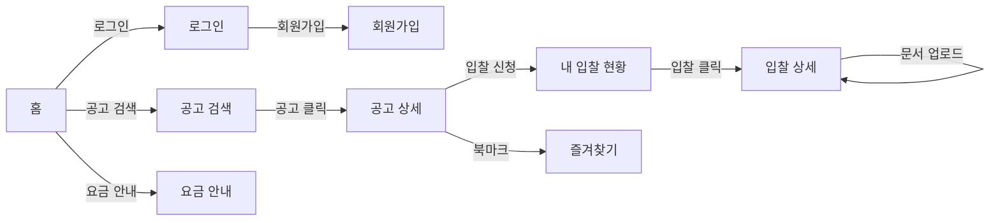
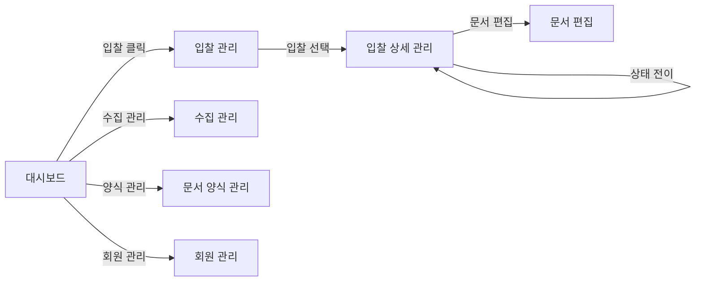

# SAM.gov Bidding Agency Platform 화면 구조 (IA)

> 설계 버전: 1.2 | 최종 수정: 2026-10-10 | 관련 CR: CR-127, CR-129

> 단계: 3. Detail Design | 실행스펙 섹션 8에 포함
>
> 화면의 **정보 구조(Information Architecture)**를 정의한다.
> 어떤 페이지가 있고, 각 페이지가 무엇을 보여주며, 어떻게 연결되는가.

---

## Customer Portal 페이지 목록

| 경로 | 페이지명 | 인증 | 역할 | 설명 | Sprint |
|------|---------|------|------|------|--------|
| `/` | 홈 | | | 서비스 소개, 최근 공고, CTA | 1 |
| `/login` | 로그인 | | | 이메일/비밀번호 로그인 | 1 |
| `/register` | 회원가입 | | | 회원가입 폼 | 1 |
| `/search` | 공고 검색 | | | 공고 목록 + 필터/검색 | 3 |
| `/search/{id}` | 공고 상세 | | | 공고 내용 + 요구사항 + 첨부 | 3 |
| `/pricing` | 요금 안내 | | | 월 구독 두 단계(무료, 회원)와 대행·컨설팅 건별 견적 (CR-129) | 7 |
| `/guide` | 인증/서류 가이드 | | | USFK 입찰 필수 인증 안내 | 3 |
| `/proposals` | 내 입찰 현황 | 🔒 | | 입찰 목록 + 상태 추적 | 4 |
| `/proposals/{id}` | 입찰 상세 | 🔒 | | 상태 타임라인 + 문서 뷰어 | 4 |
| `/bookmarks` | 즐겨찾기 | 🔒 | | 북마크한 공고 목록 | 3 |
| `/profile` | 내 프로필 | 🔒 | | 회사 정보 수정 | 1 |
| `/billing` | 결제 내역 | 🔒 | | 회원 월 요금과 대행·컨설팅 결제 내역 (CR-129) | CR-124 |
| `/coming-soon` | 준비 중 | | | 메뉴에 있으나 화면이 없는 항목 안내 (CR-127) | CR-127 |

홈(`/`)은 CR-127 에서 "서비스 소개, 최근 공고, CTA" 를 AIDA 첫 화면(마감 전 공고, 무료로 시작, 다섯 단계 띠)과 아래 구역으로 바꿨다.

---

## 고객 포털 색 이름표 (CR-127)

고객 포털의 색은 이 이름표로만 쓴다. 값은 `frontend/customer-portal/src/index.css` 의 `@theme` 한 곳에 있고, Tailwind 클래스로 그대로 쓴다(`bg-brand`, `text-ink-sub`, `border-line`). 화면 코드에 16진 색이나 Tailwind 기본 팔레트 색(`gray-500`, `blue-50` 등)을 직접 쓰지 않는다. 색을 바꿀 때는 "강조색 묶음" 7개 값만 바꾼다(사용자 2026-10-10 16:13 "색상은 추후 설정으로 변경"). 디자인시스템(ds-ui) 부품의 색(`--primary`, `--ring`, `--accent` 등)도 `src/wjbid-theme.css` 에서 이 이름표를 가리킨다.

**강조색 묶음 (색 바꿀 때 바꾸는 7개):**

| 이름표 | 뜻 | 파랑(지금) | 차콜과 주황 | 먹색 | 모카 |
|--------|-----|-----------|------------|------|------|
| `brand` | 강조: 주 단추, 링크, 검색 테두리, 단계 번호, 선택 표시 | #1a56db | #c2410c | #1f2329 | #7a4b2a |
| `brand-strong` | 강조를 누르거나 올렸을 때 | #1546b3 | #9a3412 | #000000 | #5e3920 |
| `brand-soft` | 강조의 옅은 바탕: 선택 칩, Q 표시, 안내 상자 | #edf3ff | #fdf0e7 | #eef0f2 | #f5ede6 |
| `brand-softer` | 더 옅은 바탕: 넓은 안내 면 | #f5f8ff | #fef8f3 | #f7f8f9 | #faf6f2 |
| `brand-deep` | 짙은 바탕: 전체메뉴 단추, 선택된 탭, 로고 상자, 꼬리표 | #0c1e3d | #23272e | #111418 | #2a211b |
| `brand-line` | 강조 테두리: 회원 꼬리표 | #b9cdf3 | #f3c3a3 | #c4c9d0 | #dbc3ae |
| `brand-on-dark` | 어두운 바탕 위 강조 글자: 꼬리말의 개인정보처리방침 | #8fb3ff | #fdba8c | #d0d4da | #e2c3a6 |

후보 세 색은 화면 정본과 같은 폴더의 홈시안_색3_차콜주황.html, 홈시안_색7_먹색.html, 홈시안_색8_모카.html 이다. 색은 아직 정하지 않았다.

**고정 색 (색을 바꿔도 그대로):**

| 이름표 | 뜻 | 값 | 바꿀 때 참고(기존 팔레트) |
|--------|-----|-----|------------------------|
| `ink` | 진한 글자: 제목, 본문, 값 | #141d30 | gray-900, gray-800, slate-900 |
| `ink-sub` | 보통 글자: 설명, 보조 값 | #3d4657 | gray-700, gray-600, slate-700 |
| `ink-mute` | 옅은 글자: 안내, 날짜, 입력 안내 | #6b7384 | gray-500, gray-400, slate-500 |
| `ink-faint` | 더 옅은 글자: 비활성, 지난 날 | #c4c9d2 | gray-300 |
| `line` | 기본 선: 상자, 표, 입력 | #e1e5ec | gray-200, slate-200 |
| `line-soft` | 옅은 선: 목록 줄 사이, 구역 경계 | #eef1f5 | gray-100 |
| `line-strong` | 진한 선 | #c9d0da | gray-300(선) |
| `surface` | 회색 바탕: 회색 띠, 화면 바탕, 옅은 상자 | #f6f7f9 | gray-50, gray-100(바탕), slate-50 |
| `surface-warm` | 따뜻한 회색 바탕: 사진 안내 둘째 칸 | #f7f5f1 | |
| `dark` | 어두운 면: 꼬리말 | #2b313c | gray-800 |
| `dark-text` | 어두운 면 위 글자 | #aeb6c3 | |
| `dark-line` | 어두운 면 위 선 | #424a57 | gray-700(선) |
| `danger` | 마감 임박, 오류, 새 알림 수 | #d93838 | red-500, red-600, red-700 |
| `danger-soft` | 그 옅은 바탕 | #fdeeee | red-50, red-100 |
| `success` | 완료, 참여 가능 | #12805c | green-*, emerald-* |
| `success-soft` | 그 옅은 바탕 | #e8f6ef | green-50, emerald-50, emerald-100 |
| `warning` | 주의, 서류 부족 | #b45309 | amber-*, yellow-*, orange-* |
| `warning-soft` | 그 옅은 바탕 | #fff4e5 | amber-50, amber-100, yellow-50 |
| `new` | 새 글 표시 | #e8890c | |

흰색은 Tailwind `white` 를 그대로 쓴다. 파랑 계열 안내 바탕(blue-50 등)은 `brand-soft`, 보라·청록 등 다른 색 칩은 쓰지 않고 `line` 테두리의 흰 칩으로 바꾼다(사용자 2026-10-10 15:50 "알록달록 티 안 나도록").

**옛 이름표:** `navy`, `primary`, `blue`, `secondary`, `brandBlue`, `accent`, `border` 는 새 이름표를 가리키는 별칭으로만 남긴다(`navy`·`primary` 는 `brand-deep`, `blue`·`secondary`·`brandBlue` 는 `brand`, `accent` 는 `success`, `border` 는 `line`. 지금 보이는 색을 지키는 짝이다). CR-128 이 화면에서 새 이름표로 바꾼 뒤 지운다. ds-ui 부품의 주 색 `--primary` 는 `brand` 다. 다만 화면 코드에 `bg-primary` 같은 옛 이름표 클래스가 남아 있으면 앱이 같은 이름의 클래스를 만들어 ds-ui 단추 색을 덮으므로, 옛 이름표가 다 지워져야 ds-ui 단추가 `brand` 로 보인다. `tailwind.config.js` 의 색은 Tailwind 4 가 읽지 않는 설정이라 CR-127 에서 지운다.

## 고객 화면 색 대응 (CR-128)

> 상태: 사용자 승인(2026-10-10 19:05), 적용 d02fafd. 위 색 이름표(CR-127 계약, 07ac2c3) 기준.

홈 밖 고객 화면(공고 검색, 공고 상세, 내 입찰 현황, 입찰 상세, 서류함, 결제, 관심 공고, 저장한 검색, 일정, 알림, 내 정보, 공지사항, 자주 묻는 질문, 고객센터, 이용 가이드, 요금 안내, 로그인, 회원가입, 약관 4종)과 공통 부품(단추, 입력, 표, 쪽 넘김, 빈 화면, 통계 카드, 공고문 보기, 알림 창, AI 제안서 창, D-day 표시)의 직접 지정 색을 위 이름표로 바꾼다. 화면 목록, 영역, 배치, 문구, 누를 수 있는 것은 바꾸지 않는다. 요금 안내는 CR-129 커밋 뒤 색만 바꾼다.

**공통 대응표:**

| 순번 | 지금 색 | 쓰이는 곳 | 이름표 |
|------|---------|----------|--------|
| 1 | gray-900, gray-800, slate-900, slate-800(글자), `#0c1e3d`(글자) | 쪽 제목, 본문, 값 | `ink` |
| 2 | gray-700, gray-600, slate-700, slate-600 | 설명, 보조 값 | `ink-sub` |
| 3 | gray-500, gray-400, slate-500, slate-400 | 안내, 날짜, 보조 아이콘 | `ink-mute` |
| 4 | gray-300, slate-300(글자) | 비활성, 빈 값 표시 | `ink-faint` |
| 5 | gray-200, slate-200(선), gray-200(진행 선 바탕) | 상자, 표, 입력 테두리 | `line` |
| 6 | gray-100, gray-50(선), divide-gray-100 | 목록 줄 사이 | `line-soft` |
| 7 | gray-300, slate-300(선) | 진한 선 | `line-strong` |
| 8 | gray-50, gray-100, slate-50, slate-100(바탕), `#f5f7fa` | 회색 바탕 | `surface` |
| 9 | gray-800(선) | 문서 미리보기 제목 밑줄 | `ink` |
| 10 | red-500, red-600, red-700, red-900 | 마감 임박, 오류 | `danger` |
| 11 | red-50, red-100 / red-200, red-300(선) | 오류 바탕 / 오류 테두리 | `danger-soft` / `danger` 30% |
| 12 | amber-*, yellow-*, 상태 뜻의 orange | 주의, 반려, 부적격 안내, 마감 14일 이내 | `warning`, `warning-soft`, 테두리는 `warning` 30% |
| 13 | emerald-*, green-* | 완료, 업로드됨, 보관 중, 증빙 | `success`, `success-soft` |
| 14 | blue-50, blue-100(바탕), `bg-primary/10` | 안내 상자, 선택된 줄, 꾸밈 아이콘 상자 | `brand-soft` |
| 15 | blue-50/50(누를 때 바탕) | 목록 줄 누를 때 | `brand-softer` |
| 16 | blue-400~700(글자), `#1a56db`, `text-secondary` | 링크, 안내 아이콘, 새 알림 점 | `brand` |
| 17 | hover:text-blue-700 | 링크 누를 때 | `brand-strong` |
| 18 | blue-300(선) | 강조 상자 테두리 | `brand-line` |
| 19 | `#0c1e3d`(바탕), slate-800, slate-900, gray-800(바탕), 남색 그라데이션 | 로고 상자, 표 머리, 어두운 통계 카드, 검은 꼬리표 | `brand-deep` (그라데이션은 단색) |
| 20 | slate-700(선, 어두운 바탕 위) | 표 머리 칸 사이 선 | `dark-line` |
| 21 | `rgba(255,255,255,x)` | 어두운 바탕 위 글자, 상자 | `white` 투명도(`text-white/60` 등) |
| 22 | `bg-[#1a56db]/5`, `border-[#1a56db]/30` | 면책 고지 강조 상자 | `brand-softer`, `brand-line` |
| 23 | `#eef3fb`, `#c7d6ef`, `#1b3a72` | 요금 안내 추천 요금제 | `brand-soft`, `brand-line`, `brand-deep` |
| 24 | 옛 이름표 `navy`, `primary` | 강조 글자, 옅은 강조 바탕, 어두운 통계 카드 | 글자는 `ink`, 투명도 바탕은 `brand-soft`, 짙은 바탕은 `brand-deep` |
| 25 | 옛 이름표 `blue`, `secondary`, `brandBlue` | 링크, 선택 표시, 단추 | `brand` |
| 26 | 옛 이름표 `accent` | 강조 단추, 통계 아이콘 | `brand` (색 줄이기 17행) |
| 27 | 옛 이름표 `border` | 테두리 | `line` |

흰 바탕과 흰 글자는 `white` 그대로다. 이름표 뒤에 투명도만 붙인 것(`danger/30`)은 이름표를 따라 바뀌므로 이름표 사용으로 본다.

**색 줄이기 (먹색, 강조색 하나, 상태색만):** 뜻이 있는 상태(완료, 주의, 오류, 마감 임박)만 `success`·`warning`·`danger` 를 쓰고, 꾸밈으로 색을 나눈 곳은 강조색 하나 또는 무채색으로 모은다.

| 순번 | 화면 | 영역 | 지금 | 바꾼 뒤 |
|------|------|------|------|---------|
| 1 | 이용 가이드 | 단계 카드 6개의 아이콘 상자 | 파랑, 보라, 청록, 남보라, 주황, 초록 | 6개 모두 `brand-soft` 바탕, `brand` 아이콘 |
| 2 | 내 입찰 현황 | 단계별 빈 화면 아이콘 4종 | 파랑, 주황, 보라, 초록 | 4개 모두 `brand-soft` 바탕, `brand` 아이콘 |
| 3 | 결제 | 통계 카드 아이콘 3개 | 남색, 하늘, 초록 | 3개 모두 `brand-soft` 바탕, `brand` 아이콘 |
| 4 | 서류함 | 통계 카드 아이콘(보관 중, 고정 서류 미등록) | 초록, 주황 | `success`, `warning` (상태 뜻 유지) |
| 5 | 공고 상세 | 분석 진행 중 안내 | 보라 상자 | `brand-soft` 상자, `brand` 글자 |
| 6 | 공고 상세 | 첨부 파일 아이콘 | PDF 빨강, 문서 파랑, 기타 회색 | 모두 `surface` 바탕, `ink-mute` 아이콘 |
| 7 | 공고 상세 | 마감까지 남은 날 | 7일 이하 빨강, 14일 이하 노랑, 그 외 회색 | `danger`, `warning`, `ink-sub` |
| 8 | 입찰 상세 | 서류 출처 칩(플랫폼 생성, 시스템 양식) | 파랑, 보라 | 둘 다 흰 바탕, `line` 테두리, `ink-sub` 글자 |
| 9 | 입찰 상세 | 반려 안내, 자격 요건 상자 | 주황 | `warning-soft` 상자, `warning` 글자 |
| 10 | 입찰 상세 | 서류 업로드됨, 미업로드 표시 | 초록, 주황 | `success`, `warning` |
| 11 | 공지사항 | NEW 표시, 중요 표시 | 초록, 파랑 | `new`, `brand` |
| 12 | 공통(D-day 표시) | 마감 D-day | 지남 회색, 7일 이하 빨강, 그 외 파랑 | `surface`·`ink-mute`, `danger-soft`·`danger`, `brand-soft`·`brand` |
| 13 | 공통(공고문 보기) | 경고 상자, 강조 상자 | 노랑, 파랑 | `warning-soft`, `brand-soft`·`brand-line` |
| 14 | 공통(공고문 보기) | 표 머리, 제목 띠 | 남색(slate-800, 900) | `brand-deep` |
| 15 | 요금 안내 | 포함 표시 체크 | 초록 | `brand` |
| 16 | 로그인, 회원가입 | 왼쪽 안내 면 | 남색 그라데이션 | `brand-deep` 단색, 흰 글자 투명도 |
| 17 | 공고 상세, 이용 가이드, 고객센터, 내 입찰 현황, AI 제안서 창 | 강조 단추(제안서 작성 신청, 공고 찾기 시작, 문의 보내기, 서류 올리기) | 초록 | 주 단추와 같은 `brand`. 단추 종류 `accent`, `brandBlue` 는 주 단추로 합친다 |

---

## Admin Console 페이지 목록

| 경로 | 페이지명 | 인증 | 역할 | 설명 | Sprint |
|------|---------|------|------|------|--------|
| `/login` | 관리자 로그인 | | Admin | 관리자 인증 | 1 |
| `/` | 대시보드 | 🔒 | Admin | 입찰 통계, 최근 현황 | 4 |
| `/bid-requests` | 입찰 관리 | 🔒 | Admin | 전체 입찰 목록 + 상태 전이 | 4 |
| `/bid-requests/{id}` | 입찰 상세 관리 | 🔒 | Admin | 상태 변경, 문서 확인, 담당자 배정 | 4 |
| `/bid-requests/{id}/documents/{docId}` | 문서 편집 | 🔒 | Admin | TipTap 에디터 + 버전 관리 | 7 |
| `/collection` | 수집 관리 | 🔒 | Admin | SAM.gov 수집 현황 + 수동 트리거 | 2 |
| `/templates` | 문서 양식 관리 | 🔒 | Admin | 템플릿 CRUD | 6 |
| `/members` | 회원 관리 | 🔒 | Admin | 고객 목록 관리 | 1 |
| `/rfp-samples` | 성공 제안서 패턴 | 🔒 | Admin | 성공 제안서 등록 목록 + 공고유형별 가이드 상태/편집 (CR-013-R) | CR-013 |
| `/rfp-samples/{id}` | 성공 제안서 상세 | 🔒 | Admin | 메타 + 원본 파일 업로드/목록 (슬롯 배치 폐기, CR-013-R) | CR-013 |

---

## Customer Portal 페이지별 주요 영역

### 공통 틀 (CR-127)

**적용:** 로그인·회원가입을 뺀 모든 고객 화면. 너비 1200px 가운데 정렬.
**화면 정본:** docs/기록/토론_WJbid홈페이지방향/자료/시안/AIDA_색상/홈시안_파랑.html 과 같은 폴더 shots/정본_파랑_*.png (1440x900). 글꼴은 정본과 같이 Pretendard, 공고번호는 IBM Plex Mono.

| 영역 | 표시/입력 데이터 | 주요 액션 |
|------|-----------------|----------|
| 유틸 띠 | 왼쪽: 서비스 한 줄. 오른쪽 비로그인: 회원가입(강조), 로그인, 이용 안내, 고객센터. 로그인: 회사명 님(강조), 로그아웃, 고객센터 | 각 화면 이동, 로그아웃 |
| 머리말 | 로고(윗줄 "미군·연방 조달 입찰 대행"), 검색(구분 공고명·공고번호·기지명, 입력, 검색 단추), 추천 검색어 5개, 상세검색, 아이콘 3개(관심 공고, 알림, 서류함). 로그인이면 관심 공고 수·안 읽은 알림 수를 아이콘 위 동그라미로 | 로고: 홈. 검색·추천 검색어·상세검색: 공고 검색. 아이콘: 관심 공고·알림·서류함 |
| 메뉴 띠 | 메뉴 9개(입찰공고, 재발주 예측, 낙찰정보, 발주분석, 맞춤 판정, 서류함, 등록·컨설팅, 입찰 교실, 고객센터), 요금 안내 단추, 전체메뉴 단추(오른쪽 짙은 칸) | 메뉴: 각 묶음 첫 화면. 전체메뉴 단추: 전체메뉴 열고 닫기 |
| 전체메뉴 | 메뉴 띠 아래로 펼쳐지는 9묶음, 묶음별 하위 항목(아래 「메뉴 목적지」) | 항목 누르면 이동하고 닫힘. 단추를 다시 누르거나 바깥을 누르면 닫힘 |
| 꼬리말 | 정책 링크 6개(이용약관, 개인정보처리방침(강조), 면책 고지, 환불 정책, 고객센터, 제휴 문의), 상호·이메일, 저작권 줄 | 각 정책 화면 이동 |

#### 메뉴 목적지

화면이 아직 없는 항목은 "준비 중" 안내 화면(`/coming-soon`) 한 곳으로 보낸다. 서비스 후보 29가지는 발주사 선택 대기 중이라(2026-10-10 15:49) 메뉴 구성은 한 곳(메뉴 정의 파일)에서 바꾼다.

| 묶음 | 하위 항목과 목적지 |
|------|------------------|
| 입찰공고 (`/search`) | 마감 전 공고 `/search`, 사전 공고·변경 공고 준비 중, 관심 공고 `/bookmarks`, 공고문 예시 준비 중 |
| 재발주 예측 | 다음 달 공고·재발주 달력·옵션 연장 알림 준비 중 |
| 낙찰정보 | 최근 낙찰·낙찰 업체·낙찰가 범위 준비 중 |
| 발주분석 | 기지별 지도·월별 동향·업종별 발주 준비 중 |
| 맞춤 판정 | 회사 정보 `/profile`, 적격성 진단·공고별 판정 준비 중 |
| 서류함 (`/documents`) | 공통 서류함 `/documents`, 공고별 서류 `/proposals`, 유효기간 알림·제출 전 검사 준비 중 |
| 등록·컨설팅 | SAM 등록 대행·PIEE 등록 대행·SAM 갱신·제안서 자문·현장 설명회·대금 청구·서류 영문 번역·팀 구성 찾기 준비 중 |
| 입찰 교실 | 무료 입찰 교실·교육 자료·용어 사전·서식 모음 준비 중 |
| 고객센터 (`/support`) | 공지사항 `/notices`, 자주 묻는 질문 `/faq`, 1:1 문의 `/support`, 요금 안내 `/pricing`, 카카오톡 알림 준비 중 |

### 홈 (`/`) (CR-127)

**목적:** 입찰하려는 회사가 첫 화면(1440x900)에서 마감 전 공고를 보고 무료로 시작하게 한다. 그 밖의 것은 아래 구역과 각 메뉴로 보낸다(사용자 2026-10-10 15:21).
**화면 정본:** 공통 틀과 같다. 정본과 같은 크기 캡처 대조가 완료 조건이다.

**상태:**

| 상태 | 조건 | 정본 |
|------|------|------|
| 공고 0건 | 비로그인, 공개된 마감 전 공고 0건 | `#s0` |
| 공고 있음 | 비로그인, 1건 이상 | `#s1` |
| 회원 | 로그인 (공고 0건이면 왼쪽은 공고 0건 모양) | `#s2` |

**첫 화면 (1440x900 안):**

| 영역 | 표시/입력 데이터 | 주요 액션 |
|------|-----------------|----------|
| 마감 전 공고 (왼쪽, 공고 있음) | 머리: 제목, 탭(마감 임박, 최신 공고), 전체 건수와 7일 안 마감 건수(빨강). 목록 7줄: 남은 날(D-n), 한글 제목, 공고번호, 공고 유형(입찰, 시장 조사 등), 기지, 마감 월.일(요일). 아래: 안내 한 줄, 모두 보기 | 탭: 정렬 바꿈. 줄: 공고 상세. 모두 보기: 공고 검색 |
| 마감 전 공고 (왼쪽, 공고 0건) | 0건과 기준일, "준비 중" 안내 두 줄, 마감된 공고 예시 요약(제목, 공고번호, 계약 방식, 계약 기간, 평가 방식, 참가 자격 수·제출 서류 수), 오른쪽 사진 | 예시·공고문 예시 전체 보기: 준비 중. 새 공고 알림 받기: 비로그인은 회원가입, 로그인은 알림 |
| 첫걸음 상자 (오른쪽, 비로그인) | 사진과 꼬리표 "USFK 입찰 첫걸음", 두 줄 제목, 무료 회원 혜택 3가지, 회원 요금 한 줄(금액은 요금 출처에서), SAM 등록 안내 한 줄 | 금액: 요금 안내. 무료로 시작: 회원가입. 로그인. 등록 대행: 준비 중 |
| 오늘 확인할 것 (오른쪽, 회원) | 회사명 님, 관심 공고 수, 입찰 신청 수, 새 알림 수(빨강) | 각 숫자: 관심 공고, 내 입찰, 알림 |
| 우리 회사 맞춤 판정 (오른쪽, 회원) | 판정 기능이 없는 동안 같은 자리·같은 크기에 "준비 중" 안내와 회사 정보 넣기 안내. 판정 수(참여 가능, 서류 부족, 어려움)와 참여 가능한 공고는 기능이 생기면 채운다 | 회사 정보 고치기: 회사 정보 |
| 바로가기 (오른쪽, 회원) | 서류함, 재발주 달력 | 서류함. 재발주 달력: 준비 중 |
| 다섯 단계 띠 | 1 찾기, 2 판단, 3 준비, 4 제출, 5 낙찰 뒤와 단계별 서비스 한 줄 | 누르면 아래 서비스 구역 |

**아래 구역 (회색 띠와 흰 띠를 번갈아):**

| 영역 | 표시/입력 데이터 | 주요 액션 |
|------|-----------------|----------|
| 서비스 (회색) | 제목 "입찰하는 순서대로 도와 드립니다", 단계 5열, 단계별 설명과 서비스 이름, 등급 꼬리표(무료, 회원, 건별), 범례(회원 금액은 요금 출처에서) | 없음 |
| 회원 혜택 (흰) | 제목 "회원은 한 걸음 더 봅니다", 카드 3장(공고문 상세 번역, 우리 회사 맞춤 판정, 재발주 예측 달력). 카드마다 설명과 "화면 예시입니다" 그림 | 공고문 예시 보기·재발주 달력 보기: 준비 중. 회사 정보 넣어 보기: 회사 정보 |
| 요금 (회색) | 무료, 회원(추천), 대행·컨설팅 세 칸(이름, 금액, 대상, 포함 항목; 금액과 단계는 요금 출처에서), 사진 안내 3개(등록 대행, 현장 지원, 무료 입찰 교실) | 무료로 시작: 회원가입. 회원으로 시작: 요금 안내. 상담 신청: 1:1 문의. 사진 안내: 준비 중 |
| 도움 (흰) | 자주 묻는 질문·공지사항 탭 상자(6줄), 도움 바로가기 3개(1:1 문의, 카카오톡 알림 받기, 이용 안내), 관련 사이트 6개 | 탭 전환. 더 보기·줄: 자주 묻는 질문 또는 공지사항. 바로가기: 각 화면(카카오톡 알림은 준비 중). 관련 사이트: 새 창 |
| 빠른 메뉴 (오른쪽 바깥, 떠 있음) | 관심 공고, 요금 안내, 1:1 문의, 맨 위로 | 각 화면, 맨 위로 |

**데이터 출처:** 공고 목록과 건수는 공개 공고 조회(비로그인 가능). 회원 숫자는 관심 공고·내 입찰·안 읽은 알림 조회. 요금 금액·단계는 CR-129 가 정하는 요금 출처. 서비스 목록, 자주 묻는 질문, 공지사항, 예시 그림은 화면 정의 파일(서비스 목록은 발주사 선택 뒤 바꾼다).

### 준비 중 (`/coming-soon`) (CR-127)

**목적:** 메뉴에는 있으나 아직 화면이 없는 항목을 한 곳에서 안내한다.

| 영역 | 표시/입력 데이터 | 주요 액션 |
|------|-----------------|----------|
| 안내 | 누른 항목 이름, "준비 중입니다" 한 줄, 대신 쓸 수 있는 것 | 홈, 마감 전 공고, 1:1 문의 |

### 공고 검색 (`/search`)

**목적:** SAM.gov 입찰 공고를 검색하고 관심 공고를 찾는다.

| 영역 | 표시/입력 데이터 | 주요 액션 |
|------|-----------------|----------|
| 검색바 | 키워드 입력 | 검색 실행 |
| 필터 | 공고 유형, 기관명, 마감일 범위 | 필터 적용 |
| 통계 카드 | 전체 공고 수, 마감 임박 수 | — |
| 공고 목록 | 제목, 기관명, 게시일, 마감일, 상태 | 상세로 이동, 북마크 토글 |
| 페이지네이션 | 현재 페이지, 전체 페이지 | 페이지 이동 |

### 공고 상세 (`/search/{id}`)

**목적:** 공고 내용을 확인하고 입찰 참여를 결정한다.

| 영역 | 표시/입력 데이터 | 주요 액션 |
|------|-----------------|----------|
| 공고 헤더 | 제목, 기관명, 게시일, 마감일, D-day | 북마크 토글 |
| AI 분석 배지 | "AI 분석 완료" + 분석 일시 (COMPLETED 시만 표시) | — |
| 공고 요약 (AI) | 핵심 요약, 작업 범위, 참여 자격, 평가 기준, 예산 정보, 특이사항 | — |
| 주요 일정 (AI) | 주요 일정 테이블 (항목, 일자, 비고) | — |
| 필요 서류 체크리스트 (AI) | 서류명, 필수/선택 배지, 제출 형식, 페이지 제한 | 체크리스트 확인 |
| 문서 양식 안내 (AI) | 전반 안내, 섹션별 양식 카드, 제출 방법 | — |
| 첨부문서 | 파일명, 다운로드 링크 | 파일 다운로드 |
| SAM.gov 원본 | 접이식 — 원본 description + 원문 링크 | 외부 링크 열기 |
| 입찰 신청 | 서비스 레벨 선택 | 입찰 참여 신청 |
| 자격 진단 | AI 진단 결과 (요청 시) | 자격 진단 요청 |

> **분석 미완료 fallback**: AI 분석 섹션 미표시, 기존 원본(description + resourceLinks) 그대로 표시

### 내 입찰 현황 (`/proposals`)

**목적:** 내가 신청한 입찰 건의 진행 상태를 추적한다.

| 영역 | 표시/입력 데이터 | 주요 액션 |
|------|-----------------|----------|
| 상태 필터 | 전체/진행중/완료 | 필터 적용 |
| 입찰 목록 | 공고 제목, 상태, 서비스 레벨, 신청일 | 상세로 이동 |
| 빈 상태 | 신청 건 없을 때 안내 | 공고 검색으로 이동 |

### 입찰 상세 (`/proposals/{id}`)

**목적:** 입찰 진행 상태와 문서를 확인한다.

| 영역 | 표시/입력 데이터 | 주요 액션 |
|------|-----------------|----------|
| 상태 타임라인 | 현재 상태, 상태 변화 이력, 각 단계 시각 | — |
| 공고 정보 | 제목, 기관명, 마감일 | 공고 상세로 이동 |
| 제출 서류 (CR-010 슬롯화) | 공고가 요구하는 BLOCKER 슬롯 목록(요구사항 제목/설명/카테고리/충족 상태). 각 슬롯에 업로드된 ClientDocument 요약(파일명/크기/업로드일) 또는 미충족 표시. 상단 진행률(`fulfilledBlocker / totalBlocker`) | 슬롯별 파일 선택/업로드(`POST /required-document-slots/{requirementItemId}/upload`), 매핑 해제(`DELETE`) |
| 생성 문서 | AI 생성 제안서 목록, 상태(DRAFT/LOCKED) | 문서 미리보기 |
| 액션 | "문서 제출 완료" 버튼 — 모든 BLOCKER 슬롯 충족(`canTransitionToDocsReceived=true`)일 때만 활성화 (BIZ-015) | 취소 (DOCS_PENDING 이전), DOCS_RECEIVED 전이 요청 |

### 요금 안내 (`/pricing`) (CR-129)

**목적:** 월 구독 두 단계(무료, 회원)를 견주어 고르게 하고, 대행·컨설팅은 건별 견적으로 따로 안내한다(사용자 2026-10-10 17:40).
**같은 말:** 단계 이름, 대상, 포함 항목은 홈 요금 구역(CR-127)과 같다.

| 영역 | 표시/입력 데이터 | 주요 액션 |
|------|-----------------|----------|
| 머리 | 제목 "요금 안내", 설명 "무료로 시작하고, 필요할 때 회원으로 넓히세요. 회원은 월 단위, 대행과 컨설팅은 건마다 상담합니다." | 없음 |
| 월 구독 비교 표: 단계 머리 칸 | 두 칸. 무료: 0원, 대상 "처음 둘러보는 회사". 회원(추천 꼬리표): 회원 월 금액 "N원 / 월", 대상 "입찰을 꾸준히 하는 회사". 로그인했으면 무료 칸에 "현재 플랜" 꼬리표 | 무료로 시작: 회원가입(로그인했으면 단추 없음). 회원으로 시작: 1:1 문의(결제 연동 전이라 상담으로 받는다) |
| 월 구독 비교 표: 기능 행 | 행마다 기능 이름, 무료 칸, 회원 칸(포함 표시 또는 빈 표시). 행: SAM.gov 공고 검색, 공고 한글로 보기(SAM 번역 수준), 관심 공고 저장, 입찰 신청, 입찰 교육 자료와 무료 입찰 교실(여기까지 둘 다 포함), 공고문 상세 번역(첨부 포함), 적격성 진단(우리 회사 맞춤 판정), 재발주 예측 달력, 새 공고 알림, 서류함과 제출 전 검사(여기까지 회원만) | 없음 |
| 대행·컨설팅 (건별 견적) | 제목 "대행·컨설팅", 설명 "맡기고 싶은 일이 있는 회사. 일마다 범위와 비용이 달라 상담 후 견적으로 안내합니다." 항목 상자 5개: SAM.gov·PIEE 등록 대행, 제안서 자문·검토(최종 제출과 서명은 고객), 현장 설명회 동행과 기지 출입 지원, 대금 청구 대행, 서류 영문 번역. 끝에 상담 상자 | 상담 신청: 1:1 문의 |
| 꼬리 안내 | "금액은 부가세 별도입니다. 회원은 월 단위로 결제하며 약정 없이 해지할 수 있습니다. 대행·컨설팅은 상담 후 견적으로 안내합니다." | 없음 |

**회원 월 금액 표시:**

| 상태 | 조건 | 금액 자리 |
|------|------|----------|
| 정해짐 | 요금 조회의 회원 월 금액이 있음 | "50,000원 / 월" 꼴(천 단위 쉼표) |
| 안 정해짐 | 회원 월 금액이 비어 있음 | "요금 안내 준비 중" |
| 불러오는 중 | 요금 조회 응답 전 | 금액 자리만 옅은 자리표시 |
| 조회 실패 | 요금 조회 오류 | 안 정해짐과 같다 |

**데이터 출처:** 회원 월 금액은 요금 조회(`GET /pricing`)가 설정값에서 꺼내 준다. 화면 코드에 금액을 쓰지 않는다. 단계 이름, 대상, 기능 행, 대행·컨설팅 항목은 화면 정의 파일.

### 결제 내역 (`/billing`) (CR-129)

**목적:** 회원 월 요금과 대행·컨설팅 결제 내역을 본다. 결제 연동 전이라 내역은 비어 있다.

| 영역 | 표시/입력 데이터 | 주요 액션 |
|------|-----------------|----------|
| 머리 | 제목 "결제 내역", 설명 "회원 월 요금과 대행·컨설팅 결제 내역입니다." | 없음 |
| 안내 띠 | "회원은 월 단위, 대행·컨설팅은 건별 견적" 과 한 줄 설명 | 요금 안내 |
| 요약 숫자 3개 | 누적 결제 금액, 회원 결제(회), 대행·컨설팅(건) | 없음 |
| 내역 표 | 일자, 항목(회원 월 요금 / 대행·컨설팅), 내용, 금액, 합계 줄. 내역이 없으면 빈 안내 "결제 내역이 없습니다" | 없음 |

---

## Admin Console 페이지별 주요 영역

### 대시보드 (`/`)

**목적:** 전체 입찰 현황을 한눈에 파악한다.

| 영역 | 표시/입력 데이터 | 주요 액션 |
|------|-----------------|----------|
| 통계 카드 | 상태별 입찰 수 (CREATED, REVIEW, SUBMITTED 등) | — |
| 최근 입찰 | 최근 입찰 목록 (5~10건) | 입찰 상세로 이동 |
| 마감 임박 | D-7 이내 입찰 건 | 입찰 상세로 이동 |

### 입찰 관리 (`/bid-requests`)

**목적:** 전체 입찰 건을 관리하고 상태를 전이한다.

| 영역 | 표시/입력 데이터 | 주요 액션 |
|------|-----------------|----------|
| 상태 필터 | BidRequestState 필터 탭 | 필터 적용 |
| 입찰 테이블 | 고객명, 공고 제목, 상태, 서비스 레벨, 마감일 | 상세로 이동 |
| 페이지네이션 | 현재 페이지, 전체 페이지 | 페이지 이동 |

### 입찰 상세 관리 (`/bid-requests/{id}`)

**목적:** 입찰 건의 상태를 변경하고 문서를 관리한다.

| 영역 | 표시/입력 데이터 | 주요 액션 |
|------|-----------------|----------|
| 상태 패널 | 현재 상태, 허용 다음 상태 | 상태 전이 실행 (노트 입력) |
| 고객 정보 | 회사명, 연락처 | — |
| 공고 정보 | 제목, 마감일, 요구사항 수 | 공고 상세로 이동 |
| 제출 문서 | 고객 제출 문서 목록 | 다운로드 |
| 생성 문서 | AI 생성 문서 목록, 상태 | 문서 편집으로 이동 |
| 상태 이력 | 전이 이력 타임라인 | — |

### 문서 편집 (`/bid-requests/{id}/documents/{docId}`)

**목적:** AI 생성 문서를 검토/수정하고 확정한다.

| 영역 | 표시/입력 데이터 | 주요 액션 |
|------|-----------------|----------|
| 에디터 | TipTap 리치 텍스트 에디터, 문서 내용 | 내용 편집, 저장 |
| 버전 사이드바 | 버전 목록, 각 버전 메타데이터 | 이전 버전 조회 |
| 툴바 | 서식 도구 | 볼드, 제목, 목록 등 |
| 액션 바 | — | 저장, 잠금(확정), 잠금 해제, PDF 내보내기 |

### 수집 관리 (`/collection`)

**목적:** SAM.gov 수집 상태를 확인하고 수동 수집을 실행한다.

| 영역 | 표시/입력 데이터 | 주요 액션 |
|------|-----------------|----------|
| 수집 상태 | 마지막 수집 시간, 결과 | — |
| 수동 수집 | 조회 기간(daysBack) 입력 | 수집 트리거 실행 |
| 수집 이력 | 실행 이력 목록 | — |

### 공고문 관리 상세 (`/notices/{id}`) — CR-016 / CR-039

**목적:** 원본에서 한글화된 공고문을 검수하고, 한글화 결과를 확인/재생성/보정하며 고객 노출을 토글한다. 구현체: [NoticeAdminDetailPage.tsx](../frontend/admin-console/src/pages/NoticeAdminDetailPage.tsx).

| 영역 | 표시/입력 데이터 | 주요 액션 |
|------|-----------------|----------|
| 헤더 | 영문 제목, 한글 제목, solNo, 한글화 상태(PENDING/ANALYZING/COMPLETED/FAILED), 노출 상태 | **재생성**(COMPLETED/FAILED일 때, ANALYZING 중 disabled) · **노출 승인/해제** · **강제 중단(CR-039)** · **삭제(CR-040)** |
| 한글화 결과 | ANALYZING이면 "LLM이 공고를 한글화/요약하고 있습니다…" 스피너, COMPLETED면 contentJson 렌더, FAILED면 errorMessage | — |

> **CR-039 강제 중단**: generationStatus가 `ANALYZING`일 때만 "강제 중단" 버튼을 노출한다. 클릭 시 `POST /admin/notices/{id}/cancel` → FAILED 전환 → 재생성 버튼 disabled(=ANALYZING 조건) 해제로 재시도 가능. 무한 폴링(스피너만 도는 stuck) 탈출용. 자동 정리(스케줄러)는 화면 액션 없이 백그라운드로 동일 처리.
> **CR-040 삭제**: "삭제" 버튼은 VISIBLE(노출 중)·ANALYZING(분석 중)이 아닐 때만 활성. 클릭 시 확인 모달 → `DELETE /admin/notices/{id}` → 성공 시 목록(`/notices`)으로 이동. 서버가 가드 위반 시 409 + 사유 메시지(노출 중/분석 중) 노출. hard delete라 복구 불가 — 모달에 경고.

### 문서 양식 관리 (`/templates`)

**목적:** 제안서 작성에 사용할 문서 양식을 등록/관리한다.

| 영역 | 표시/입력 데이터 | 주요 액션 |
|------|-----------------|----------|
| 양식 목록 | 양식명, 문서 유형, 버전, 활성 상태 | 편집/비활성화 |
| 양식 등록 | 양식명, 문서 유형, TipTap JSON 에디터 | 등록, 저장 |

---

### 성공 제안서 패턴 (`/rfp-samples`) — CR-013

**목적:** 관리자가 과거 성공/낙찰 제안서를 등록하고, 공고유형별 "이기는 패턴" 가이드를 추출/편집/관리한다. (CR-013-R: 슬롯 → 공고유형 단위)

| 영역 | 표시/입력 데이터 | 주요 액션 |
|------|-----------------|----------|
| 등록 목록 | 공고번호, 사업유형, 결과(WON/SUBMITTED), 업체, 파일수 | 상세 이동, 신규 등록 모달 |
| 신규 등록 모달 | 공고번호/사업유형/결과(필수), 업체/발주처/낙찰액/회계연도(선택) | 등록 |
| 공고유형별 가이드 (CR-013-R) | 유형 8종별 상태(PENDING/EXTRACTING/COMPLETED/FAILED), 출처(AI/사람편집), 추출 건수 | 유형별 "추출/재추출" 트리거 + "편집" 모달(사람 직접 편집) |

> 🔄 **CR-013-R**: "7슬롯 가이드 상태" → "공고유형별 가이드". 슬롯 단위 → 공고유형 단위. 사람 편집 모달 신설.

---

### 성공 제안서 상세 (`/rfp-samples/{id}`) — CR-013 / CR-013-R

**목적:** 한 제안서의 원본 파일을 통째로 업로드/보관한다. (슬롯 배치 폐기 — 파일명이 곧 섹션 태그)

| 영역 | 표시/입력 데이터 | 주요 액션 |
|------|-----------------|----------|
| 메타 정보 | 공고번호, 사업유형, 결과, 업체/발주처/낙찰액 | 삭제 |
| 원본 파일 | 원본 파일(pdf/xlsx/docx), PWS 배지 | 업로드(제안서/PWS), 삭제 |

> 🔄 **CR-013-R**: 7슬롯 배치 카드 + 슬롯 자동추정 + 슬롯별 가이드 미리보기 **제거**. 가이드 편집은 목록 화면의 유형별 가이드에서.

---

## 화면 간 흐름

### Customer Portal

### Admin Console

---

## 참고 자료

| 자료 | 출처 | 설명 |
|------|------|------|
| 기존 구현 코드 | frontend/customer-portal, frontend/admin-console | 역설계 원본 |
| SAM.gov 사이트 | sam.gov | 원본 입찰 사이트 UI 참조 |

---

## 서류함 `/documents` (CR-125 — 실연동)

> 기존 DUMMY 껍데기 → MemberDocument 실연동. 고정 슬롯 카드 + 기타 서류 목록.

- **고정 카드 6종**(사업자등록증·회사소개서·CAGE 증빙·재무제표·SAM 등록증·과거 수행실적): 제목 고정. 파일만 업로드/교체/삭제(파일 피커만, 입력 모달 없음).
- **기타 서류(비고정)**: "기타 서류 추가" 버튼 → 등록 모달(문서제목 필수 / 파일 필수 / 설명 선택) → `category=OTHER` POST. 다건 누적, 행별 교체·삭제.
- 요약 StatCard: 보관 N건 / 고정 미등록 N건(실데이터).
- **슬롯 자동채움**(입찰 상세/제안서 슬롯 화면): "서류함에서 자동 채우기" 버튼 → `auto-fill` 호출 → 슬롯 목록 갱신 + "N건 자동 채움" 토스트. 서류함에 없는 카테고리는 미충족 유지.
